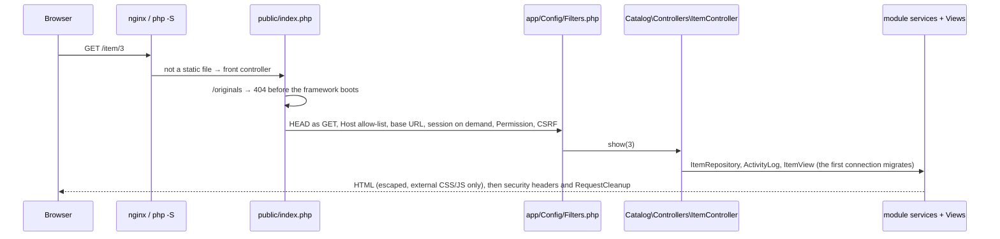
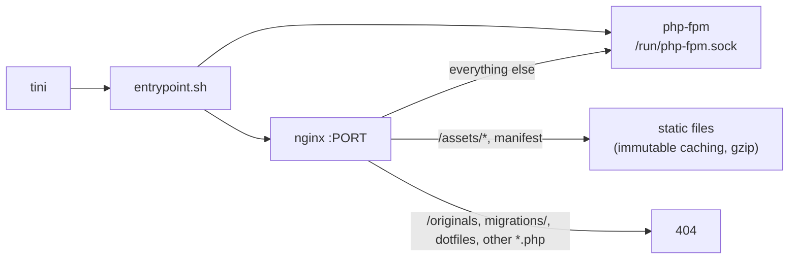

# Architecture

Apotheke 3.0 is a CodeIgniter 4 app ([ADR-001](adr/001-codeigniter4.md)). It serves every page, answers as the
2.x app did, and reads the same database and data directory. The 2.x app (one front controller and plain PHP
functions under `src/`) is no longer in this repository; 2.6.x releases still ship it
([Upgrading to 3.0](upgrade-3.0.md)). Older notes that name its functions (`item_get()`, `db_tx()`, …) refer to
that app; the class that took each one over says so in its docblock ("legacy …").

## Directory layout

```
public/index.php          front controller: refuses camera-original URLs before the framework boots, then CodeIgniter
public/router.php         router script for `php -S` (static assets, then index.php)
public/assets/            stylesheet, scripts and icons
app/Config/               CodeIgniter config: Services (the only wiring), Filters, Routes and RoutesCompiled
modules/<Module>/         one namespace per area (Apotheke\<Module>): Controllers, Views, services, Commands
spark                     CodeIgniter CLI: apotheke:migrate, settings, accounts, backup, restore, routes
writable/                 CodeIgniter's cache, logs and session scratch (not the data directory)
tools/PhpStan/            the DI rule (phpstan-di.neon)
tests/Modules/            module tests (phpunit -c tests/Modules/phpunit.xml.dist)
migrations/NNNN_*.php     versioned schema steps (run by Migrations\PdoMigrationRunner)
bin/                      CLI wrappers: migrate.php, seed.php, backup.php, restore.php, settings.php (each runs a spark command)
docker/                   nginx.conf (template), fastcgi.conf, php-fpm.conf, php.ini, entrypoint.sh
tests/                    Unit/ (root suite), Modules/ (module suite), e2e/ (puppeteer), visual/ (Playwright), upgrade/
scripts/                  lint.sh, check-links.mjs, smoke.sh, docker-checks.sh, check-commits.sh, update-snapshots.sh, …
docs/                     this documentation and the README screenshots
```

## Request flow



Each route in `app/Config/Routes.php` names a controller method and the permission it needs. A controller validates
input, calls its module's services and renders a view, returns JSON (when the request has `X-Requested-With: fetch`
or `Accept: application/json`, `Core\Http\WantsJson`) or redirects (303 after a POST). A `UserError` becomes an
error page (or JSON) with its status code (400 by default; 404, 419 for an expired CSRF token, 422 for validation);
any other exception is logged and shown as a generic 500 page.

Important routes:

| Route | Purpose |
|---|---|
| `GET /` | list; JSON variant for instant search (`html`, `count`, `chips`, `more`, …) |
| `GET /new`, `GET /item/N/edit`, `POST /save` | add / edit form and save |
| `GET /item/N` | item page |
| `POST /item/N/qty` | quantity +/- (JSON, returns the new quantity and the low-stock state) |
| `POST /item/N/photos…` | add, reorder, set cover, delete photos |
| `POST /item/N/duplicate` | duplicate (optionally with photos), redirects to the copy's edit form |
| `POST /item/N/lend`, `POST /item/N/return`, `GET /lent` | lending |
| `POST /bulk` | bulk actions on `ids[]` (delete shows a confirmation page first) |
| `POST /item/N/delete` | delete |
| `/locations…`, `/categories…` | manage lists (add, rename, default, delete with move); `POST /locations/N/parent` moves a location in the tree |
| `GET /labels`, `GET /item/N/label` | printable QR labels |
| `GET /barcode`, `GET /barcode/{code}` | barcode lookup page; redirect to the item, the matches (`/?q=`), or `/new?barcode=` |
| `GET /filters`, `POST /filters`, `POST /filters/N/rename`, `POST /filters/N/delete` | saved filters (manage page, save the current list view, rename, delete) |
| `GET /activity` | history (all items, or `?item=N`) |
| `GET /backup`, `GET /backup.zip`, `POST /backup/restore`, `POST /backup/restore/confirm` | backup and restore |
| `GET /export.csv` | CSV export |
| `GET /stats` | lazily loaded overview fragment |
| `GET /media/(full|thumb)/<hex>.jpg` | photos (strict file-name pattern, served by PHP from `DATA_DIR`) |
| `POST /theme` | Auto / Light / Dark |
| `GET /healthz` | health check (connects to the database) |

### Sessions, auth and CSRF

`Core\Filters\SessionCookie` sets up the PHP session (files in `DATA_DIR/sessions`, cookie `apothekesid` on plain HTTP and `__Host-apothekesid` on HTTPS, `HttpOnly`,
`SameSite=Lax`, `Secure` on HTTPS – including `X-Forwarded-Proto: https` when “Trust the reverse proxy” is on; the cookie lifetime comes from `session_days`, default 30). The server also stores the sign-in time in the session and ends it, the same way as a sign-out, once that time is older than `session_days`. Later visits do not move it. A session that has no sign-in time yet is stamped on its next request and is not ended immediately. A signed-in session also ends when no request has arrived for `session_idle_hours` hours (default 168, at most 8760). That last-request time is kept in the session file and moves at most once a minute, so a busy page does not rewrite the file on every request. `/healthz`, `/health` and the branding routes (`/theme.css`, `/labels.css`, `/manifest.webmanifest`, `/favicon.ico`, `/brand/…`) are answered without loading the session, so they do not refresh it. A session starts only when a request needs one (a sign-in or a CSRF token), and it is **closed right away** so parallel
requests (photos, instant search) never wait for the session lock. Every state-changing request passes `Core\Filters\CsrfFilter`
(form field `csrf` or header `X-CSRF-Token`). Sign-out stays a POST. A live session still needs the token; one the server has already ended redirects to the sign-in page. When sign-in is on (Settings → Users & sign-in; `APP_PASSWORD` creates the account `admin`), everything except `/login`, `/healthz`, `/health` and
the branding routes requires a signed-in session (`uid`) whose
stored epoch matches that user's current session epoch (`users.session_epoch`, migration 0028; a row with none still matches the password-hash fingerprint its sessions already held). A new password, or **Sign out everywhere** (`POST /account/signout`, and `php bin/settings.php user signout NAME`), stores a new epoch, so older sessions are dropped. Changing your own password, or using the button, keeps this device signed in. Unauthenticated JSON requests get a 401, media requests a bare
401, pages a redirect to `/login`. With guest browsing on, a visitor who is not signed in is the anonymous user with the role `guest` instead.
Then `Auth\RoutePermission` names the permission the route needs (view, create, edit, delete, move, bulk, lend,
import, export, stocktake, labels, settings, users, backup; `self` for /account, `public` for /login and /register) and
`Auth\Filters\PermissionFilter` checks it against the role's permissions (`Auth\Permissions`) — 403 for accounts, a redirect to `/login` (JSON 401) for guests.

## Database layer

* `Core\Config\DatabaseFactory` opens the request's connection from the `DB_*` settings (`DsnTranslator`, one login
  per request). Before the first connection of a process, `Migrations\BootMigration` runs pending migrations, so a
  fresh install or an upgrade needs no manual step.
* SQL is written once for both dialects. The portability rules ([Database](database.md)):
  * case/accent-insensitive uniqueness and search use **PHP-folded columns** (`name_key`, `items.search`, computed
    with `Core\Libraries\Text::fold()`), so both databases use plain `UNIQUE` and `LIKE … ESCAPE '!'`;
  * natural sorting uses a PHP-computed `sort_key`, so "box 2" sorts before "box 10";
  * timestamps are UTC `Y-m-d H:i:s` text; lending dates are local `Y-m-d` text;
  * dialect-specific bits (insert ids, date bucketing for the statistics, the migration lock) live in the
    repositories and the migration runner.
* Every write goes through `Core\Database\Writes`: a failed statement throws, and a transaction whose statement
  failed rolls back. Bulk actions and duplicating reuse the item save inside one transaction.
* The activity log entry is written in the same transaction as the change it records.

More in [Database](database.md).

## Views and front end

Each module renders its pages with plain PHP view classes (`modules/<Module>/Views`). `Layout\Page` is the shared
shell: the `<head>` (theme from the cookie, `theme-color`, manifest, CSRF meta tag, versioned CSS/JS), the menu and
the end of the document. Every dynamic value is escaped.

The Content-Security-Policy forbids inline scripts and styles, so:

* `public/assets/theme.js` (loaded synchronously in `<head>`) only restores a `localStorage` theme before first paint;
* `public/assets/app.js` (deferred) progressively enhances server-rendered pages: instant search, the filter sheet,
  chips, quantity buttons (coalescing quick taps), the photo manager and client-side shrinking, tag input, confirm
  dialogs (`data-confirm`), the overview panel, selection mode and the bulk bar;
* there are no `style="…"` attributes; all styling is in `public/assets/app.css`, with light/dark variables under
  `[data-theme]` and `prefers-color-scheme`.

### Settings

Two layers: **bootstrap** values (`Core\Config\ApothekeConfig`: data dir, database, seeding) come from `config.php` / the environment;
**everything else** comes from `Settings\SettingsService` (schema in `Settings\SettingsSchema`), which reads the `settings` table once per request
and falls back to the defaults (`config.php` values or literals) before migration 0013. The custom accent is delivered
as a generated stylesheet (`/theme.css?v=<hash>`, CSS variables for light, dark and `prefers-color-scheme`), so no inline
styles are needed; the manifest and `favicon.ico` are generated routes, so an uploaded logo can replace the icons. See
[control-panel.md](control-panel.md).

Forms are real `<form method="post">` elements, so the core flows work without JavaScript; `app.js` only makes them
faster (fetch + JSON) where it matters.

## Location tree

Locations have an optional `parent_id`. The taxonomy repository reads all locations with their direct item counts in
one query and `Taxonomy\LocationTree::order()` turns them into tree order (each parent followed by its children,
siblings in natural order), adding `depth`, `path` ("Garage › Shelf 2") and `total` (items including
sub-locations). Views use that list everywhere: `LocationTree::optionLabel()` indents dropdown options, the parent
picker leaves out the location's own branch, and the item page shows the path. The list filter `loc=N` expands to
`location_id IN (…)` with the location's subtree. A search word that matches a location name expands the same way,
so items below a matching location are found too. The overview's *By location* bars add every item to the top-level
location of its branch, and the purchase-price totals of the *Value* card use the same rollup.

## Docker image



nginx serves `public/assets/` directly, sends every other request to `public/index.php` through php-fpm, and returns
404 for `/originals`, `data/`, `bin/`, `migrations/`, `docker/`, `tests/`, `vendor/`, `config.php`, dotfiles and every `.php`
path except `/index.php`, the front controller itself. `scripts/docker-checks.sh` verifies this behaviour in CI.

## Modules, filters and data

**Modules.** Core (boot, config and the DSN translator, database, filters, HTTP helpers, storage, logging) depends on
nothing. Every other module (Settings, Auth, Layout, Media, Taxonomy, Notes, Search, Catalog, Activity, Undo,
Favourites, BulkMerge, Labels, Lending, Stocktake, ImportExport, Backup, Autofill, Migrations, DevServer) may depend
on Core and on the modules [AGENTS.md](../AGENTS.md#ci4-module-rules) lists for it; deptrac checks the graph in CI
([`deptrac.yaml`](../deptrac.yaml)). Classes get their collaborators through their constructors;
`Config\Services` builds them per request, and only controllers, filters and the Services file may call it
(`phpstan-di.neon`).

**Request flow.** `public/index.php` refuses `/originals` paths, then boots CodeIgniter. The routes come from
`app/Config/RoutesCompiled.php` (written by `php spark apotheke:routes`; `Routes.php` is used when it has changed
since). Started as root, spark runs as the data folder's owner, so `apotheke:routes` cannot write that file in a
root-owned checkout; run it as the checkout's owner. Before the controller, the filters in `app/Config/Filters.php` run in a fixed order: HEAD as GET, the
originals guard, the Host allow-list (421), the per-request base URL (`public_url`, `trust_proxy`), the upload size
check, the session parameters (sessions start on demand only), same-origin writes when sign-in is off, then the
Permission filter (legacy `user_can()` per route) and the session CSRF check. After it: the security headers and
`RequestCleanup`, which removes the files of a request that did not finish. The controller reads and writes through
its module's services; every write goes through `Core\Database\Writes`, every file through `Core\Storage`.

**Data.** The database connection comes from the same `DB_*` settings as legacy, through `DsnTranslator` and
`DatabaseFactory` (one login per request). Before the first connection of a process, `BootMigration` brings the
schema up to date with the shared runner ([Database → How migrations run](database.md#how-migrations-run)). Files
live where legacy keeps them: `images/`, `thumbs/`, `files/` and `sessions/` under `DATA_DIR`, camera originals under
`ORIGINALS_DIR`, with legacy's modes.

**Command line.** `bin/migrate.php`, `bin/seed.php`, `bin/settings.php` (except `key generate`), `bin/backup.php` and
`bin/restore.php` run the matching `spark apotheke:*` command; a restore started as root switches to the data
directory's owner first.

**Docker.** The image serves this app only, from `public/` on PHP 8.4 (see [Docker image](#docker-image)).
`APOTHEKE_APP=legacy` exits with code 64; use a 2.6 image to stay on the legacy app.
