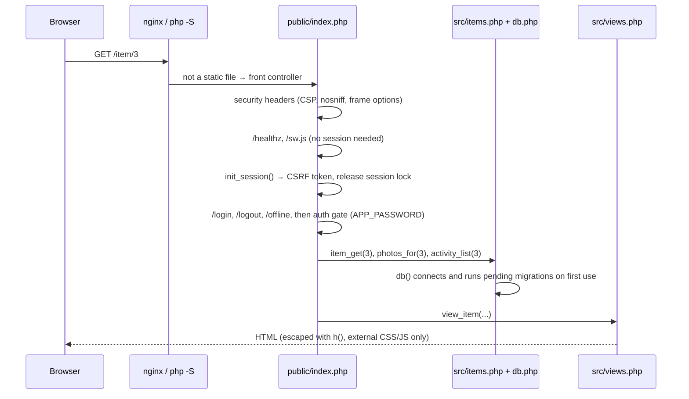
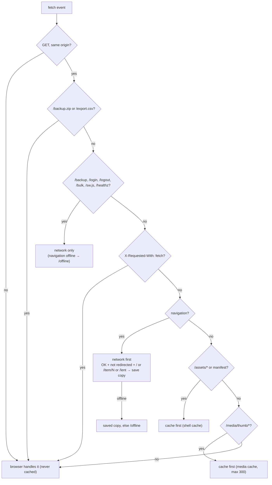

# Architecture

Apotheke is deliberately small: one front controller, a handful of PHP files with plain functions, server-rendered
HTML, one stylesheet and one script. There is no framework, no autoloader, no template engine and no build step.

## Directory layout

```
public/                   web root (the only directory a web server should expose)
  index.php               front controller + router (also the router script for `php -S`)
  manifest.webmanifest    web app manifest
  assets/                 app.css, app.js, theme.js, icons (served as static files)
src/
  bootstrap.php           constants, data directories, sessions, auth, CSRF, small helpers, asset(), service worker
  config.php              configuration loader (defaults < config.php < environment)
  db.php                  PDO connection, dialect helpers, migration runner
  legacy.php              one-time conversion of pre-migration SQLite installs (schema v1–v3)
  items.php               domain logic: items, locations/categories, tags, search, statistics, photos (GD),
                          activity log, low stock, bulk actions, lending, duplicating
  backup.php              portable backup zip (dump + photos) and restore
  qr.php                  pure-PHP QR code encoder (SVG)
  seed.php                starter locations/categories and demo data
  views.php               all HTML: page shell, partials (cards, chips, sheets), one view_* function per screen
  sw.js                   service worker template (served at /sw.js)
migrations/NNNN_*.php     versioned schema steps
bin/                      CLI: migrate.php, seed.php, backup.php, restore.php
docker/                   nginx.conf (template), fastcgi.conf, php-fpm.conf, php.ini, entrypoint.sh
tests/                    run.sh, integration.php + lib.php, Unit/, Integration/, e2e/ (puppeteer), visual/ (Playwright)
scripts/                  lint.sh, check-links.mjs, smoke.sh, docker-checks.sh, check-commits.sh, update-snapshots.sh, e2e-container-setup.sh
docs/                     this documentation and the README screenshots
```

## Request flow



`public/index.php` is a linear list of `if ($path === … && $method === …)` / `preg_match` blocks inside one
`try`. Each block validates input, calls domain functions and either renders a view, returns JSON (`json_out()`,
when the request has `X-Requested-With: fetch`) or redirects (`redirect()`, 303 after a POST). A `UserError` thrown
anywhere becomes an error page (or JSON) with its status code (400 by default; 404, 419 for an expired CSRF token,
422 for validation); any other exception is logged and shown as a generic 500 page.

Important routes:

| Route | Purpose |
|---|---|
| `GET /` | list; JSON variant for instant search (`html`, `count`, `chips`, `more`, …) |
| `GET /new`, `GET /item/N/edit`, `POST /save` | add / edit form and save |
| `GET /item/N` | item page |
| `POST /item/N/qty` | quantity +/- (JSON, returns the new quantity and the low-stock state) |
| `POST /item/N/photos…` | add, reorder, set cover, delete photos |
| `POST /item/N/duplicate` | duplicate (optionally with photos), redirects to the copy's edit form |
| `POST /item/N/lend`, `POST /item/N/return`, `GET /lent` | lending |
| `POST /bulk` | bulk actions on `ids[]` (delete shows a confirmation page first) |
| `POST /item/N/delete` | delete |
| `/locations…`, `/categories…` | manage lists (add, rename, default, delete with move) |
| `GET /labels`, `GET /item/N/label` | printable QR labels |
| `GET /activity` | history (all items, or `?item=N`) |
| `GET /backup`, `GET /backup.zip`, `POST /backup/restore`, `POST /backup/restore/confirm` | backup and restore |
| `GET /export.csv` | CSV export |
| `GET /stats` | lazily loaded overview fragment |
| `GET /media/(full|thumb)/<hex>.jpg` | photos (strict file-name pattern, served by PHP from `DATA_DIR`) |
| `POST /theme` | Auto / Light / Dark |
| `GET /sw.js`, `GET /offline` | service worker and offline page (public, no data) |
| `GET /healthz` | health check (connects to the database) |

### Sessions, auth and CSRF

`init_session()` opens the PHP session (files in `DATA_DIR/sessions`, cookie `apothekesid`, `HttpOnly`,
`SameSite=Lax`, `Secure` on HTTPS), makes sure a CSRF token exists, and **closes the session right away** so parallel
requests (photos, instant search) never wait for the session lock. Every state-changing route calls `check_csrf()`
(form field `csrf` or header `X-CSRF-Token`). With `APP_PASSWORD` set, everything except `/login`, `/healthz`,
`/sw.js` and `/offline` requires a signed-in session; unauthenticated JSON requests get a 401, media requests a bare
401, pages a redirect to `/login`.

## Database layer

* `db()` returns the request's PDO connection. On first use it connects (`db_connect()`) and runs `migrate()`, so a
  fresh install or an upgrade needs no manual step.
* SQL is written once for both dialects. The portability rules (see the header of `src/db.php`):
  * case/accent-insensitive uniqueness and search use **PHP-folded columns** (`name_key`, `items.search`, computed
    with `fold()`), so both databases use plain `UNIQUE` and `LIKE … ESCAPE '!'`;
  * natural sorting uses a PHP-computed `sort_key` (`natkey()`), so "box 2" sorts before "box 10";
  * timestamps are UTC `Y-m-d H:i:s` text; lending dates are local `Y-m-d` text;
  * dialect-specific bits live in small helpers: `db_insert()` (insert ids), `db_local_bucket()` (date bucketing
    for the statistics), and the migration lock.
* `db_tx(fn)` runs a closure in a transaction, or joins the caller's transaction if one is open. That is how bulk
  actions and duplicating reuse `item_save()` and still commit or roll back as one unit.
* `activity_log()` is always called inside the same transaction as the change it records.

More in [Database](database.md).

## Views and front end

`src/views.php` renders everything with plain PHP templates. `page_start()` emits the `<head>` (theme from the cookie,
`theme-color`, manifest, CSRF meta tag, versioned CSS/JS); `page_end()` closes the document. Every dynamic value
goes through `h()`.

The Content-Security-Policy forbids inline scripts and styles, so:

* `public/assets/theme.js` (loaded synchronously in `<head>`) only restores a `localStorage` theme before first paint;
* `public/assets/app.js` (deferred) progressively enhances server-rendered pages: instant search, the filter sheet,
  chips, quantity buttons (coalescing quick taps), the photo manager and client-side shrinking, tag input, confirm
  dialogs (`data-confirm`), the overview panel, selection mode and the bulk bar, and the PWA bits (service worker
  registration, offline page list, offline banner, clearing caches on sign-out);
* there are no `style="…"` attributes; all styling is in `public/assets/app.css`, with light/dark variables under
  `[data-theme]` and `prefers-color-scheme`.

Forms are real `<form method="post">` elements, so the core flows work without JavaScript; `app.js` only makes them
faster (fetch + JSON) where it matters.

## Service worker



`/sw.js` is generated by `service_worker_js()` from the template `src/sw.js`: `__VERSION__` becomes a hash of the
template, the precache list (`/offline` and the versioned `app.css`, `app.js`, `theme.js` URLs, icons, manifest),
the manifest contents and the icon versions; `__PRECACHE__` becomes that list. Any asset change therefore produces a
new worker, which precaches a new `apotheke-shell-<version>` cache and deletes the old ones on activation. The script
is sent with `Cache-Control: no-cache`, so browsers check for updates on every navigation. Saved pages go to
`apotheke-pages` (max. 60, keyed by path, so `?p=` variants share one copy) and thumbnails to `apotheke-media`.

## Docker image


nginx serves `public/assets/` directly, sends every other request to `public/index.php` through php-fpm, and returns
404 for `src/`, `data/`, `bin/`, `migrations/`, `docker/`, `tests/`, `vendor/`, `config.php`, dotfiles and every `.php`
path except `/index.php`, the front controller itself. `scripts/docker-checks.sh` verifies this behaviour in CI.
