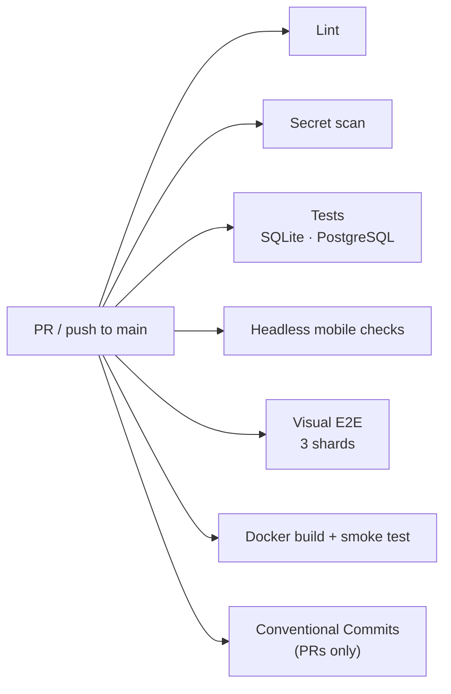

# CI

Three GitHub Actions workflows live in [`.github/workflows/`](../.github/workflows).

## `ci.yml`: on every pull request and on pushes to `main`

Runs with `permissions: contents: read`; a newer push to the same ref cancels the running one
(`concurrency: ci-<ref>`).



The jobs are independent and run in parallel.

| Job | Steps |
|---|---|
| **Lint** | PHP 8.3 and Node 20, installs `shellcheck`, runs `scripts/lint.sh` (`php -l`, `node --check`, Markdown link check, `shellcheck`). |
| **Tests (PHP 8.3, sqlite / pgsql)** | Matrix over the database with a PostgreSQL 17 service. Installs `zbar-tools` for the QR round-trip tests (each apt call has its own timeout, the install is retried 3 times, and the step stops after 15 minutes) and the Composer dev dependencies, then: migrations through the CLI on a fresh database (`bin/migrate.php`, an idempotent second run, `bin/seed.php --demo` twice, `--status`), and PHPUnit (unit tests + the HTTP suite). The SQLite leg then runs `scripts/coverage.sh --no-readme` (pcov: unit suite with `--coverage-php`, every `php -S` request of the HTTP suite through the `tests/coverage/prepend.php` collector, merged with phpcov; plus `playwright test --list` for the test counts), writes the coverage table to the job summary and uploads `coverage-sqlite` (clover XML for unit / HTTP / combined, HTML report, `playwright-list.json`). The [release workflow](#releaseyml-versions-changelog-and-github-releases) reads that artifact. |
| **Headless mobile checks** | Starts `php -S` with demo data and runs `tests/e2e/mobile.mjs` (puppeteer-core + Chrome) at 375×667 and 390×844: filter sheet, theme switch, overflow, sticky bars, photos. |
| **Visual E2E (shard N/3)** | Runs inside `mcr.microsoft.com/playwright:v1.64.0-noble` with a PostgreSQL service; `scripts/e2e-container-setup.sh` installs PHP 8.3 (apt retries each download 5 times, and each apt step is retried up to 4 times with a 20/40/60 s pause), then the job runs `npx playwright test --shard=N/3` (`retries=1` in CI). On failure the HTML report, traces and screenshot diffs are uploaded as `playwright-report-shard-N`. |
| **Docker build + smoke test** | Builds the image with Buildx (GitHub Actions cache, tag `apotheke:ci`). The next step reads the `php:X.Y.Z-fpm-alpine` pin from the Dockerfile and runs `php -r` in that image, failing unless `PHP_VERSION` matches the pin (`version_compare` with `==`). A mismatch prints `expected` and that pin. The pin is one exact line: a trailing space, a CR, or a later floating `FROM php` stage fails the step. The image build itself fails unless the ImageMagick policy is in effect (`magick -list policy` and `scripts/imagick-policy-check.php`, which also checks the delegate and `@file` rights and the time limit). It writes the image size to the job summary, then `scripts/docker-heic.sh` (the policy check again, Imagick lists HEIC, a real HEIC upload keeps its sha256 and yields stripped served and analysis JPEGs, an Imagick fallback flattens transparency onto white and writes sRGB instead of CMYK, and a web-root `ORIGINALS_DIR` returns a generic page under php-fpm). `scripts/docker-signin-checks.sh` checks the sign-in requirement at start (SEC-M3): no `APP_PASSWORD` exits 78 with `sign-in is off`, a bad `ALLOW_NO_LOGIN` exits 64, `APP_PASSWORD` starts, the same data without it starts again, sign-in turned off refuses again, and `ALLOW_NO_LOGIN=1` starts. Then: container on SQLite (`ALLOW_NO_LOGIN=1`) → `scripts/smoke.sh` and `scripts/docker-checks.sh` (routing, blocked paths, headers, gzip, body limits, Host check, same-origin rule, no session cookie on 404s); a container with a random `APP_PASSWORD` → `scripts/docker-auth-checks.sh` (no session for anonymous requests, a 30 MB restore is refused before sign-in and accepted after it, and with an unknown `Host` gets 421); a second container on PostgreSQL (`--network host`, `PORT=8081`, `ALLOW_NO_LOGIN=1`) → `scripts/smoke.sh`; a graceful-stop check (`docker stop` must exit 0 within 20 s); the Playwright `@smoke` subset against the image (`E2E_DOCKER_IMAGE=apotheke:ci`, project `docker-smoke`). Container logs are always printed. |
| **Conventional Commits** | Pull requests only: `scripts/check-commits.sh <base sha> <head sha>` checks every commit subject in the PR (merge commits and `chore(release): vX.Y.Z` commits are skipped). |
| **Secret scan** | Full git history (`actions/checkout` with `fetch-depth: 0`) with the gitleaks CLI, pinned by version and checksum in the workflow. The job fails when gitleaks reports a finding. It does not use the gitleaks GitHub Action and needs no token or license. See [Secret scan](#secret-scan). |

## `release.yml`: versions, changelog and GitHub Releases

Runs when CI finishes successfully for a push to `main` (`workflow_run`), or by hand (`workflow_dispatch`).
The workflow token is `contents: read`. The release job raises that to `contents: write` (push the release commit and
tag, create the GitHub Release) and `actions: read` (download the CI coverage artifact). `concurrency: release`, never
cancelled. It skips when `main` has moved past the commit CI tested.
`scripts/release.php plan` computes the bump from the Conventional Commits since the last `v*` tag; if there is one, the
README coverage table is regenerated from `coverage-sqlite`, `release.php apply` updates `VERSION` and `CHANGELOG.md`,
and the job pushes `chore(release): vX.Y.Z [skip ci]` plus the tag atomically and runs `gh release create`.
The release commit doesn't start CI (`[skip ci]`, and pushes made with `GITHUB_TOKEN` never trigger workflows), so there is
no loop. Details: [releasing.md](releasing.md).

### Why the coverage table is refreshed by the release commit

The alternative, a CI check that fails when the README table is stale, would make every PR that adds a line of code
re-run the full coverage locally and commit the result, and two PRs would conflict on the table. Coverage numbers are a
property of what is on `main`, so the release workflow writes them from the artifact of the exact commit it releases.
Locally `npm run coverage:readme` (or `php scripts/coverage-readme.php coverage --check`) is still available.

## `snapshots.yml`: Update visual snapshots

Runs when a pull request gets the label **`update-snapshots`** (or manually via *workflow_dispatch* on `main`). In the
same Playwright image as the `e2e` job, with a PostgreSQL service, it runs
`npx playwright test --update-snapshots=all --retries=0 --workers=3` and uploads `tests/visual/__screenshots__/` as the
artifact **`snapshots`** (14 days). Fetch it with `scripts/update-snapshots.sh --from-ci <run id>` and commit the
result; see [Testing](testing.md#screenshot-baselines). `=all` re-renders every baseline (not only failing ones), so
shots that drifted within the tolerance are refreshed too. The workflow never pushes anything itself.

## Secret scan

The **Secret scan** job in `ci.yml` checks every commit reachable from the checkout, not only the latest tree. The
checkout uses `actions/checkout` pinned to commit `11d5960a326750d5838078e36cf38b85af677262` (v4.4.0) with
`fetch-depth: 0`, and the scan is `gitleaks git --log-opts="--all"` so every ref in that history is visited.
gitleaks is the official CLI binary from its GitHub release (version **8.30.1**, linux x64, SHA-256 pinned in the
workflow). The organization-licensed `gitleaks-action` is not used.

The job fails on any finding (`--exit-code 1`) and redacts secrets in the log (`--redact`). `.gitleaks.toml`
allowlists one migrate-banner fixture, `SecretMissingEq99`, which `generic-api-key` flags and which remains in
history. The allowlist uses `condition = "AND"`: the path must be `tests/Unit/MigrateDsnTest.php` and the secret
must be exactly that placeholder. The same literal in any other file is still reported. If a later scan flags
another known placeholder, add the smallest possible pattern with a comment saying why. Do not allowlist a
real-looking secret; remove it from history instead.

Workflow tokens stay `contents: read` everywhere. The only extra grant is on the release job (`contents: write` and
`actions: read`), because that job pushes the version commit and tag and downloads the coverage artifact.

## Commit rules

Every commit in a pull request must follow [Conventional Commits](https://www.conventionalcommits.org/):

```
<type>[(scope)][!]: <subject>
```

* `type`: `feat`, `fix`, `docs`, `style`, `refactor`, `perf`, `test`, `build`, `ci` or `chore`;
* `scope`: optional, lowercase letters, digits and `._/-`, e.g. `feat(lending): …`;
* `!` marks a breaking change;
* the whole subject line is at most **72 characters**;
* subjects starting with `Merge `, `Revert `, `fixup! ` or `squash! ` are skipped, and merge commits are not checked.

Check locally before pushing:

```bash
scripts/check-commits.sh origin/main
scripts/check-commits.sh --message "feat(stock): add low-stock alerts"
```

## Keeping CI green

* Each commit should pass lint and tests on its own.
* Fix a red build with a new commit; don't rewrite pushed history.
* A failing screenshot assertion after an intended UI change means the baselines need updating (label
  `update-snapshots`), not a looser threshold.
* Every `ci.yml` job has a `timeout-minutes` (5 to 30), so a hung step fails the job within minutes
  instead of running until GitHub's 6-hour limit. If a job times out or a mirror fails, re-run the failed
  jobs; don't push a commit just to restart CI.
