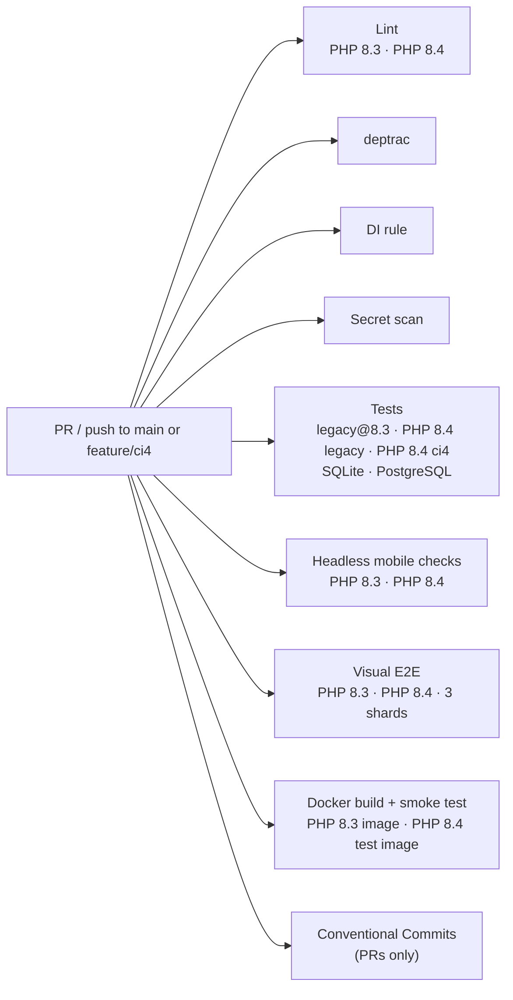

# CI

Three GitHub Actions workflows live in [`.github/workflows/`](../.github/workflows).

## `ci.yml`: on every pull request and on pushes to `main` and `feature/ci4`

`pull_request` has no branch filter, so a pull request into `feature/ci4` runs this workflow.
`push` is limited to `main` and `feature/ci4` (a push to `feature/ci4` uses the workflow file on that branch).
Runs with `permissions: contents: read`; a newer push to the same ref cancels the running one
(`concurrency: ci-<ref>`).



The jobs are independent and run in parallel.

| Job | Steps |
|---|---|
| **Lint (PHP 8.3 and PHP 8.4)** | Node 20, installs `shellcheck`, runs `scripts/lint.sh` (`php -l` on that job's PHP, `node --check`, Markdown link check, `shellcheck`, `actionlint`). The link check walks README, CONTRIBUTING, `AGENTS.md` and every Markdown file under `docs/`. In CI, `actionlint` 1.7.7 is installed by `scripts/install-actionlint.sh` (version and checksum pinned). |
| **deptrac** | PHP 8.4. Runs `php scripts/ci4-arch.php deptrac` against [`deptrac.yaml`](../deptrac.yaml). See [PHP 8.4 legs](#php-84-legs). |
| **DI rule** | PHP 8.4. Runs `composer audit --working-dir=ci4` as a deliberate gate, then `php scripts/ci4-arch.php di` against [`phpstan-di.neon`](../phpstan-di.neon). A failure from a newly published advisory means update the dependency; it is not a regression in the pull request. See [PHP 8.4 legs](#php-84-legs). |
| **Tests (`app` @ PHP `version`, sqlite / pgsql)** | Matrix `app: [legacy, ci4]` × `php: ['8.4']` × `db: [sqlite, pgsql]`, plus legacy@8.3 on both databases (the upgrade/rollback reference: the shipped 2.5.x image). PostgreSQL 17 service. `scripts/ci4-leg.sh` decides whether the cell runs the suite. When it does: `zbar-tools`, Composer dev dependencies, migrations through the CLI on a fresh database (`bin/migrate.php`, an idempotent second run, `bin/seed.php --demo` twice, `--status`), and PHPUnit (unit tests + the HTTP suite) with `APOTHEKE_APP` and `APOTHEKE_TEST_DB` set to the matrix app and database. `tests/lib.php` passes that database to every server it starts. PHP 8.4 cells also install `ci4/` dependencies. The ci4 cell skips `tests/integration.php`. On ci4@pgsql, `tests/ci4-router.php` (not shipped boot) requires the connection driver `Postgre` and inserts a row into `public.apotheke_ci4_pgsql_probe`; `scripts/ci4-pgsql-proof.php` then fails the job if that table is missing or empty. Only legacy@8.3 SQLite then runs `scripts/coverage.sh --no-readme` (pcov: unit suite with `--coverage-php`, every `php -S` request of the HTTP suite through the `tests/coverage/prepend.php` collector, merged with phpcov; plus `playwright test --list` for the test counts), writes the coverage table to the job summary and uploads `coverage-sqlite` (clover XML for unit / HTTP / combined, HTML report, `playwright-list.json`). The [release workflow](#releaseyml-versions-changelog-and-github-releases) reads that artifact, and only from a push to `main`. |
| **Headless mobile checks (PHP 8.3 and PHP 8.4)** | Starts `php -S` with demo data and runs `tests/e2e/mobile.mjs` (puppeteer-core + Chrome) at 375×667 and 390×844: filter sheet, theme switch, overflow, sticky bars, photos. |
| **Visual E2E (PHP, shard N/3)** | Runs inside `mcr.microsoft.com/playwright:v1.64.0-noble` with a PostgreSQL service. The matrix is PHP 8.3 and PHP 8.4, three shards each. `scripts/e2e-container-setup.sh` installs that PHP (8.3 from Ubuntu, 8.4 from `ppa:ondrej/php`). apt retries each download 5 times, and each apt and PPA step is retried up to 4 times with a 20/40/60 s pause, so short 503 bursts from Launchpad don't fail a shard. A longer PPA outage still fails the 8.4 shards. Then the job runs `npx playwright test --shard=N/3` (`retries=1` in CI). On failure the HTML report, traces and screenshot diffs are uploaded as `playwright-report-php-<version>-shard-N`. Snapshot updates still call the script with no argument, so they stay on PHP 8.3. |
| **Docker build + smoke test (PHP 8.3 and PHP 8.4)** | Builds the image with Buildx (GitHub Actions cache, one scope per PHP version) and writes its size to the job summary. The Dockerfile default is `PHP_VERSION=8.3` (the shipped 2.5.x image). The 8.4 cell passes `PHP_VERSION=8.4` and is a test image only. Both cells build Imagick from the pinned GitHub tarball, with the sha-pinned PECL fallback and https-only curl, and run `scripts/docker-heic.sh` (Imagick lists HEIC, a real HEIC upload keeps its sha256 and yields stripped served and analysis JPEGs, an Imagick fallback flattens transparency onto white and writes sRGB instead of CMYK, and a web-root `ORIGINALS_DIR` returns a generic page under php-fpm). Then, for each cell: container on SQLite → `scripts/smoke.sh` and `scripts/docker-checks.sh` (routing, blocked paths, headers, gzip, body limits); a second container on PostgreSQL (`--network host`, `PORT=8081`) → `scripts/smoke.sh`; a graceful-stop check (`docker stop` must exit 0 within 20 s); the Playwright `@smoke` subset against the image (`E2E_DOCKER_IMAGE=apotheke:ci`, project `docker-smoke`). Container logs are always printed. |
| **Conventional Commits** | Pull requests only: `scripts/check-commits.sh <base sha> <head sha>` checks every commit subject in the PR (merge commits and `chore(release): vX.Y.Z` commits are skipped). |
| **Secret scan** | Full git history (`actions/checkout` with `fetch-depth: 0`) with the gitleaks CLI, pinned by version and checksum in the workflow. The job fails when gitleaks reports a finding. It does not use the gitleaks GitHub Action and needs no token or license. See [Secret scan](#secret-scan). |

## PHP 8.4 legs

The test matrix is `app: [legacy, ci4]` × PHP 8.4 × SQLite and PostgreSQL. Two extra cells, legacy@8.3 on each database, are the upgrade/rollback reference (the 2.5.x image). Legacy PHPUnit on 8.4 has run since PR 2. Lint, headless mobile checks, Playwright and Docker build + smoke run on PHP 8.3 and PHP 8.4. Parity compares legacy@8.4 with CI4@8.4; legacy@8.3 is not that comparison.

The legacy PHPUnit cells also run the parity recorder (`tests/parity/`). Its first steps are a fresh install, `/healthz` and `/health`, and a General settings save, compared across two processes on that job's PHP. On the legacy@8.4 cell that is legacy@8.4 versus legacy@8.4, and a difference fails the job. [`tests/parity/allowlist.yml`](../tests/parity/allowlist.yml) names the four quirks that must stay identical (N-2, QA L-2, N-4, I-3). It does not hide a diff. The legacy 8.3↔8.4 note is [php84-legacy-diff.md](plans/feature12-ci4/php84-legacy-diff.md).

`src/qr.php` loads on every request. Whenever opcache function JIT is on, on PHP 8.2, 8.3 and 8.4, that file sets `opcache.jit=disable` for the whole PHP worker from its first request, not only while a QR code is encoded. The cost is negligible. `opcache_jit_blacklist()` does not help.

`scripts/ci4-leg.sh` accepts only `legacy` and `ci4`. Any other value exits 2. `legacy` always runs the suite. `ci4` fails the job if `ci4/public/index.php` is missing, and it fails if `tests/lib.php` does not actually switch the server: `apotheke_app()` must follow `APOTHEKE_APP`, and the CI4 front controller must be `ci4/public/router.php`. A comment that mentions the variable is not enough. The catalog HTTP suite (`tests/integration.php`) is skipped on the ci4 cell until those routes exist. Legacy unit tests still run, and the parity recorder forces two legacy servers so the ci4 cell keeps comparing legacy with legacy.

The job sets `APOTHEKE_TEST_DB` to `sqlite` or `pgsql`. `tests/lib.php` copies that choice, and the host, database, user, password and schema, into the environment of every server it starts. Those CI4 servers use `tests/ci4-router.php`. On the pgsql leg that router, after CI4 wires the connection, checks the driver is `Postgre` and inserts into `public.apotheke_ci4_pgsql_probe`. `ci4/public/index.php` and `ci4/public/router.php` do not. Setting `APOTHEKE_TEST_DB` on a production install does not create the table. The following step runs `scripts/ci4-pgsql-proof.php`, which prints `apotheke_ci4_pgsql_probe rows=N` and fails when the count is 0. SQLSTATE 42P01 is reported as a missing table. Any other PDO failure is reported as a connection or query failure with its SQLSTATE. The script does not print the DSN or the password.

The test job's PostgreSQL password is the test-only value `apotheke\test`. CI4's `/healthz` check on that cell connects with the backslash still in `DB_PASSWORD`.

**deptrac** and the **DI rule** run the tools from `vendor/bin` (then `ci4/vendor/bin`, then `PATH`):

* [`deptrac.yaml`](../deptrac.yaml) lists Core, DevServer and Migrations. Core depends on nothing. DevServer and Migrations may depend on Core.
* [`phpstan-di.neon`](../phpstan-di.neon) is level 6 over `ci4/modules`, the glue config and `ci4/public`. `service()` and `Services::` are allowed only in controllers and `Config/Services.php`.

The DI job runs `composer audit --working-dir=ci4` before the rule. That audit is a deliberate gate. If it fails because a new advisory was published, update the dependency. The failure is not a regression in the pull request.

An empty config is still a pass. A filled config fails when the tool is not installed.

## `release.yml`: versions, changelog and GitHub Releases

Runs when CI finishes successfully for a push to `main` (`workflow_run` with `branches: [main]`), or by hand (`workflow_dispatch`).
Pushes and pull requests on `feature/ci4` do not release. The release workflow is not modified for the CI4 branch: its trigger lists only `main`, and both the workflow-run job and a manual run check out `main`. `workflow_run` workflows are read from the default branch, so a copy of this file on `feature/ci4` cannot widen what `main` releases.
The workflow token is `contents: read`. The release job raises that to `contents: write` (push the release commit and
tag, create the GitHub Release) and `actions: read` (download the CI coverage artifact). `concurrency: release`, never
cancelled. It skips when `main` has moved past the commit CI tested.
`scripts/release.php plan` computes the bump from the Conventional Commits since the last `v*` tag; if there is one, the
README coverage table is regenerated from `coverage-sqlite`, `release.php apply` updates `VERSION` and `CHANGELOG.md`,
and the job pushes `chore(release): vX.Y.Z [skip ci]` plus the tag atomically and runs `gh release create`.
The release commit doesn't start CI (`[skip ci]`, and pushes made with `GITHUB_TOKEN` never trigger workflows), so there is
no loop. Details: [releasing.md](releasing.md).

### Why the coverage table is refreshed by the release commit

The alternative, a CI check that fails when the README table is stale, would make every PR that adds a line of code
re-run the full coverage locally and commit the result, and two PRs would conflict on the table. Coverage numbers are a
property of what is on `main`, so the release workflow writes them from the artifact of the exact commit it releases.
Locally `npm run coverage:readme` (or `php scripts/coverage-readme.php coverage --check`) is still available.

## `snapshots.yml`: Update visual snapshots

Runs when a pull request gets the label **`update-snapshots`** (or manually via *workflow_dispatch* on `main`). In the
same Playwright image as the `e2e` job, with a PostgreSQL service, it runs
`npx playwright test --update-snapshots=all --retries=0 --workers=3` and uploads `tests/visual/__screenshots__/` as the
artifact **`snapshots`** (14 days). Fetch it with `scripts/update-snapshots.sh --from-ci <run id>` and commit the
result; see [Testing](testing.md#screenshot-baselines). `=all` re-renders every baseline (not only failing ones), so
shots that drifted within the tolerance are refreshed too. The workflow never pushes anything itself.

## Secret scan

The **Secret scan** job in `ci.yml` checks every commit reachable from the checkout, not only the latest tree. The
checkout uses `actions/checkout` pinned to commit `11d5960a326750d5838078e36cf38b85af677262` (v4.4.0) with
`fetch-depth: 0`, and the scan is `gitleaks git --log-opts="--all"` so every ref in that history is visited.
gitleaks is the official CLI binary from its GitHub release (version **8.30.1**, linux x64, SHA-256 pinned in the
workflow). The organization-licensed `gitleaks-action` is not used.

The job fails on any finding (`--exit-code 1`) and redacts secrets in the log (`--redact`). `.gitleaks.toml`
allowlists one migrate-banner fixture, `SecretMissingEq99`, which `generic-api-key` flags and which remains in
history. The allowlist uses `condition = "AND"`: the path must be `tests/Unit/MigrateDsnTest.php` and the secret
must be exactly that placeholder. The same literal in any other file is still reported. If a later scan flags
another known placeholder, add the smallest possible pattern with a comment saying why. Do not allowlist a
real-looking secret; remove it from history instead.

Scan locally with `gitleaks git`, not `gitleaks dir`. gitleaks 8.30.1's directory walk skips a file when an
allowlist path matches and it ignores `condition = "AND"`, so `gitleaks dir` skips all of
`tests/Unit/MigrateDsnTest.php`. Git mode applies the AND rule. CI uses git mode.

Workflow tokens stay `contents: read` everywhere. The only extra grant is on the release job (`contents: write` and
`actions: read`), because that job pushes the version commit and tag and downloads the coverage artifact.

## Commit rules

Every commit in a pull request must follow [Conventional Commits](https://www.conventionalcommits.org/):

```
<type>[(scope)][!]: <subject>
```

* `type`: `feat`, `fix`, `docs`, `style`, `refactor`, `perf`, `test`, `build`, `ci` or `chore`;
* `scope`: optional, lowercase letters, digits and `._/-`, e.g. `feat(lending): …`;
* `!` marks a breaking change;
* the whole subject line is at most **72 characters**;
* subjects starting with `Merge `, `Revert `, `fixup! ` or `squash! ` are skipped, and merge commits are not checked.

Check locally before pushing:

```bash
scripts/check-commits.sh origin/main
scripts/check-commits.sh --message "feat(stock): add low-stock alerts"
```

## Keeping CI green

* Each commit should pass lint and tests on its own.
* Fix a red build with a new commit; don't rewrite pushed history.
* A failing screenshot assertion after an intended UI change means the baselines need updating (label
  `update-snapshots`), not a looser threshold.
