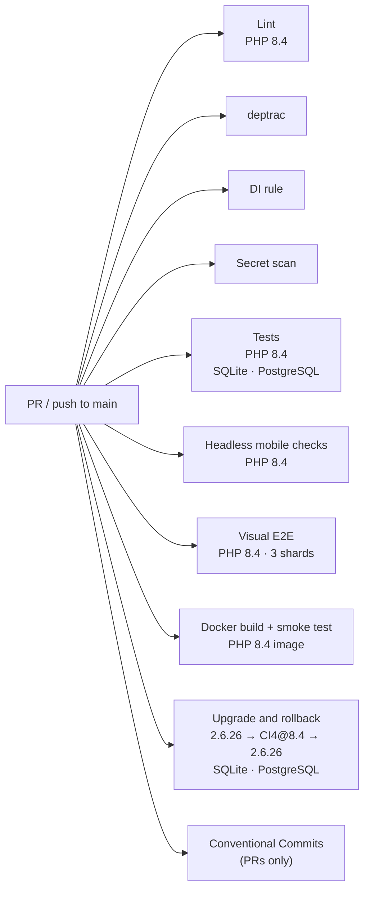

# CI

Three GitHub Actions workflows live in [`.github/workflows/`](../.github/workflows).

## `ci.yml`: on every pull request and on pushes to `main`

`pull_request` has no branch filter, so every pull request runs this workflow. `push` is limited to `main`, the
CodeIgniter 4 app since the branch switch.
Runs with `permissions: contents: read`; a newer push to the same ref cancels the running one
(`concurrency: ci-<ref>`).



The jobs are independent and run in parallel.

| Job | Steps |
|---|---|
| **Lint (PHP 8.3 and PHP 8.4)** | Node 20, installs `shellcheck`, runs `scripts/lint.sh` (`php -l` on that job's PHP, `node --check`, Markdown link check, `shellcheck`, `actionlint`, and the CHANGELOG link check `php scripts/release.php check-links`, which fails on an `[Unreleased]` bullet without a PR link). The link check walks README, CONTRIBUTING, `AGENTS.md` and every Markdown file under `docs/`. In CI, `actionlint` 1.7.7 is installed by `scripts/install-actionlint.sh` (version and checksum pinned). |
| **deptrac** | PHP 8.4. Runs `php scripts/ci4-arch.php deptrac` against [`deptrac.yaml`](../deptrac.yaml). See [PHP 8.4 legs](#php-84-legs). |
| **DI rule** | PHP 8.4. Runs `composer audit` as a deliberate gate, then `php scripts/ci4-arch.php di` against [`phpstan-di.neon`](../phpstan-di.neon). A failure from a newly published advisory means update the dependency; it is not a regression in the pull request. See [PHP 8.4 legs](#php-84-legs). |
| **Tests (PHP `version`, sqlite / pgsql)** | Matrix `php: ['8.4']` × `db: [sqlite, pgsql]`, with `APOTHEKE_APP=ci4` and `APOTHEKE_TEST_DB` set to the cell's database. PostgreSQL 17 service. `zbar-tools` and the HEIC decoder (each apt call has its own timeout, the install is retried 3 times, and the step stops after 15 minutes), Composer dependencies, migrations through the CLI on a fresh database (`bin/migrate.php`, an idempotent second run, `bin/seed.php --demo` twice, `--status`), and PHPUnit (the root suite, which also runs the module suite). `tests/lib.php` passes that database to every server it starts. The real-HEIC Media test must run, and the Autofill and Media module suites run again with `allow_url_fopen` off. On pgsql, `tests/ci4-router.php` (not shipped boot) requires the connection driver `Postgre` and inserts a row into `public.apotheke_ci4_pgsql_probe`; `scripts/ci4-pgsql-proof.php` then fails the job if that table is missing or empty. On sqlite the PHPUnit step is `scripts/coverage.sh --no-readme` (pcov: the module suite with `--coverage-php`, the root suite without `Ci4ModuleSuiteTest` with every `php -S` request collected by `tests/coverage/prepend.php` through `tests/coverage/router.php`, merged with phpcov; plus `playwright test --list` for the test counts); it writes the coverage table to the job summary and uploads `coverage-ci4-sqlite` (clover XML for module / root / combined, HTML report, `playwright-list.json`). The [release workflow](#releaseyml-versions-changelog-and-github-releases) reads that artifact, and only from a push to `main`. |
| **Headless mobile checks (PHP 8.3 and PHP 8.4)** | Starts `php -S` with demo data and runs `tests/e2e/mobile.mjs` (puppeteer-core + Chrome) at 375×667 and 390×844: filter sheet, theme switch, overflow, sticky bars, photos. |
| **Visual E2E (PHP, shard N/3)** | Runs inside `mcr.microsoft.com/playwright:v1.64.0-noble` with a PostgreSQL service. The matrix is PHP 8.3 and PHP 8.4, three shards each. `scripts/e2e-container-setup.sh` installs that PHP (8.3 from Ubuntu, 8.4 from `ppa:ondrej/php`). apt retries each download 5 times, and each apt and PPA step is retried up to 4 times with a 20/40/60 s pause, so short 503 bursts from Launchpad don't fail a shard. A longer PPA outage still fails the 8.4 shards. Then the job runs `npx playwright test --shard=N/3` (`retries=1` in CI). On failure the HTML report, traces and screenshot diffs are uploaded as `playwright-report-php-<version>-shard-N`. Snapshot updates still call the script with no argument, so they stay on PHP 8.3. |
| **Docker build + smoke test (PHP 8.4)** and **(PHP 8.4, FrankenPHP)** | Two legs, one per image (`Dockerfile`, nginx + php-fpm; `Dockerfile.frankenphp`, FrankenPHP); the nginx leg keeps its check name. Both run every step below. Both lint their Dockerfile with `hadolint` (pinned by digest, `--failure-threshold info`; each ignored rule has its reason next to it). The FrankenPHP leg also checks `FRANKENPHP_NUM_THREADS` (default 2; 0, 65 and `abc` exit 64; 4 starts). Both check that the web server and PHP run as `www-data`, that `www-data` cannot write the app code (only `writable/` and `/data`, N-1427), and that the `HEALTHCHECK` turns healthy. `scripts/docker-auth-checks.sh` signs in and checks that a 30 MB POST to routes other than `POST /backup/restore` gets 413. Builds the image with Buildx (GitHub Actions cache, one scope per PHP version, tag `apotheke:ci`). The Dockerfile default is `ARG PHP_VERSION=8.4.27` (the shipped image). The one cell passes that exact patch as the `PHP_VERSION` build-arg. The next step reads the pin from the `ARG PHP_VERSION=X.Y.Z` default (`ARG`/`FROM` case-insensitive), requires exactly one such line and exactly one FROM line of the PHP base, `php:${PHP_VERSION}-fpm-alpine` or `dunglas/frankenphp:${FRANKENPHP_VERSION}-php${PHP_VERSION}-alpine AS php`, fails if the cell's build-arg differs from the default, and runs `php -r` in the image, failing unless `PHP_VERSION` matches the build-arg that cell built (`version_compare` with `==`). A mismatch prints `expected` and that version. A trailing space, a CR, or a later floating `FROM php` stage fails the step. The image build itself fails unless the ImageMagick policy is in effect (`magick -list policy` and `scripts/imagick-policy-check.php`, which also checks the delegate and `@file` rights and the time limit). It writes the image size to the job summary. The cell builds Imagick from the pinned GitHub tarball, with the sha-pinned PECL fallback and https-only curl, and runs `scripts/docker-heic.sh` (the policy check again, Imagick lists HEIC, a real HEIC upload keeps its sha256 and yields stripped served and analysis JPEGs, an Imagick fallback flattens transparency onto white and writes sRGB instead of CMYK, and a web-root `ORIGINALS_DIR` returns a generic page under php-fpm). `scripts/docker-signin-checks.sh` checks the sign-in requirement at start (SEC-M3): no `APP_PASSWORD` exits 78 with `sign-in is off`, a bad `ALLOW_NO_LOGIN` exits 64, `APP_PASSWORD` starts, the same data without it starts again, sign-in turned off refuses again, and `ALLOW_NO_LOGIN=1` starts. It also checks that `APOTHEKE_APP=legacy` and an unknown value exit 64, that a symbolic link in place of a data directory exits 78 without its target being created, and that the first start removes the legacy sessions once and replaces a link in place of the marker with a `www-data` file (L-430, N-432). Then: container on SQLite (`ALLOW_NO_LOGIN=1`) → `scripts/smoke.sh` and `scripts/docker-checks.sh` (routing, blocked paths, headers, gzip, body limits, Host check, same-origin rule, no session cookie on 404s, and four slow uploads in flight while `/healthz`, the sign-in page and a form post still answer within 2 s, M-1420); a container with a random `APP_PASSWORD` → `scripts/docker-auth-checks.sh` (no session for anonymous requests, a 30 MB restore is refused before sign-in and accepted after it, and with an unknown `Host` gets 421; on the FrankenPHP image also: a body over 64 KiB is a 401 before sign-in, a 600 MiB restore is a 401 before and a 413 after sign-in, chunked bodies are capped at 22 MiB, and only `POST` on exactly `/backup/restore` gets 520 MiB) and `scripts/docker-log-checks.sh` (no `Cookie`, `Authorization`, CSRF token or `X-Apotheke-Proxy` value in the access log, L-1422); a second container on PostgreSQL (`--network host`, `PORT=8081`, `ALLOW_NO_LOGIN=1`) → `scripts/smoke.sh`; `scripts/docker-jobs-checks.sh` (the background jobs worker runs as `www-data`, works a queued job, restarts with a backoff after a kill while `/healthz` answers, stops on SIGTERM, and `APOTHEKE_JOBS_WORKER=0` turns it off); a graceful-stop check (`docker stop` must exit 0 within 20 s); the Playwright `@smoke` subset against the image (`E2E_DOCKER_IMAGE=apotheke:ci`, project `docker-smoke`). Container logs are always printed. |
| **Docker Compose self-hosting (Dockerfile)** and **(Dockerfile.frankenphp)** | `docker compose build` with `APOTHEKE_DOCKERFILE` set to each image. A new install without `APP_PASSWORD` must exit 78 (`sign-in is off`). With a random `APP_PASSWORD` and `APP_KEY` in `.env`, `docker compose up --wait` must turn healthy, the port must be bound to `127.0.0.1:9091` only (and not answer on the runner's own address), and `scripts/docker-auth-checks.sh` must pass, and the jobs worker must run as `www-data`. A restart without `APP_PASSWORD` keeps sign-in on. Then `DB_DRIVER=pgsql` without `DB_PASSWORD` must exit 78 at once with *DB_DRIVER=pgsql needs DB_PASSWORD* (N-1426), and the `postgres` profile with `DB_PASSWORD` and the same checks, plus `scripts/docker-log-checks.sh`. |
| **Conventional Commits** | Pull requests only: `scripts/check-commits.sh <base sha> <head sha>` checks every commit subject in the PR (merge commits and `chore(release): vX.Y.Z` commits are skipped). |
| **Secret scan** | Full git history (`actions/checkout` with `fetch-depth: 0`) with the gitleaks CLI, pinned by version and checksum in the workflow. The job fails when gitleaks reports a finding. It does not use the gitleaks GitHub Action and needs no token or license. See [Secret scan](#secret-scan). |

## PHP 8.4 legs

The test matrix is PHP 8.4 × SQLite and PostgreSQL, for the one app. Lint, headless mobile checks, Playwright and Docker build + smoke run on PHP 8.4. The legacy cells (legacy@8.3 and legacy@8.4) left at the cutover; the upgrade-rollback job still runs the v2.6.26 reference on PHP 8.3.

The parity recorder (`tests/parity/recorder.php`, `ParityRecorderTest`) and [`tests/parity/allowlist.yml`](../tests/parity/allowlist.yml) stay as regression fixtures: the allowlist names the four quirks that must stay identical (N-2, QA L-2, N-4, I-3) and does not hide a diff.

The parity gate job was retired at the cutover (PLAN step 18); its last run on the pre-cutover head is recorded in [HANDOFF](HANDOFF.md).

`Labels\QrJit` guards the QR encoder. Whenever opcache function JIT is on, it sets `opcache.jit=disable` for the whole PHP worker before the first QR code of that worker is encoded (a labels page), not only for that request. The cost is negligible. `opcache_jit_blacklist()` does not help.

The job sets `APOTHEKE_TEST_DB` to `sqlite` or `pgsql`. `tests/lib.php` copies that choice, and the host, database, user, password and schema, into the environment of every server it starts. Those CI4 servers use `tests/ci4-router.php`. On the pgsql leg that router, after CI4 wires the connection, checks the driver is `Postgre` and inserts into `public.apotheke_ci4_pgsql_probe`. `public/index.php` and `public/router.php` do not. Setting `APOTHEKE_TEST_DB` on a production install does not create the table. The following step runs `scripts/ci4-pgsql-proof.php`, which prints `apotheke_ci4_pgsql_probe rows=N` and fails when the count is 0. SQLSTATE 42P01 is reported as a missing table. Any other PDO failure is reported as a connection or query failure with its SQLSTATE. The script does not print the DSN or the password.

The test job's PostgreSQL password is the test-only value `apotheke\test`. CI4's `/healthz` check on that cell connects with the backslash still in `DB_PASSWORD`.

**deptrac** and the **DI rule** run the tools from `vendor/bin` (then `vendor/bin`, then `PATH`):

* [`deptrac.yaml`](../deptrac.yaml) has one layer per module under `modules/` (22). Core depends on nothing; every other module may depend on Core and on the modules [AGENTS.md](../AGENTS.md#ci4-module-rules) lists for it, with no cycles.
* [`phpstan-di.neon`](../phpstan-di.neon) is level 6 over `modules/`, the glue config and `public/`. `service()` and `Services::` are allowed only in controllers, in filter `before()`/`after()`, and in `Config/Services.php`.

The DI job runs `composer audit` before the rule. That audit is a deliberate gate. If it fails because a new advisory was published, update the dependency. The failure is not a regression in the pull request.

An empty config is still a pass. A filled config fails when the tool is not installed.

## `release.yml`: versions, changelog and GitHub Releases

Runs when CI finishes successfully for a push to `main` (`workflow_run` with `branches: [main]`), or by hand (`workflow_dispatch`).
Pull requests and other branches do not release: the trigger lists only `main`, and both the workflow-run job and a manual run check out `main`. `workflow_run` workflows are read from the default branch, so a copy of this file on another branch cannot widen what `main` releases. 3.0.0 is the first release cut from the switched `main`.
The workflow token is `contents: read`; the release job adds only `actions: read` (download the CI coverage artifact).
The release commit, the tag and the GitHub Release are written with the release GitHub App's token, minted only when
there is a release and passed only to the push and `gh release create` steps (see
[releasing.md](releasing.md#push-credentials-the-release-github-app)). `concurrency: release`, never cancelled. It skips when `main` has moved past the commit CI tested.
`scripts/release.php plan` computes the bump from the Conventional Commits since the last `v*` tag; if there is one, the
README coverage table is regenerated from `coverage-ci4-sqlite`, `release.php apply` updates `VERSION` and `CHANGELOG.md`,
and the job pushes `chore(release): vX.Y.Z [skip ci]` plus the tag atomically and runs `gh release create`.
The release commit doesn't start CI because its message carries `[skip ci]`, so there is no loop. That marker is the only
guard: the push is made with the App token, and unlike `GITHUB_TOKEN` pushes, App-token pushes do trigger workflows. Details: [releasing.md](releasing.md).

### Why the coverage table is refreshed by the release commit

The alternative, a CI check that fails when the README table is stale, would make every PR that adds a line of code
re-run the full coverage locally and commit the result, and two PRs would conflict on the table. Coverage numbers are a
property of what is on `main`, so the release workflow writes them from the artifact of the exact commit it releases.
Locally `npm run coverage:readme` (or `php scripts/coverage-readme.php coverage --check`) is still available.

## `snapshots.yml`: Update visual snapshots

Runs when a pull request gets the label **`update-snapshots`** (or manually via *workflow_dispatch* on `main`). In the
same Playwright image as the `e2e` job, with a PostgreSQL service, it runs
`npx playwright test --update-snapshots=all --retries=0 --workers=3` and uploads `tests/visual/__screenshots__/` as the
artifact **`snapshots`** (14 days). Fetch it with `scripts/update-snapshots.sh --from-ci <run id>` and commit the
result; see [Testing](testing.md#screenshot-baselines). `=all` re-renders every baseline (not only failing ones), so
shots that drifted within the tolerance are refreshed too. The workflow never pushes anything itself.

## Secret scan

The **Secret scan** job in `ci.yml` checks every commit reachable from the checkout, not only the latest tree. The
checkout uses `actions/checkout` pinned to commit `11d5960a326750d5838078e36cf38b85af677262` (v4.4.0) with
`fetch-depth: 0`, and the scan is `gitleaks git --log-opts="--all"` so every ref in that history is visited.
gitleaks is the official CLI binary from its GitHub release (version **8.30.1**, linux x64, SHA-256 pinned in the
workflow). The organization-licensed `gitleaks-action` is not used.

The job fails on any finding (`--exit-code 1`) and redacts secrets in the log (`--redact`). `.gitleaks.toml`
allowlists one migrate-banner fixture, `SecretMissingEq99`, which `generic-api-key` flags and which remains in
history. The allowlist uses `condition = "AND"`: the path must be `tests/Unit/MigrateDsnTest.php` and the secret
must be exactly that placeholder. The same literal in any other file is still reported. If a later scan flags
another known placeholder, add the smallest possible pattern with a comment saying why. Do not allowlist a
real-looking secret; remove it from history instead.

Scan locally with `gitleaks git`, not `gitleaks dir`. gitleaks 8.30.1's directory walk skips a file when an
allowlist path matches and it ignores `condition = "AND"`, so `gitleaks dir` skips all of
`tests/Unit/MigrateDsnTest.php`. Git mode applies the AND rule. CI uses git mode.

Workflow tokens stay `contents: read` everywhere. The only extra grant is on the release job (`contents: write` and
`actions: read`), because that job pushes the version commit and tag and downloads the coverage artifact.

## Commit rules

Every commit in a pull request must follow [Conventional Commits](https://www.conventionalcommits.org/):

```
<type>[(scope)][!]: <subject>
```

* `type`: `feat`, `fix`, `docs`, `style`, `refactor`, `perf`, `test`, `build`, `ci` or `chore`;
* `scope`: optional, lowercase letters, digits and `._/-`, e.g. `feat(lending): …`;
* `!` marks a breaking change;
* the whole subject line is at most **72 characters**;
* subjects starting with `Merge `, `Revert `, `fixup! ` or `squash! ` are skipped, and merge commits are not checked.

Check locally before pushing:

```bash
scripts/check-commits.sh origin/main
scripts/check-commits.sh --message "feat(stock): add low-stock alerts"
```

## Keeping CI green

* Each commit should pass lint and tests on its own.
* Fix a red build with a new commit; don't rewrite pushed history.
* A failing screenshot assertion after an intended UI change means the baselines need updating (label
  `update-snapshots`), not a looser threshold.
* Every `ci.yml` job has a `timeout-minutes` (5 to 30), so a hung step fails the job within minutes
  instead of running until GitHub's 6-hour limit. If a job times out or a mirror fails, re-run the failed
  jobs; don't push a commit just to restart CI.
