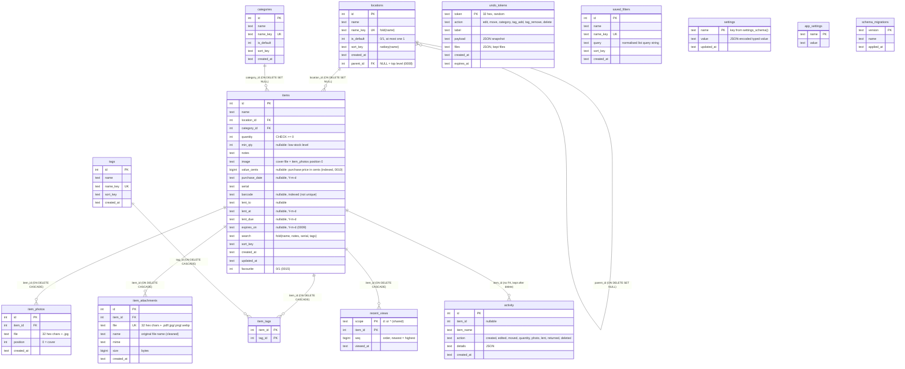
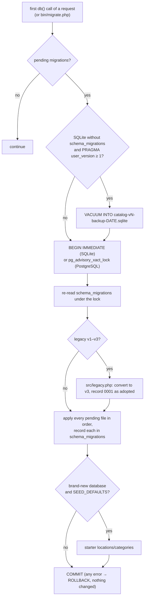

# Database

Apotheke runs on **SQLite** (default, one file in `DATA_DIR`) or **PostgreSQL** (tested with 17). The schema is the
same on both; it is defined by the numbered files in [`migrations/`](../migrations).

## Schema



Notes:

* **Locations form a tree** through `locations.parent_id` (migration 0008, indexed). The tree is small, so it is
  read in one query and assembled in PHP (`tax_list()` / `location_tree_order()` in `src/items.php` add `depth`,
  `path` and `total`); there are no recursive SQL queries. `location_set_parent()` refuses cycles and more than
  `LOCATION_MAX_DEPTH` (6) levels below a top-level location. `tax_delete()` moves a deleted location's children to
  its parent before deleting it, so the `ON DELETE SET NULL` only matters for rows changed outside the app. On
  PostgreSQL the foreign key is `DEFERRABLE INITIALLY DEFERRED` so a restore can insert children before their parents
  (SQLite restores use `PRAGMA defer_foreign_keys`). Categories are flat.
* All timestamps (`created_at`, `updated_at`, `applied_at`) are UTC text `Y-m-d H:i:s`. `purchase_date`, `lent_at`,
  `lent_due` and `expires_on` are calendar dates (`Y-m-d`); "overdue" and "expired" compare them with today's date in
  `TZ`.
* `name_key`, `items.search` and `sort_key` are computed in PHP (`fold()`, `natkey()`); this keeps uniqueness, search
  and natural sorting identical on both databases without collations or extensions.
* `items.image` mirrors the cover photo (`item_photos.position = 0`) so the list needs no join.
* An item is **running low** when `min_qty IS NOT NULL AND quantity <= min_qty`, and **lent** when
  `lent_to IS NOT NULL`.
* `activity.details` is JSON, e.g. `{"changes": {"min_qty": ["2", ""]}}` for an edit, `{"to": "Maria", "at": "…",
  "due": "…"}` for a loan, `{"from": "Drill", "from_id": 7, "quantity": [2, 5], "photos": 1}` for a merge, `{"from": "Maria", "days": 12}` for a return, `{"copied_from": "Drill", …}` for a duplicate.
* `settings` (migration 0013) holds the Control Panel values, one row per key, the value JSON-encoded (`60`, `"#C8502D"`,
  `true`, `null`). The migration seeds every key from `config.php` / the environment; afterwards the table wins. The
  password is a `password_hash()` hash in `password_hash`. See [control-panel.md](control-panel.md).
* `item_attachments` (migration 0014) lists the files attached to an item. The bytes live in `DATA_DIR/files/` under the
  random `file` name; `name` is only shown and used as the download name. Deleting an item deletes its attachments.
* `items.favourite` is 0/1 (the ★ on cards). `recent_views` keeps the *recently viewed* list: one row per scope and item,
  `seq` orders it, rows beyond the limit are deleted on every view and rows older than 90 days now and then. It is
  per-device state and therefore **not** part of backups.
* `undo_tokens` (migration 0016) backs *Undo*: `payload` is JSON with a full snapshot of every affected item (the
  `items` row, tag names, photo and attachment rows), `files` lists the photo/attachment files a delete keeps on disk
  (`[["img", "…jpg"], ["att", "…pdf"]]`). Tokens live `undo_seconds`; expired ones are pruned (and their files deleted
  if nothing references them again) whenever a new token is created or */undo* is called. Not part of backups; a restore
  clears them.
* `app_settings` holds internal flags (for example that the starter data was seeded once).
* `saved_filters.query` is the list's query string normalised by `saved_filter_query()` (known parameters only, fixed order,
  e.g. `q=drill&loc=3&sort=name`), so the same combination always gives the same string and the active chip can be found.

### Migrations so far

| Version | File | What it does |
|---|---|---|
| 0001 | `0001_initial_schema.php` | `locations`, `categories`, `items` (SQL per dialect) |
| 0002 | `0002_sort_keys_and_settings.php` | `sort_key` columns (back-filled), `app_settings` |
| 0003 | `0003_item_photos.php` | `item_photos`; each existing photo becomes its item's cover |
| 0004 | `0004_tags_and_custom_fields.php` | `tags`, `item_tags`; `value_cents`, `purchase_date`, `serial` |
| 0005 | `0005_activity_log.php` | `activity` |
| 0006 | `0006_low_stock.php` | `items.min_qty` |
| 0007 | `0007_lending.php` | `items.lent_to`, `lent_at`, `lent_due` + index on `lent_due` |
| 0008 | `0008_nested_locations.php` | `locations.parent_id` + index |
| 0009 | `0009_expiry.php` | `items.expires_on` + index |
| 0010 | `0010_value_index.php` | index on `items.value_cents` (sort by value, totals) |
| 0011 | `0011_saved_filters.php` | `saved_filters` (named list views) |
| 0012 | `0012_barcode.php` | `items.barcode` + index |
| 0013 | `0013_settings.php` | `settings` (Control Panel key/value), seeded from `config.php` / env |
| 0014 | `0014_attachments.php` | `item_attachments` (PDF/image files per item) + index |
| 0015 | `0015_favourites_recent.php` | `items.favourite` + index, `recent_views` (recently viewed per device or install) |
| 0016 | `0016_undo.php` | `undo_tokens` (short-lived undo snapshots) + index on `expires_at` |

## How migrations run



All pending steps run in **one transaction**, so a failed upgrade leaves the database untouched, and the lock makes
concurrent first requests wait instead of migrating twice. `php bin/migrate.php --status` lists applied and pending
versions.

## Writing a migration

1. Add `migrations/NNNN_short_name.php` with the next free number (the runner sorts by the four digits).
2. Return either an array with SQL per dialect:

   ```php
   <?php
   // 0008 – what and why.
   return [
       'sqlite' => 'ALTER TABLE items ADD COLUMN colour TEXT',
       'pgsql'  => 'ALTER TABLE items ADD COLUMN colour TEXT',
   ];
   ```

   or a closure, when you need PHP (back-filling folded columns, dialect differences):

   ```php
   <?php
   return static function (PDO $pdo, string $driver): void {
       $pdo->exec('ALTER TABLE items ADD COLUMN colour TEXT');
       // $driver is 'sqlite' or 'pgsql'
   };
   ```

3. **Never edit a migration that has been released**; add a new one instead.
4. Keep SQL portable: compare against the folded columns with `LIKE … ESCAPE '!'` (`like_escape()`), sort by
   `sort_key`, use `CASE` instead of boolean sums, `db_insert()` for new ids and `db_local_bucket()` for date
   bucketing. Avoid backslashes in SQL literals (PDO's placeholder parser on PHP < 8.4 trips over them).
5. If the new column holds item data, update what reads and writes it: `ITEM_COLS` / `item_get()` / `item_save()` in
   `src/items.php`, the CSV export in `public/index.php`, and, when it should be copied, `item_input()` (bulk actions,
   duplicating). **Backups need no change**: `backup_dump()` exports every column of the tables in `backup_tables()`,
   and restoring an older backup simply leaves new columns at their defaults.
6. Add tests: `tests/Unit/MigrationRunnerTest.php` for the runner itself, unit tests for the new behaviour, and the
   HTTP suite in `tests/integration.php` (it runs on SQLite and PostgreSQL).

## Working with the data directly

SQLite:

```bash
sqlite3 data/catalog.sqlite '.tables'
sqlite3 data/catalog.sqlite ".backup backup.sqlite"     # consistent copy while the app runs
```

PostgreSQL (compose profile):

```bash
docker compose exec postgres psql -U apotheke apotheke -c '\dt'
```

Prefer the app's own backup (☰ → *Backup & restore* or `bin/backup.php`) for anything you may want to restore: it
includes the photos and works across both databases.
