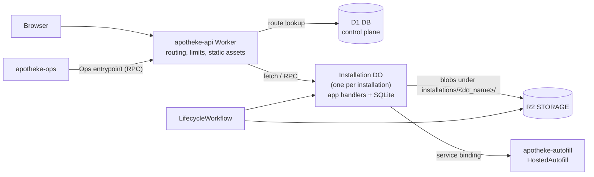

# Workers migration plan (future option)

**Status: a possible future feature, not scheduled work.** Nothing on this page is planned, staffed or approved.
It describes how the API could run entirely on Cloudflare Workers, written in TypeScript on D1, Durable Objects
and R2, instead of the CodeIgniter 4 app in a FrankenPHP container. Every effort figure is a rough estimate.
Decisions that belong to the project owner are listed under [open questions](#8-open-questions).

The self-host decision is the one fixed input. Self-hosters would run the same Worker code on
[workerd](https://github.com/cloudflare/workerd), Cloudflare's open-source Workers runtime, and in the target
state that replaces the FrankenPHP Docker image ([section 6](#6-self-hosting-on-workerd)).

Contents:

1. [The current architecture](#1-the-current-architecture)
2. [The target architecture](#2-the-target-architecture)
3. [Module port map](#3-module-port-map)
4. [Data migration](#4-data-migration)
5. [Phased rollout](#5-phased-rollout)
6. [Self-hosting on workerd](#6-self-hosting-on-workerd)
7. [Risks, effort and Workers limits](#7-risks-effort-and-workers-limits)
8. [Open questions](#8-open-questions)

## 1. The current architecture

### What runs where

| Piece | Code | What it does |
|---|---|---|
| The app | `app/`, `modules/` (22 modules, about 43,800 lines of PHP including views), `public/` | CodeIgniter 4 on PHP 8.4 ([ADR-001](../adr/001-codeigniter4.md)). Server-rendered HTML pages plus the JSON API under `/api/v1` ([api.md](../api.md), `docs/api/openapi.yaml`). About 110 route registrations in `app/Config/Routes.php`, each with a `permission` option. |
| Schema | `migrations/0001`–`0035` | 28 shared migrations that stay byte-identical with 2.6.x, plus CI4-only ones from `0029` (see [AGENTS.md](../../AGENTS.md#hard-constraints) and [database.md](../database.md)). |
| `apotheke-api` | `edge/src/` (about 2,500 lines of TypeScript), `edge/wrangler.jsonc`, `edge/storage.jsonc` | The Worker in front of the app. Routes a host to an installation through the control-plane D1 (`edge/src/route.ts`), starts that installation's container through the `ApothekeContainer` Durable Object (`edge/src/index.ts`), and serves the container's storage calls from outbound handlers (`d1.internal`, `r2.internal`, `autofill.internal`). |
| Per-installation storage | `edge/src/installation.ts`, `edge/src/r2.ts`, `edge/src/d1.ts` | The `Installation` Durable Object (SQLite-backed, EU jurisdiction) holds one installation's database and answers `/query`, `/batch` and `/exec`. Files go to the `STORAGE` R2 bucket under `installations/<do_name>/` ([ADR-002](../adr/002-edge-storage.md), [operator console: per-installation storage](../operator-console.md#per-installation-storage)). |
| Control plane | `edge/migrations/control/0001`–`0005` | D1 tables `plans`, `plan_limits`, `installations`, `installation_routes`, `subscriptions`, `usage_counters`, `operator_audit`, `lifecycle_jobs`, `limit_overrides` ([operator-console.md](../operator-console.md#schema)). |
| Lifecycle jobs | `edge/src/lifecycle.ts`, `edge/src/lifecycle-workflow.ts` | `LifecycleWorkflow` runs provision, suspend, resume, export, delete and purge step by step ([lifecycle jobs](../operator-console.md#lifecycle-jobs)). |
| Operator console | `edge/ops/` (`apotheke-ops`, about 1,400 lines), `ops/console/` | The console and `/api/ops/v1`, behind Cloudflare Access. Reaches installations only through `apotheke-api`'s `Ops` entrypoint ([console API](../operator-console.md#console-api)). |
| Front end | `edge/app/` (`getapotheke-app`), `frontend/` | Static assets for the landing page and the small `/app/` SPA, plus `/config.json`. Unchanged by this plan. |
| Self-host | `Dockerfile` (nginx + php-fpm), `Dockerfile.frankenphp`, `docker/`, `docker-compose.yml` | The supported install ([getting-started.md](../getting-started.md)): PDO on SQLite or PostgreSQL, files under `DATA_DIR`, and the `jobs:work` loop (`docker/jobs-worker.sh`). |

### Why the container exists today

The 3.0 port moved the 2.x app to CodeIgniter 4 and kept it PHP ([ADR-001](../adr/001-codeigniter4.md)). Running
that app on Cloudflare needs a PHP runtime, so `edge/wrangler.jsonc` declares one container application
(`Dockerfile.frankenphp`, `instance_type: "basic"`, `max_instances: 1`) behind a Durable Object. The same image
also serves self-hosters, so one codebase covers Docker, a self-hosted Cloudflare account and the hosted service
([ADR-002, context](../adr/002-edge-storage.md#context)).

The container's disk is ephemeral, so all durable state was moved out of it: the database to the `Installation`
object's SQLite through `d1.internal`, files to R2 through `r2.internal` (P4, [HANDOFF](../HANDOFF.md)). The
container is now a stateless PHP process that the Worker starts on demand, sleeps after `SLEEP_AFTER_MS`
(900,000 ms) and wakes again. That has costs this plan would remove:

- **Cold starts.** `edge/src/index.ts` waits up to `READY_TIMEOUT_MS` (90 s) for `/healthz`; its comment records
  a first start with migrations at 29.4 s.
- **Round trips.** Every SQL statement and every file operation crosses from the container to an outbound handler
  and on to the Durable Object or R2. The `perf/d1-round-trips` work in [HANDOFF](../HANDOFF.md) exists to cut
  those.
- **Two runtimes for one request.** Identity, limits, metering and routing live in TypeScript; the app logic lives
  in PHP. The signed `ops.internal` channel (`modules/Backup/OpsBackupEndpoint.php`,
  `modules/Auth/OpsAccountsEndpoint.php`, `edge/src/ops-signature.ts`) exists only to cross that boundary.
- **Background jobs.** `APOTHEKE_JOBS_WORKER` is `"0"` on `apotheke-api`; its comment in `edge/wrangler.jsonc` says
  jobs on Cloudflare will run through a Cron Trigger or Queues, which is not built yet.

## 2. The target architecture

### Shape

One Worker, `apotheke-api`, serves the whole API in TypeScript. The container application, `ApothekeContainer` and
the three outbound handlers go away. The per-installation `Installation` Durable Object stops being a SQL bridge and
becomes the place where an installation's requests run: the Worker routes a request to the object, and the object
runs the handler next to its own SQLite.



### Bindings

| Binding | Type | Today | Target |
|---|---|---|---|
| `DB` | D1 | Control plane (`edge/storage.jsonc`) | Unchanged: control plane only. |
| `INSTALLATION` | Durable Object, SQLite, EU jurisdiction | SQL bridge for the container | Runs the app for one installation. Same class name and ids, so no data moves. |
| `STORAGE` | R2, EU jurisdiction | Reached by the container through `r2.internal` | Called directly by the object, still under `installations/<do_name>/` (`installationPrefix()` in `edge/src/installation.ts`). |
| `APOTHEKE` | Durable Object with a container | Starts the PHP container | Removed at the end ([phase 7](#phases)). Removing a Durable Object class needs a `deleted_classes` migration, which deletes its storage and needs the owner's approval (comment in `edge/storage.jsonc`). |
| `AUTOFILL` | Service binding to `apotheke-autofill` | Used by `AutofillOutbound` | Called by the object directly; same entrypoint and headers (`edge/src/autofill.ts`). |
| `ASSETS` | Static assets | Not on `apotheke-api` | Serves `public/assets/` (CSS, JS, icons) so the HTML pages keep their files. |
| `IMAGES` | Images binding (optional) | None | One option for photo resizing ([media](#media)). |
| Secrets `APP_KEY`, `APP_PASSWORD` | Worker secrets | Passed into the container env | Read by the Worker; `installationAppKey()` keeps deriving each installation's key. |

The vars that only configure the container (`SLEEP_AFTER_MS`, `APOTHEKE_PHP_WORKER`, `APOTHEKE_JOBS_WORKER`) go;
`ALLOWED_HOSTS`, `COOKIE_DOMAIN`, `CORS_ALLOWED_ORIGINS` and `LIMITS_ENABLED` stay with the same meaning.

### Where per-installation data lives

Two options. Both keep one database per installation, so no installation's rows share a database with another's.

| | Durable Object SQLite (one `Installation` object each) | D1 database per installation |
|---|---|---|
| Today | Already where hosted installations keep their data ([ADR-002, modes](../adr/002-edge-storage.md#modes-in-detail)) | Not used for app data; D1 holds only the control plane |
| Data move at cutover | None: the TypeScript code reads the same tables in the same object | A copy per installation into a new database |
| Query latency | In-process: `ctx.storage.sql` runs in the object that handles the request | One network round trip per query or batch |
| Transactions | Real transactions (`transactionSync`, `transaction`), so restore, bulk actions and the search rebuild stay all-or-nothing | Atomic `batch()` only; large paths need the chunked, compensating forms ADR-002 describes for D1 |
| Size | 10 GB per object | 10 GB per database |
| Recovery | Point-in-time recovery for the last 30 days, per object ([SQLite storage API](https://developers.cloudflare.com/durable-objects/api/sqlite-storage-api/)) | Time Travel (30 days on Workers Paid) and `wrangler d1 export` |
| Provisioning | Implicit: an id from `env.INSTALLATION.jurisdiction("eu")` | A database per installation, created through the API, plus a binding or a dynamic lookup |
| Concurrency | One object per installation, single-threaded (soft limit 1,000 requests per second per object) | One database per installation, single-threaded |
| Admin tooling | No `wrangler` export; the app's own backup is the export | `wrangler d1 export`, the dashboard console |

**Proposal (for the owner to confirm):** keep Durable Object SQLite. It is the current hosted design, it needs no
data move, and in-process SQL removes the round trips that motivate the port. D1 stays the control plane. The same
`Installation` class serves a self-hosted single installation on workerd ([section 6](#6-self-hosting-on-workerd)).
Whether the D1 single-instance mode for self-hosting on Cloudflare ([self-host-cloudflare.md](../self-host-cloudflare.md))
is kept is an [open question](#8-open-questions).

### Code layout in the target

- `edge/src/app/`: the ported modules, one folder per CI4 module, keeping the dependency graph in
  [AGENTS.md](../../AGENTS.md#ci4-module-rules) (a lint rule can enforce it, as deptrac does today).
- `edge/src/platform/`: the adapters the app sees instead of bindings: `Sql` (DO SQLite), `Blobs` (R2), `Clock`,
  `Secrets`, `Autofill`, `Jobs`. Hosted and self-hosted builds bind different implementations
  ([section 6e](#e-one-codebase-for-hosted-and-self-hosted)).
- `edge/src/index.ts`, `route.ts`, `limits.ts`, `lifecycle*.ts`, `ops-*.ts`: kept, minus the container code.

## 3. Module port map

Sizes are rough estimates in person-weeks (pw) for one developer who knows the codebase, including tests. The line
counts are the module folders' PHP today, views included. "Storage" names what the module reads and writes in the
target: SQL tables in the installation's SQLite, and blob keys under the installation's R2 prefix.

### Cross-cutting: Core and request handling

| | |
|---|---|
| CI4 source | `modules/Core/` (12,480 lines: `Database/`, `Storage/`, `Security/`, `Jobs/`, `Hosted/`, `Filters/`, `Http/`, `Config/`), `app/Config/Filters.php`, `app/Config/Routes.php`, `app/Config/Services.php`, `modules/Layout/` (506) |
| TS target | `edge/src/app/core/`: router, the before-filter chain in the order `app/Config/Filters.php` fixes (Host allow-list, base URL, session parameters, same-origin writes, permission, CSRF), problem+json errors, config loader, `ItemHistory`, the unit of work, the job queue; `edge/src/app/layout/` for the page shell |
| Storage | All app tables through `Sql`; `uow_guard` and `uow_refs` are not needed once writes run inside a DO transaction |
| Tricky parts | The permission map must stay route-for-route (`PermissionFilterTest` is the oracle). Absolute URLs from `public_url` and `trust_proxy`, never the Host header. `ClientAddress` semantics. The `UnitOfWork` contract (`hold`, `insert` returning a `Ref`, `write(…, expect, fail)`, `assert`) maps onto `transactionSync`, which simplifies it. SQL stays SQLite only: PostgreSQL-only paths (`FOR UPDATE`, `LOCK TABLE`) are dropped. |
| Rough size | 6–8 pw |

### Auth

| | |
|---|---|
| CI4 source | `modules/Auth/` (4,738 lines: `Accounts`, `UserRepository`, `RoleRepository`, `Permissions`, `SessionEpoch`, `RateLimiter`, `SignInPace`, `FirstAdminClaim`, `HostedAdminReset`, `HostedDisabledUsers`, `OpsAccountsEndpoint`), `modules/Core/Security/` (`SecretBox`, `SecretKey`, `OpsSignature`), the API session controllers |
| TS target | `edge/src/app/auth/`: sign-in pages and `/api/v1/session`, users and roles admin, session store, rate limiter, first-admin claim and admin reset as plain RPC methods on the object |
| Storage | `users`, `roles`, `sessions` (0034), `auth_attempts`, `hosted_disabled_users` (0035), `app_settings` / `settings` |
| Tricky parts | Password hashes are PHP `password_hash(…, PASSWORD_DEFAULT)` (bcrypt), so the Worker needs a bcrypt verifier and must keep accepting existing hashes. Stored secrets use libsodium `secretbox` (`SecretBox.php`), which WebCrypto does not provide, so a small library is needed to read `enc:v1:` values. PHP sessions are stored in PHP's serialization format; sharing a live session between PHP and TypeScript during a dual run needs a reader for that format, or one re-login per installation at its cutover ([open question](#8-open-questions)). The `__Host-` cookie, `session_days` and idle limits, and the session epoch must behave the same. The signed `ops.internal` channel becomes direct RPC from the Worker's `Ops` entrypoint into the object. |
| Rough size | 4–5 pw |

### Items and catalog

| | |
|---|---|
| CI4 source | `modules/Catalog/` (4,533: `Items/`, `ItemList`, `ListFilters`, `SavedFilters`, `Barcode`, `Stats`, `Calendar`, `RecentItems`), `modules/Search/` (480), `modules/Undo/` (333), `modules/Activity/` (364), `modules/BulkMerge/` (885), `modules/Favourites/` (217), `modules/Lending/` (278), `modules/Stocktake/` (683), `modules/Labels/` (596) |
| TS target | `edge/src/app/catalog/` and siblings, one folder per module |
| Storage | `items`, `item_photos`, `item_attachments`, `item_tags`, `saved_filters`, `recent_views`, `undo_tokens`, `activity`, `stocktakes`, `stocktake_lines`, `search_docs`, `search_fts`, `search_meta`; attachments under `attachments/` |
| Tricky parts | Search: `SearchIndex` picks `fts5` or `like` at run time; FTS5 is available in Durable Object SQLite and D1, so the `fts5` path should be the one used. History and undo snapshots must be written in the same transaction as the change. Bulk actions are capped at 500 items per unit today ([HANDOFF](../HANDOFF.md)); inside a DO transaction the cap can stay as is. The QR encoder in `Labels\QrCode` is a port or a library. Pagination, sort keys and list filters are covered by golden tests (`tests/Unit/Ci4PagesGoldenTest.php`). |
| Rough size | 7–9 pw |

### Taxonomy and notes

| | |
|---|---|
| CI4 source | `modules/Taxonomy/` (1,132: `TaxonomyRepository`, `LocationTree`, `TagRepository`, `Kind`), `modules/Notes/MarkdownRenderer.php` (198) |
| TS target | `edge/src/app/taxonomy/`, `edge/src/app/notes/` |
| Storage | `locations` (nested, up to 6 levels), `categories`, `tags` |
| Tricky parts | `MarkdownRenderer` must stay byte-identical to the legacy `md_render()` / `md_plain()` with its 20,000-character cap ([AGENTS.md](../../AGENTS.md#ci4-module-rules)); a fixture corpus from the PHP renderer is the test. Location path rules and the manage pages' history writes. |
| Rough size | 1.5–2 pw |

### Media

| | |
|---|---|
| CI4 source | `modules/Media/` (1,065: `ImageStore`, `ImageLimits`, `Storage/ImagickDecoder`, `Storage/OriginalStore`, `Storage/ServedImageWriter`, `Controllers/MediaController`), brand files in `modules/Settings/` (`BrandStore`, `Branding/`) |
| TS target | `edge/src/app/media/` with an `ImageProcessor` adapter |
| Storage | `item_photos` (with photo versions, 0021); blobs `media/full/…`, `media/thumb/…`, originals |
| Tricky parts | The PHP code decodes, rotates, resizes and re-encodes with GD, and decodes HEIC with Imagick (`ImageLimits::GD_MAX_PIXELS` is 40,000,000; `HEIC_MAX_PIXELS` is 128,000,000). A Worker has 128 MB of memory, and a 40-megapixel RGBA bitmap alone is about 160 MB, so in-Worker decoding (WASM codecs) cannot cover today's limits. Options: the Cloudflare Images binding (input up to 20 MB, offline local support limited to `width`, `height`, `rotate` and `format` per [its docs](https://developers.cloudflare.com/images/transform-images/bindings/)), WASM codecs with lower pixel caps, or resizing in the browser before upload. Self-hosting needs an option that works without Cloudflare ([section 6c](#c-what-workerd-does-not-provide)). HEIC input support is an [open question](#8-open-questions). |
| Rough size | 3–4 pw, plus a spike |

### Autofill

| | |
|---|---|
| CI4 source | `modules/Autofill/` (2,081: `AutofillClient`, `AutofillService`, `CatalogContext`, `ImageLimit`, `InfoCache`, `ResponseClassifier`, `TokenPolicy`, `AnalysisCopyBuilder`), `edge/src/autofill.ts` |
| TS target | `edge/src/app/autofill/` over an `Autofill` adapter: the `AUTOFILL` service binding on the hosted service, an HTTP URL with the write-only token when self-hosted (as `AutofillClient` does today) |
| Storage | Settings (`autofill_token`, encrypted), the cached `/v1/info` and warn-once pair (today `DATA_DIR/autofill/info.json` through storage) |
| Tricky parts | The analysis copy is a resized JPEG (`AUTOFILL_UPLOAD_MAX_SIDE`, `AUTOFILL_UPLOAD_JPEG_QUALITY`, quality stepping until it fits the byte cap), so it depends on the media decision. The 262,144-byte response cap (`AutofillClient::MAX_BODY`) and the timeouts move to `fetch` with an `AbortSignal`. The hosted budget and headers stay as in `edge/src/autofill.ts`. |
| Rough size | 2–3 pw |

### Ops and console

| | |
|---|---|
| CI4 source | `modules/Backup/OpsBackupEndpoint.php`, `modules/Backup/OpsBackups.php`, `modules/Auth/OpsAccountsEndpoint.php`, `modules/Core/Security/OpsSignature.php`; TS: `edge/src/index.ts` (`Ops` entrypoint, `opsBackup`, `opsAccounts`, `listUsers`), `edge/src/ops-accounts.ts`, `edge/src/ops-signature.ts`, `edge/src/lifecycle*.ts`, `edge/ops/src/` |
| TS target | The same `Ops` entrypoint, calling methods on the `Installation` object directly. `edge/ops/` is already TypeScript and keeps its API. |
| Storage | Control plane in D1 (unchanged); per-installation tables through the object |
| Tricky parts | The lifecycle export step today starts a container to make the app's backup (`ApothekeContainer.opsBackup`); in the target the object makes the backup itself, so suspend and export no longer stop and start a container. `stopContainer()` and the purge of the container object's storage go away. The never-`primary` checks in every function stay and keep their tests. Where `LifecycleWorkflow` is hosted (`apotheke-ops` per its file comment, or `apotheke-api`) does not change the plan. |
| Rough size | 2–3 pw |

### Per-installation data: backup, restore, import and export, settings

| | |
|---|---|
| CI4 source | `modules/Backup/` (6,723: `Backups`, `Restorer`, `RestoreStage`, `RestoreFence`, `RestoreUploads`, `Jobs/RestoreConfirmJob`), `modules/ImportExport/` (1,747), `modules/Settings/` (2,265), `modules/ControlPanel/` (1,054), `modules/Migrations/` (1,362), `modules/Core/Jobs/` |
| TS target | `edge/src/app/backup/`, `import-export/`, `settings/`, `control-panel/`, `migrations/`, `jobs/` |
| Storage | Every catalog table, `restore_marker` (0032), `imports`, `import_rows` (0030), `jobs` (0029), `schema_migrations`; blobs under `backups/` |
| Tricky parts | The backup is a ZIP (`ZipArchive` in `Backups.php` and `Restorer.php`) that must stay readable by 2.6.x and by the PHP image, so the TypeScript writer and reader must produce and accept the same format, streamed within 128 MB. Restore inside a DO transaction can replace the staged-copy design of `RestoreStage` (`CHUNK_BYTES` 512 KiB, `CHUNK_ROWS` 1,000), but chunked uploads (`/api/v1/restores/{id}/chunks/{n}`) stay because request bodies are capped. The `jobs` table and `jobs:work` become a per-installation alarm on the object ([section 6c](#c-what-workerd-does-not-provide)). The migrations must produce the same schema as the PHP runner, including the CI4-only rules in [AGENTS.md](../../AGENTS.md#hard-constraints); a schema dump compared against the PHP runner's is the test. |
| Rough size | 6–8 pw |

### Totals

About 32–42 pw for the modules above. The phase table in [section 7](#effort-per-phase) adds the platform,
rollout and self-host work.

## 4. Data migration

### Hosted installations

With the Durable Object SQLite proposal, a hosted installation's data does not move. The TypeScript handlers run in
the same `Installation` object, against the same tables and the same R2 prefix. "Migration" here means proving
that the new code reads and writes the existing data exactly as the PHP code does, then moving request handling.

1. **Schema freeze for the port.** While both runtimes can serve an installation, schema changes ship in both
   (a PHP migration and the matching TypeScript one), and the TypeScript runner refuses to start on a schema it
   does not know (`schema_migrations` newer than its own list).
2. **Snapshot checks before cutover.** For each installation, record per-table row counts and an order-stable
   checksum of every catalog table (rows sorted by primary key, hashed column by column), plus the R2 object count
   and total bytes under its prefix. Both runtimes must report the same values on the same snapshot.
3. **Cutover.** Flip the installation's routing to TypeScript ([section 5](#5-phased-rollout)). Before the flip,
   take a point-in-time bookmark of the object (`ctx.storage.getCurrentBookmark()`) and record it with the cutover
   in `operator_audit`. Keep the app's own backup from the lifecycle export as a second copy.
4. **After cutover.** Re-run the counts and checksums after the first day; a difference that the request log does
   not explain stops further cutovers.
5. **Rollback.** Flip routing back to the container. As long as the TypeScript side writes the same schema and
   invariants, the PHP app reads its writes, so no data restore is needed. If data is wrong, restore the object to
   the recorded bookmark (`onNextSessionRestoreBookmark()`, within 30 days) or restore the app backup, then flip
   back.

### If D1 per installation is chosen instead

1. Export: the app's own backup (the ZIP the lifecycle export already writes), or a table-by-table read inside the
   object.
2. Import: create the installation's D1 database, apply the migrations, and load rows in batches that respect D1's
   limits (100 bound parameters, 100 KB per statement, 2 MB per row; [D1 limits](https://developers.cloudflare.com/d1/platform/limits/)),
   in the same order as the restore.
3. Verify with the counts and checksums above, on both copies.
4. Cutover: set the installation read-only for the copy window (the restore fence, `RestoreFence`, is the existing
   mechanism), copy the delta, verify, switch routing.
5. Rollback: the DO copy is left untouched until the owner approves its purge, so switching back is a routing
   change.

### Self-hosted Docker installs

A Docker install moves to workerd through the existing backup and restore: make a backup on the PHP image, start
the workerd image on an empty data directory, restore the backup there. The backup format is already the portable
one (the dump is database-independent: a SQLite backup restores on PostgreSQL and the other way round, and
restore runs on the edge too). PostgreSQL installs move the same way, since the target
has no PostgreSQL path ([open question](#8-open-questions)). Rolling back means starting the PHP image again on
the untouched old data directory.

## 5. Phased rollout

### Strangler routing

The Worker already decides per request where a request goes (`routeFor()` in `edge/src/route.ts`, then
`env.APOTHEKE.getByName()`). The strangler adds one more decision before the container:

- **Per route:** a table of route patterns (method plus path, matching `app/Config/Routes.php`) that the
  TypeScript app serves. Unlisted routes go to the container.
- **Per installation:** a field on the installation, for example `runtime` with `container`, `shadow` or
  `workers`, read with the route lookup and cached like it (30 s TTL in `route.ts`). This is a control-plane
  migration and a console field; the console stays read-only for it until writes are enabled for it.
- `primary` moves last, and only on the owner's decision.

A request goes to TypeScript only when both allow it. Read-only routes can move per route; anything that writes or
uses the session moves per installation, so one installation never has two runtimes writing its data at the same
time.

### Shadow mode

For an installation in `shadow`, a `GET` is answered by the container as today, and the TypeScript handler runs on
the same request in `waitUntil()` (which allows up to 30 seconds after the response). The two responses are
normalised and compared, and differences are logged by route, status and a hash, never by body or user data.
The normalisation is the parity recorder's (`tests/parity/recorder.php`, [testing.md](../testing.md#parity-recorder)):
CSRF tokens, `Host`, `Date`, `Set-Cookie` and `Content-Length` are left out. Writes are not shadowed against live
data; they are covered by the replay tests below.

### Parity tests

- **The recorder approach.** `tests/parity/` already compares two servers on the same steps. It gets a third
  target: the TypeScript app on workerd. The `allowlist.yml` quirks stay identical.
- **Contract tests.** `tests/ApiContract.php` checks responses against `docs/api/openapi.yaml`. The same checks run
  against the TypeScript app.
- **Golden pages.** `tests/Unit/Ci4PagesGoldenTest.php` fixes page HTML; the TypeScript views must match it.
- **Functional E2E.** The Playwright suite (`tests/e2e/`, `playwright.config.ts`) runs against a base URL, so it
  can run against both servers.
- **Write replay.** A recorded sequence of write requests runs against a PHP server and a TypeScript server, each
  from the same seeded data, and the final database dumps and blob lists must match. `tools/d1-harness/` (pinned
  wrangler and workerd, no credentials) already runs batch guards, migrations and replay on local D1 and is the
  model.
- **Edge tests.** `edge/tests/*.test.mjs` (routing, isolation, limits, lifecycle) keep running; the container tests
  (`container-ready`, `container-forward`) are retired with the container.

### Phases

| Phase | Scope | Exit criteria |
|---|---|---|
| 0. Platform | `edge/src/app/core`, adapters, router, filters, error pages, sessions, migrations runner, test harness on workerd, CI job | Schema from the TypeScript runner equals the PHP runner's on an empty database |
| 1. Read-only routes | `/healthz`, `/health`, branding (`theme.css`, `manifest.webmanifest`, …), `/media/(full\|thumb)/…`, item list and detail, search, `/api/v1/openapi.json` | Shadow mode clean on all test installations for two weeks |
| 2. Auth and sessions | Sign-in, `/api/v1/session`, account pages, users and roles | Installation-level cutover of a test installation |
| 3. Catalog writes | Items, taxonomy, notes, bulk and merge, undo, favourites, lending, stocktake, labels | Write replay clean; Playwright green on both |
| 4. Media and autofill | Uploads, thumbnails, originals, autofill | Media decision made and implemented; photo round trip on both |
| 5. Backup, restore, import and export, jobs | ZIP writer and reader, restore, CSV import and export, alarms for jobs | Backup round trip: PHP → TS → PHP |
| 6. Ops channel and workerd self-host | `Ops` RPC without `ops.internal`, lifecycle export from the object, workerd image and docs | Lifecycle tests green without a container; workerd image passes the self-host smoke test |
| 7. Decommission | Every installation on `workers`; remove the container application, `ApothekeContainer`, outbound handlers and `Dockerfile.frankenphp` from the hosted path | Owner approval for the `deleted_classes` migration |

## 6. Self-hosting on workerd

**Decided by the owner:** self-hosters run the same Worker code on workerd, and in the target state that replaces
the FrankenPHP Docker image. The facts below were checked against workerd's `README.md` and
`src/workerd/server/workerd.capnp` on its `main` branch, and Cloudflare's Miniflare and Durable Objects docs, on
2026-11-21. Several of the features below are marked experimental upstream; anything not confirmed is in the
[open questions](#8-open-questions).

### a. workerd in Docker

- **Image.** No official workerd image is published yet: a pull request to publish `docker.io/cloudflare/workerd`
  with each release ([cloudflare/workerd#8504](https://github.com/cloudflare/workerd/pull/8504)) was open on
  2026-11-21. The plan is a project image built in two stages: a Node stage that bundles the Worker
  (esbuild, as `wrangler deploy --dry-run` does) and takes the `workerd` binary from the pinned `workerd` npm
  package, and a small glibc runtime stage (workerd's prebuilt binary needs glibc 2.35 or later, per its README) that
  runs as a non-root user. If the upstream image ships, the runtime stage can be `FROM` it instead.
- **Config.** A Cap'n Proto text config (`apotheke.capnp`) with one Worker service, its Durable Object namespace
  and a socket. workerd can also serve a Wrangler config directly (`workerd serve wrangler.jsonc`), with D1, R2,
  Cron, Queues and Workflows only behind `--experimental` per its README; the capnp form is more explicit and is
  the proposal.
- **Ports.** One HTTP socket on `9091`, the port the PHP images use, so the Compose file's
  `127.0.0.1:9091:9091` mapping and reverse-proxy setups keep working. TLS stays with the reverse proxy, as today
  ([deployment and operations](../deployment-and-operations.md)).
- **Volumes.** One volume at `/data`, as today: `/data/do/` for Durable Object SQLite files and `/data/blobs/` for
  the object store. Secrets come from the environment (`APP_KEY`, `APP_PASSWORD`) through `fromEnvironment`
  bindings, so they are never written into the config. An `APP_KEY_FILE` would need its file exposed through a
  read-only `disk` service.

A sketch of the config, for orientation only (field names from `workerd.capnp`):

```capnp
using Workerd = import "/workerd/workerd.capnp";

const config :Workerd.Config = (
  services = [
    (name = "apotheke", worker = .apotheke),
    (name = "data", disk = (path = "/data", writable = true)),
  ],
  sockets = [(name = "http", address = "*:9091", http = (), service = "apotheke")],
);

const apotheke :Workerd.Worker = (
  modules = [(name = "index.js", esModule = embed "dist/index.js")],
  compatibilityDate = "2026-10-29",
  compatibilityFlags = ["nodejs_compat"],
  durableObjectNamespaces = [(className = "Installation", uniqueKey = "apotheke-installation", enableSql = true)],
  durableObjectStorage = (localDisk = "data"),
  bindings = [
    (name = "INSTALLATION", durableObjectNamespace = "Installation"),
    (name = "APP_KEY", fromEnvironment = "APP_KEY"),
    (name = "APP_PASSWORD", fromEnvironment = "APP_PASSWORD"),
  ],
);
```

### b. Local stand-ins for D1, Durable Objects and R2

| Cloudflare | On workerd | Native or needs more |
|---|---|---|
| Durable Object SQLite (the app's database) | `durableObjectStorage = (localDisk = "<disk service>")` with `enableSql = true`. One `<id>.sqlite` file per object (plus `-wal` and `-shm` at times) in a folder named by the namespace's `uniqueKey`. | Native. `localDisk` is marked "EXPERIMENTAL; SUBJECT TO BACKWARDS-INCOMPATIBLE CHANGE" in `workerd.capnp`. |
| D1 (control plane) | Not needed when self-hosting: there is one installation and no control plane. If a D1 binding is ever needed, workerd has a bundled `/workerd/d1.js` module (each database is one Durable Object), and Miniflare has `d1Databases` with persistence. | Bundled module, experimental; or Miniflare. |
| R2 on disk | The `bucket` service with `localDisk` (a JSON file per object under `objects/`, the bytes under `blobs/`), used by the bundled `/workerd/r2.js` module behind an `r2Bucket` binding. Supports ranges, conditional puts and multipart. | Bundled module and service, both experimental (`--experimental`). |
| R2 on an S3-compatible store | An `r2Bucket` binding turns calls into HTTP requests to a named service, so a small shim Worker can translate them to S3 calls. workerd's cluster mode stores its bucket in S3-compatible storage, but that is a different feature. | Needs a shim, or the `Blobs` adapter talks S3 directly. |
| Miniflare | A simulator for development and testing that runs workerd from Node, with `durableObjectsPersist`, `d1Persist` and `r2Persist` options ([Miniflare docs](https://developers.cloudflare.com/workers/testing/miniflare/)). | Fallback only: it adds Node to the image and is documented for development and testing, not serving. |

**Proposal:** plain workerd with `localDisk` for Durable Objects and the `Blobs` adapter writing to the disk bucket.
An S3 shim is optional and can come later.

### c. What workerd does not provide

| Used today or in the target | On workerd | Fallback |
|---|---|---|
| Containers | workerd can attach Docker containers to Durable Objects (`containerEngine = (localDocker = …)`), documented as "only used for local development and testing". | Not needed: the target has no container. |
| Cloudflare Access (`edge/ops/src/access.ts`) | Not available | Not needed: the operator console and `apotheke-ops` are hosted-only. Self-hosters keep the app's own sign-in. |
| Workflows (`LifecycleWorkflow`) | Bundled `/workerd/workflows.js`, experimental | Not needed: lifecycle jobs are hosted-only. |
| Queues | Bundled `/workerd/queues.js`, experimental | Not used: background jobs run as Durable Object alarms in both modes. |
| Cron Triggers | Bundled `/workerd/cron.js`, experimental | Not used by `apotheke-api` today (`triggers.crons` is empty on `apotheke-ops`). Periodic app work (the restore sweep, the import sweep) runs from an alarm on the object. |
| Durable Object alarms (jobs) | Expected with `localDisk` storage | To confirm ([open question](#8-open-questions)); fallback is a sweep on the next request. |
| Point-in-time recovery | Not available locally (the SQLite storage API page says the PITR API is not supported in local development) | File backups and the app's own backup ([d](#d-upgrades-and-backups)). |
| Images binding (photo resizing) | Wrangler's offline Images support covers only `width`, `height`, `rotate` and `format`; no confirmed workerd-only implementation | A WASM codec path in the `ImageProcessor` adapter, with lower pixel caps than today, or resizing in the browser ([open question](#8-open-questions)). |
| `AUTOFILL` service binding | No service to bind | The self-hosted `Autofill` adapter calls the configured autofill URL with the write-only token, as `AutofillClient` does today. |
| Control-plane D1, plan limits, usage counters | Not needed | `LIMITS_ENABLED` stays `"0"`; the single installation is `primary`. |
| Observability (`observability.enabled`) | Console logging to stdout; tracing export options exist in `workerd.capnp` | `docker logs`, as today. |

### d. Upgrades and backups

- **Pinning.** workerd versions are dates (for example `v1.20261120.1`), and a version supports compatibility dates
  up to its own; its README says a newer workerd never breaks code on an older compatibility date. The image pins
  the workerd npm version, and the Worker pins `compatibility_date` (today `2026-10-29` in `edge/wrangler.jsonc`)
  and its flags. Both are bumped together, in a PR, and the hosted Worker and the self-host image use the same
  compatibility date.
- **Stable storage names.** The Durable Object namespace's `uniqueKey` (and any `durableObjectUniqueKeyModifier`)
  must never change; `workerd.capnp` warns that losing it can make stored data hard or impossible to recover. The
  object for the single installation is always `idFromName("primary")`.
- **Migrations on start.** The `Installation` object runs pending migrations inside `blockConcurrencyWhile()` in
  its constructor, before it serves a request, and refuses to serve a schema newer than its own list. This keeps
  today's behaviour (pending migrations run automatically on the first request, under a lock,
  [upgrades](../deployment-and-operations.md#upgrades)) and the hosted path's (the schema
  bootstraps on the object under a lease, [HANDOFF](../HANDOFF.md)).
- **Rollback.** Going back one image version works if no migration ran in between. Otherwise: restore the file
  backup taken before the upgrade, then start the older image, as with the PHP image today
  ([upgrading and rolling back](../deployment-and-operations.md)).
- **Backups.** Two layers. The app's own backup (the ZIP under `backups/`, downloadable from `/backup`) is the
  portable one and restores on the PHP image too. File backups copy `/data/do/` and `/data/blobs/` with the
  container stopped, or after a checkpoint, because the SQLite files can have `-wal` and `-shm` companions.

### e. One codebase for hosted and self-hosted

- **Binding adapters.** App code never touches `env` directly. `edge/src/platform/` builds `Sql`, `Blobs`,
  `Autofill`, `ImageProcessor`, `Jobs` and `Secrets` from the bindings that exist: R2 or the disk bucket, the
  `AUTOFILL` binding or an HTTP URL, the Images binding or WASM. This follows the current rule that storage is
  selected only from bindings, never from a var (`storageBackend()` in `edge/src/r2.ts`).
- **Mode flags.** One explicit `APOTHEKE_MODE` (`hosted` or `self-hosted`) decides what is wired: the control plane,
  limits and the `Ops` entrypoint exist only in `hosted`. A half-configured mode refuses to start, as
  `storageBackend()` does today for half a storage fragment.
- **Two configs, one bundle.** `edge/wrangler.jsonc` (plus `edge/storage.jsonc`) for Cloudflare and
  `apotheke.capnp` for workerd, both pointing at the same entry module and compatibility date. A test compares
  their compatibility dates and flags.
- **CI job.** A new job, next to the existing **D1 (local workerd)** job in `.github/workflows/ci.yml` (which
  already installs a pinned workerd through `tools/d1-harness/` with no Cloudflare credentials), builds the
  self-host image, starts it on an empty volume, and runs the same suites against it that run against
  `wrangler dev`: the unit and edge tests, the contract tests, the parity recorder and the Playwright smoke set. No
  workflow `paths:` filter: it runs on every PR, like the rest of CI.

## 7. Risks, effort and Workers limits

### Risks

| Risk | Effect | Mitigation |
|---|---|---|
| Behaviour drift during a long dual run | Two implementations of every rule | Per-installation cutover, shadow mode, write replay; schema changes ship in both until decommission |
| Image processing in 128 MB | Large or HEIC photos that work today might be refused | Decide the media option first (phase 4 spike); keep the PHP image for self-hosters until the workerd path matches |
| Experimental workerd features | `localDisk` storage and the bundled modules can change | Pin workerd; run the self-host CI job on every PR; keep the PHP image until they settle |
| Losing PostgreSQL for self-hosters | Installs on PostgreSQL must move to SQLite | Backup and restore already cross databases; owner decision needed |
| Backup format compatibility | Backups must stay readable by 2.6.x and the PHP image | Round-trip tests PHP → TS → PHP in CI |
| Session and password compatibility | Users signed out, or old hashes not accepted | bcrypt verify of existing hashes; one re-login per installation at cutover if sessions are not shared |
| CPU-heavy requests | bcrypt, ZIP and CSV work can be slow on a 30 s default CPU limit | Raise `limits.cpu_ms` where needed (up to 5 minutes); move long work to alarms |
| Scope | 43,800 lines of PHP to port | Phased, each phase useful alone; stop points after every phase |
| Durable Object class removal | Removing `ApothekeContainer` needs a `deleted_classes` migration | Done last, with owner approval |

### Effort per phase

Rough estimates for one developer, including tests and docs. Not a commitment.

| Phase | Estimate |
|---|---|
| 0. Platform | 6–8 pw |
| 1. Read-only routes | 3–4 pw |
| 2. Auth and sessions | 4–5 pw |
| 3. Catalog writes | 8–10 pw |
| 4. Media and autofill | 5–7 pw (with the spike) |
| 5. Backup, restore, import and export, jobs | 6–8 pw |
| 6. Ops channel and workerd self-host | 4–6 pw |
| 7. Decommission | 1–2 pw |
| **Total** | **about 37–50 pw** |

### Workers limits

Checked against Cloudflare's docs on 2026-11-21. Limits change; the linked pages are the source.

**Workers** ([Workers limits](https://developers.cloudflare.com/workers/platform/limits/)):

| Limit | Workers Free | Workers Paid | Relevance |
|---|---|---|---|
| CPU time per HTTP request | 10 ms | 5 min (default 30 s) | bcrypt, ZIP and image work need Paid; Free cannot host the app |
| Memory | 128 MB | 128 MB | Image decoding, ZIP streaming, CSV import |
| Subrequests | 50 per request | 10,000 per request | R2 listing during purge and export pages |
| Simultaneous outgoing connections | 6 per request | 6 per request | Parallel R2 reads |
| Request body size | Set by the zone's plan: 100 MB (Free, Pro), 200 MB (Business), up to 5 GB (Enterprise) | same | Uploads and restore chunks; the FrankenPHP image allows `post_max_size` 520M today, so restore keeps its chunked uploads |
| Response body size | No enforced limit | same | Backup downloads stream |
| URL size / request headers | 16 KB / 128 KB | same | |
| Worker size | 64 MiB | 64 MiB | The bundle with views and codecs |
| Startup time | 1 s | 1 s | Keep top-level work small |
| Wall time, `waitUntil()` | 30 s after the response | same | Shadow comparisons |

**D1**, control plane only in the proposal ([D1 limits](https://developers.cloudflare.com/d1/platform/limits/)):
10 GB per database (Paid), 2 MB per row, 100 KB per statement, 100 bound parameters, 100 columns, 30 s per query,
1,000 queries per Worker invocation on Paid (a `batch()` counts as one), 50 MB query result.

**Durable Objects**, the app's database ([Durable Objects limits](https://developers.cloudflare.com/durable-objects/platform/limits/)):
10 GB storage per object, 8 MB per row or value, 100 KB per statement, 100 bound parameters, 100 columns, 30 s CPU
per request by default (configurable up to 5 minutes with `limits.cpu_ms`), a soft limit of 1,000 requests per
second per object, and 100 MiB per outbound HTTP request body.

**Images binding** ([Images binding](https://developers.cloudflare.com/images/transform-images/bindings/)): input up
to 20 MB.

The existing SQL rules in [ADR-002, consequences](../adr/002-edge-storage.md#consequences) (no transaction
statements in SQL, at most 100 parameters, `json_each` for lists) already match these limits and carry over.

## 8. Open questions

For Stathis:

1. **Go or no go, and when.** Is this worth scheduling at all, and before or after the hosted service goes live?
2. **Storage.** Keep per-installation data in Durable Object SQLite (the proposal), or move it to D1 per
   installation?
3. **PostgreSQL.** The workerd self-host path has no PostgreSQL. Is dropping PostgreSQL for self-hosters acceptable,
   with backup and restore as the move?
4. **The PHP images.** How long do `Dockerfile` and `Dockerfile.frankenphp` stay supported after the workerd image
   ships, and is the 90-day window used for 2.x the model?
5. **Self-hosting on Cloudflare.** Is the single-instance D1 mode ([self-host-cloudflare.md](../self-host-cloudflare.md))
   kept, or does it become the same `Installation` object as the hosted service?
6. **Sessions at cutover.** Is one re-login per installation acceptable (the 3.0 precedent), or must live sessions
   carry over between PHP and TypeScript?
7. **Media.** Which image option: the Images binding (hosted), WASM codecs, browser-side resizing, or a mix? Is a
   lower pixel cap than today acceptable? Must HEIC uploads keep working, and on self-host too?
8. **Dependencies.** The port needs a few libraries (bcrypt, libsodium `secretbox`, ZIP, possibly image codecs and
   QR). Which are acceptable, given today's rule that the only runtime packages are CodeIgniter 4 and its pinned
   dependencies?
9. **Server-rendered UI.** Keep the HTML pages and `public/assets/` as they are (the proposal, CSP-safe, no build
   step for the UI), or move the UI to the `/app/` SPA as part of this?
10. **The 2.6.x backport rule.** Do the shared-schema and backup-compatibility rules still apply once the PHP app
    is retired?
11. **workerd facts to confirm on a pinned release** (they were read from workerd's `main` branch):
    - that Durable Object alarms work with `localDisk` storage;
    - that FTS5 is available in workerd's local Durable Object SQLite;
    - how stable `localDisk`, the `bucket` service and the bundled `r2.js` module are, all marked experimental;
    - whether `cloudflare/workerd#8504` ships an official image, and from which release;
    - whether a workerd-only (no Wrangler, no Miniflare) Images implementation exists.
12. **Hosting cost.** CPU-time billing replaces container time. Is a cost comparison needed before deciding?
