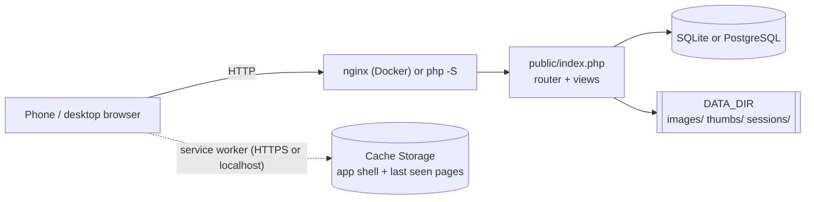

# Apotheke documentation

Apotheke is a small, self-hosted web app for cataloguing your belongings: photos, a location ("box 1023"), a
category, a quantity, tags and a few custom fields, with instant search. It is plain PHP 8.2+ with PDO (SQLite or
PostgreSQL) and GD: no framework, no runtime Composer packages, no JavaScript build step and no CDNs.

The [README](../README.md) is the short tour. These pages go into the details.

## Contents

| Page | What it covers |
|---|---|
| [Getting started](getting-started.md) | Docker, Docker Compose (including the `postgres` profile), running without Docker, local development |
| [Configuration](configuration.md) | `config.php`, every environment variable, precedence rules |
| [User guide](user-guide.md) | Every feature: items, photos, locations and categories, search and filters, low-stock alerts, bulk actions, lending, duplicating, QR labels, history, backup, offline use, iPhone tips |
| [Architecture](architecture.md) | Directory layout, request flow, the database layer, front-end JavaScript, the service worker |
| [Database](database.md) | Schema and ER diagram, migrations and how to write one |
| [Testing](testing.md) | `tests/run.sh`, PHPUnit on SQLite and PostgreSQL, the headless mobile checks, Playwright and the screenshot baseline workflow |
| [CI](ci.md) | Every GitHub Actions job, the snapshot workflow, commit rules |
| [Deployment and operations](deployment-and-operations.md) | Backup and restore, upgrades, reverse proxies and HTTPS, security headers and CSP |
| [Contributing](contributing.md) | Ground rules, workflow, commit messages, adding a feature end to end |

Screenshots used in the README live in [`screenshots/`](screenshots/).

## At a glance

## What Apotheke does not do

To avoid surprises, a few things that are **not** there:

* **No nested locations.** Locations are a flat list (like categories). A location cannot contain another location;
  name them so they sort well instead ("Garage", "Garage – shelf 1", "Garage – shelf 2"). See the
  [user guide](user-guide.md#locations-and-categories).
* No multi-user accounts or permissions: there is at most one shared password (`APP_PASSWORD`).
* No barcode scanning of product codes; the QR labels only link back to Apotheke pages.
* No currency conversion: `CURRENCY` is only a label.
