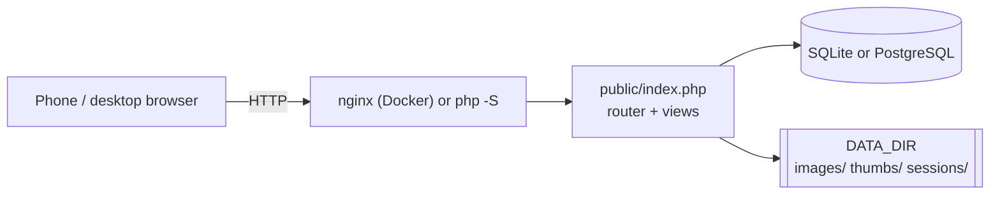

  <picture>
    <source media="(prefers-color-scheme: dark)" srcset="assets/apotheke-logo-dark.svg">
    
  </picture>

# Apotheke documentation

Apotheke is a small, self-hosted web app for cataloguing your belongings: photos, a location ("box 1023"), a
category, a quantity, tags and a few custom fields, with instant search. The legacy app (`main`, 2.5.x) is plain
PHP 8.2+ with PDO (SQLite or PostgreSQL) and GD: no framework, no runtime Composer packages, no JavaScript build step
and no CDNs. The 3.0 port adopts CodeIgniter 4; see [ADR-001](adr/001-codeigniter4.md).

The [README](../README.md) is the short tour, and [CHANGELOG.md](../CHANGELOG.md) lists the changes. These pages go into the details.
Agents working on the codebase should start with [`AGENTS.md`](../AGENTS.md).

## Contents

| Page | What it covers |
|---|---|
| [AGENTS.md](../AGENTS.md) | Instructions for AI agents: stack constraints, layout, tests, commits |
| [Getting started](getting-started.md) | Docker Compose (including the `postgres` profile), `docker run`, running without Docker, local development, command-line tools |
| [Configuration](configuration.md) | `config.php`, every environment variable, precedence rules, stored-secret encryption |
| [Control Panel](control-panel.md) | Settings at `/settings`: what lives in the database vs. `config.php`, accent contrast, logo upload, users & roles, import/export, `bin/settings.php` |
| [AI autofill](autofill.md) | Optional suggestions from a photo by the separate autofill service: setup, model and image size, the byte cap, the test buttons, the write-only token, what is sent, failures, upgrading from 2.3, the test stub |
| [User guide](user-guide.md) | Every feature: items, photos, search and filters, locations and categories, low-stock alerts, bulk actions, lending, duplicating and merging, stocktake, QR labels, undo, history, backup, CSV import, users, home screen, iPhone tips |
| [Architecture](architecture.md) | Directory layout, request flow, the database layer, front-end JavaScript |
| [Database](database.md) | Schema and ER diagram, migrations and how to write one |
| [Testing](testing.md) | `tests/run.sh`, PHPUnit on SQLite and PostgreSQL, the parity recorder, the headless mobile checks, Playwright and the screenshot baseline workflow |
| [CI](ci.md) | Every GitHub Actions job, the snapshot workflow, commit rules |
| [Releasing](releasing.md) | SemVer from Conventional Commits, `VERSION`, `CHANGELOG.md`, tags and GitHub Releases |
| [Upgrading to 3.0](upgrade-3.0.md) | The CodeIgniter 4 app: what changes, backup, the switch, both rollbacks, what CI proves |
| [Deployment and operations](deployment-and-operations.md) | Backup and restore, upgrades, Docker defaults, host names, reverse proxies and HTTPS, PostgreSQL role, security, monitoring |
| [Contributing](contributing.md) | Ground rules, workflow, commit messages, adding a feature end to end |

Screenshots used in the README live in [`screenshots/`](screenshots/).

## At a glance

## What Apotheke does not do

To avoid surprises, a few things that are **not** there:

* No nested categories. Locations can be nested (up to 6 levels, see the [user guide](user-guide.md#nested-locations)),
  categories are a flat list.
* No offline mode: the pages come from the server every time (the app can still be added to the home screen).
* No per-location permissions and no single sign-on.
* No product lookup: a scanned barcode only finds or pre-fills items in your own catalog.
* No currency conversion: `CURRENCY` is only a label.
