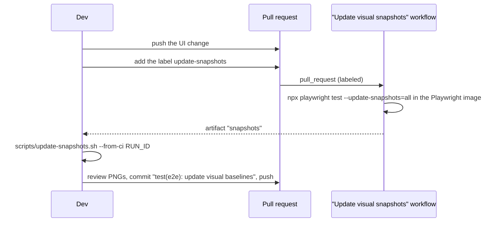

# Testing

| Layer | Where | Runs on | Needs |
|---|---|---|---|
| Lint | `scripts/lint.sh` | `php -l` on every PHP file, `node --check` on the JS in `public/`, relative Markdown links (`scripts/check-links.mjs`: README, CONTRIBUTING, `AGENTS.md`, and every Markdown file under `docs/`), `shellcheck`, `actionlint` on `.github/workflows` | PHP, Node, shellcheck, actionlint (installed in CI) |
| PHPUnit | `tests/Unit/`, `tests/Modules/` (CIUnitTestCase, run from `Ci4ModuleSuiteTest`) | SQLite or PostgreSQL | `composer install` |
| Headless mobile checks | `tests/e2e/mobile.mjs` | Chrome via puppeteer-core at 375×667 and 390×844 | Node, Chrome |
| End-to-end + visual | `tests/visual/*.spec.ts` | Playwright: WebKit, Chromium, light and dark, SQLite and PostgreSQL | Node, PHP, Playwright browsers |

## `tests/run.sh`

```bash
tests/run.sh                      # lint + the module suite on SQLite (after composer install)
DB_DRIVER=pgsql tests/run.sh      # the module suite against PostgreSQL (TEST_PG_* below)
```

CI runs PHPUnit on PHP 8.4, on SQLite and PostgreSQL, with `APOTHEKE_APP=ci4`. The harness starts
`tests/ci4-router.php` (the shipped dev server remains `public/router.php`), and `APOTHEKE_TEST_DB` tells
`tests/lib.php` which database to pass to those servers. The legacy suites (the HTTP integration suite and the
legacy unit tests) left at the cutover; they stay in the 2.6 releases. Lint, the headless mobile checks, Playwright
and Docker build + smoke run on PHP 8.4. deptrac and the DI rule check every module. See [CI](ci.md#php-84-legs).

The integration suite starts PHP's built-in server on temporary data directories and exercises the app over HTTP with
a small client (`tests/lib.php`: cookies, CSRF, multipart uploads, JSON). It covers uploads (images generated with
GD), search and filters, quantities, edit/delete, locations and categories, low-stock alerts, bulk actions, lending,
duplicating, nested locations, QR labels, CSV, backup/restore, migrations from legacy schemas, CSRF
and upload rejection, password mode (including gated CSV/backup downloads and login CSRF), statistics,
HEAD-on-read-routes (the router treats `HEAD` like `GET`), singular stats/`item_noun` copy, list pagination
(`PAGE_SIZE`), and the HTTP photo limit. It prints one line per assertion and exits non-zero on failure.

## Parity recorder

`tests/parity/` compares two fresh installs of the app. The first steps are a fresh install (home page, migration
list, settings rows, file modes), `/healthz` and `/health`, and saving General settings. It also compares a server
started on `public/index.php` with one on the test router (`tests/ci4-router.php`) for those health bytes, the three
`/originals` URLs and the originals directory modes. Since the cutover both run the CodeIgniter 4 app; `tests/lib.php`
still calls the `public/index.php` mode `legacy`. The database dump is not part of that comparison.
CSRF tokens, the `Host` header, `Date`, `Set-Cookie` and `Content-Length` are not part of the comparison. A difference
fails the test.

[`tests/parity/allowlist.yml`](../tests/parity/allowlist.yml) lists the four quirks that must stay identical to 2.x
(N-2, QA L-2, N-4, I-3). An entry does not excuse a diff.

```bash
vendor/bin/phpunit --filter ParityRecorderTest
```

### Parity gate (PLAN step 16)

The parity gate compared every ported area on a legacy and a CI4 server, step by step. It was retired at the cutover
(PLAN step 18): the last run on the pre-cutover head is recorded in [HANDOFF](HANDOFF.md), and the scenario, its
script (with its `pending` step mechanism, unused since #151) and the CI job remain in the history before the cutover. The recorder above and the allowlist remain as CI4
regression fixtures.

### Upgrade and rollback (PLAN step 16, part 2)

[`scripts/upgrade-rollback.sh`](../scripts/upgrade-rollback.sh) runs PLAN §3.6 on one data directory and database:
legacy on PHP 8.3 seeds the demo catalog (`bin/seed.php --demo`, JPEG photos), then
[`tests/upgrade/seed-extra.php`](../tests/upgrade/seed-extra.php) adds a PNG and a HEIC photo with their originals,
tags, a PDF attachment under `files/`, a saved filter and a stocktake, so every table a backup carries has rows (the
seed guard fails otherwise). CI4 on PHP 8.4 takes over (its `bin/migrate.php` runs first and applies the CI4-only
migrations; `bin/migrate.php --status` shows every migration applied;
`/healthz`, the list and a photo with its thumbnail answer), then legacy on 8.3 again. Each app then restores the
other's `bin/backup.php` zip with `bin/restore.php`, over the same install and into a fresh one. After every step
[`tests/upgrade/snapshot.php`](../tests/upgrade/snapshot.php) takes every table (columns and rows, sorted) and the
sha256 of every file under `images/`, `thumbs/`, `originals/` (`map/` included) and `files/`, and
[`compare.php`](../tests/upgrade/compare.php) fails on any difference from the seeded state, and on an originals
directory that is not 0750 or a file there that is not 0640, and on a `files/` that is not the apps' mode (legacy's 0770 under
the script's umask, passed as `UPGRADE_FILES_MODE`; 0750 under 022); other mode differences are printed as `WARN`. After a
restore only the carried tables (`backup_tables()`, which must equal CI4's `Backups::tables()`) and the settings are
compared, without `settings.updated_at`. The CI4-only additions (`upg_ci4_only()` in
[`tests/upgrade/lib.php`](../tests/upgrade/lib.php): migration 0029 and its `jobs` table) are left out of every
snapshot and checked on their own by [`tests/upgrade/ci4-only.php`](../tests/upgrade/ci4-only.php): two `jobs` rows
seeded after the upgrade must be there unchanged after the CI4 backup, the rollback to legacy and both in-place
restores, and the CI4 zip must not name migration 0029 or carry the table. Last, mutation checks on a throwaway install show that an emptied or
dropped table, a changed or missing attachment, a 0644 original and a 0700 `files/` each fail
against a clean snapshot, each undone before the next (the dropped table runs last). `UPGRADE_WORK` must be a new path;
the script removes only that directory and its own `upg_<run>_*` schemas. CI runs it on SQLite and PostgreSQL
(`upgrade-rollback`).

```bash
DB_DRIVER=sqlite bash scripts/upgrade-rollback.sh            # needs php8.3, php8.4, vendor and the v2.6.26 tag
DB_DRIVER=pgsql TEST_PG_HOST=127.0.0.1 TEST_PG_PORT=5432 TEST_PG_DB=apotheke TEST_PG_USER=apotheke \
  TEST_PG_PASSWORD=secret bash scripts/upgrade-rollback.sh     # schemas upg_<run>_*, dropped at the end
UPGRADE_KEEP=1 DB_DRIVER=sqlite bash scripts/upgrade-rollback.sh   # keep the work dir and snapshots
```

## PHPUnit

```bash
composer install
vendor/bin/phpunit                                            # SQLite
DB_DRIVER=pgsql TEST_PG_PASSWORD=secret vendor/bin/phpunit    # PostgreSQL
vendor/bin/phpunit --filter LendingTest                       # one class
bash scripts/coverage.sh --no-readme                          # coverage of both suites (needs pcov)
vendor/bin/phpunit -c tests/Modules/phpunit.xml.dist          # module tests only
```

* `tests/Unit/` holds the unit tests. Database tests extend `DatabaseTestCase`, which gives every test a fresh SQLite
  file or, on PostgreSQL, its own throwaway schema (`migrateFresh()` runs all migrations).
* `tests/phpunit-bootstrap.php` loads Composer's autoloader only; there is no legacy app to load. The tests that
  compared CI4 with legacy became plain CI4 tests at the cutover (PLAN step 18).
* `tests/Unit/Ci4ModuleSuiteTest.php` runs the module suite inside PHPUnit, so it is part of the PHPUnit run on both
  databases.

PostgreSQL settings (`TEST_PG_HOST`, `TEST_PG_PORT`, `TEST_PG_DB`, `TEST_PG_USER`, `TEST_PG_PASSWORD`) default to
`127.0.0.1`, `5432`, `apotheke`, `apotheke`, `apotheke`. The credential tests (`Ci4DsnCredentialsTest`,
`PgsqlSchemaCreateTest`) create login roles, so a non-superuser test role needs `CREATEROLE`, and on PostgreSQL 16 or
later also `createrole_self_grant = 'set, inherit'` (for example `ALTER ROLE apotheke SET createrole_self_grant =
'set, inherit'`). The container below makes `apotheke` a superuser, which needs neither. A throwaway server:

```bash
docker run --rm -p 5432:5432 -e POSTGRES_USER=apotheke -e POSTGRES_PASSWORD=secret -e POSTGRES_DB=apotheke postgres:17
```

## Headless mobile checks

```bash
npm ci --prefix tests/e2e
DATA_DIR=/tmp/apotheke-e2e php -S 127.0.0.1:9091 -t public public/index.php &
php tests/e2e/seed.php http://127.0.0.1:9091
CHROME="$(command -v google-chrome)" node tests/e2e/mobile.mjs http://127.0.0.1:9091
```

## Playwright (end-to-end and visual)

```bash
npm ci
npx playwright install --with-deps chromium webkit
npm run test:e2e                                    # everything
npx playwright test tests/visual/lending.spec.ts    # one spec, all projects
npx playwright test --project=webkit-iphone-se      # one project
npx playwright test --grep-invert visual            # functional specs only (skips the screenshot specs)
TEST_PG_HOST=127.0.0.1 npm run test:e2e:smoke-pg    # @smoke subset on PostgreSQL
E2E_DOCKER_IMAGE=apotheke:latest npx playwright test --project=docker-smoke   # @smoke against the Docker image
npm run test:e2e:report                             # open the HTML report
```

### Projects

| Project | Device | Runs |
|---|---|---|
| `webkit-iphone13`, `webkit-iphone-se` | WebKit, iPhone 13 / SE | every spec, light |
| `chromium-pixel` | Chromium, Pixel 7 | every spec, light |
| `desktop-chromium` | Chromium, 1280×860 | every spec, light |
| `*-dark` (4 projects) | same devices, dark scheme | `visual*.spec.ts` and `theme.spec.ts` |
| `pgsql-smoke` | desktop Chromium on PostgreSQL | tests tagged `@smoke` |
| `docker-smoke` | desktop Chromium against `E2E_DOCKER_IMAGE` | tests tagged `@smoke` (only when the variable is set) |

### Fixtures (`tests/visual/fixtures.ts`)

* One server per worker: `php -S` on a free port (or the Docker image), with `TZ=Europe/Athens` and the clock frozen
  via `APOTHEKE_CLOCK` (`2026-06-15 09:00:00` UTC), so dates and charts are deterministic.
* Before **every** test the data is reset and re-seeded by `tests/visual/ci4-fixtures.php` (`demo`: 8 items with
  generated photos, or `empty`) through the app's own code, so tests never depend on each other.
* `app.sql()` runs SQL against the test database (to assert or to prepare state), `app.exec()`, `app.migrate()`,
  `app.defaultCategory()` and `app.settings()` prepare state through the app, `app.go()` navigates and waits.
* Every test fails on console errors or uncaught page errors (`errors` fixture). Helpers check layout:
  `app.noOverflow()` (no horizontal scrolling) and `app.tapTargets()` (every visible control ≥ 44 px).

### Specs

| Spec | Covers |
|---|---|
| `list.spec.ts` | empty state, grid, overview tiles and charts, instant search (incl. Greek), filter sheet and chips, quantity on cards |
| `add.spec.ts`, `item.spec.ts` | add/edit forms and validation, photos (gallery, reorder, cover, delete), quantity, delete confirmation |
| `manage.spec.ts` | locations and categories, defaults, delete with move |
| `data.spec.ts` | QR labels, CSV, backup, restore dry run and confirm, rejected files |
| `history.spec.ts` | activity log |
| `auth.spec.ts`, `errors.spec.ts`, `theme.spec.ts` | sign-in, error pages, Auto/Light/Dark |
| `photos.spec.ts` | canvas crop/rotate saves a new version, no-JS exact fields, drag-to-reorder sets the cover |
| `import.spec.ts` | upload, column mapping, dry run with row errors, skip errors, import, export round trip |
| `search.spec.ts` | ranking, highlights, snippets, typo note, escaping, no-JS search, engine in System |
| `roles.spec.ts` | roles editor (custom role, permission change, delete), guest browsing, registration + approval, accounts off |
| `users.spec.ts` | first admin, adding a viewer, read-only UI and 403s, own password, role change, deleting an account |
| `stock.spec.ts` | low-stock level, live badge, tile and filter |
| `bulk.spec.ts` | selection mode, move, tags, select all, delete confirmation |
| `lending.spec.ts` | lend, overdue, filters, Lent page, return (`@smoke`) |
| `value.spec.ts` | Value card totals, sort by value, editing a price (`@smoke`) |
| `expiry.spec.ts` | expiry date, badges, Expiring soon / Expired tiles and filters (`@smoke`) |
| `barcode.spec.ts` | manual barcode lookup → prefilled new item → item, search by barcode, edit form field (`@smoke`) |
| `saved-filters.spec.ts` | save the current filters under a name, active chip, duplicate refused, apply, rename, delete (`@smoke`) |
| `duplicate.spec.ts` | duplicate with and without photos |
| `locations-nested.spec.ts` | nested locations: create inside, move, tree order, filter by parent, item trail, delete (`@smoke`) |
| `visual.spec.ts`, `visual-login.spec.ts` | `toHaveScreenshot` baselines of the key screens |

### Screenshot baselines

Baselines live in `tests/visual/__screenshots__/<project>/<spec>/<name>.png`. They are **only** rendered in the
official `mcr.microsoft.com/playwright:v<version>-noble` image (the version comes from `package.json`), the same image
the CI `e2e` job runs in, because fonts and anti-aliasing differ between machines. Locally, the screenshot assertions
will fail on any other system; that is expected. Run the functional specs instead
(`npx playwright test --grep-invert visual`).

To update the baselines after an intended UI change:



* `scripts/update-snapshots.sh --from-ci <run id>` downloads the `snapshots` artifact with `gh` and replaces
  `tests/visual/__screenshots__/` (find the id with `gh run list --workflow snapshots.yml`).
* Alternatively, with Docker locally: `npm run test:e2e:update` (= `scripts/update-snapshots.sh`), which runs the
  same image plus a throwaway PostgreSQL container.
* Remove and re-add the label to render again.

When a screenshot assertion fails in CI, the `playwright-report-shard-N` artifact contains the HTML report, traces and
`*-diff.png` images.
