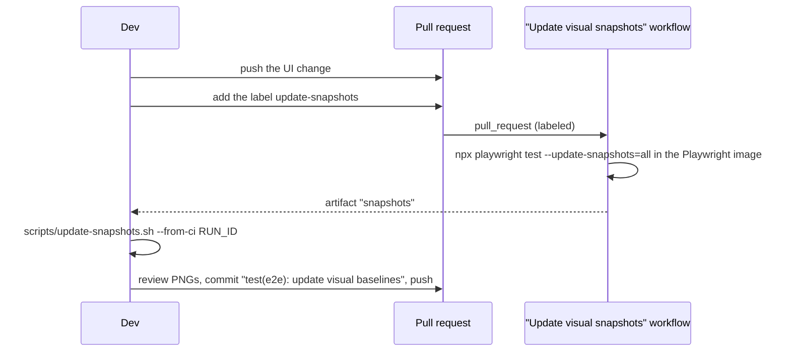

# Testing

| Layer | Where | Runs on | Needs |
|---|---|---|---|
| Lint | `scripts/lint.sh` | `php -l` on every PHP file, `node --check` on the JS in `public/` and `src/`, relative Markdown links (`scripts/check-links.mjs`), `shellcheck` | PHP, Node, shellcheck |
| HTTP integration suite | `tests/integration.php` (+ `tests/lib.php`) | `php -S` on throwaway data dirs, SQLite or PostgreSQL | PHP only |
| PHPUnit | `tests/Unit/`, `tests/Integration/HttpSuiteTest.php` | SQLite or PostgreSQL | `composer install` |
| Headless mobile checks | `tests/e2e/mobile.mjs` | Chrome via puppeteer-core at 375×667 and 390×844 | Node, Chrome |
| End-to-end + visual | `tests/visual/*.spec.ts` | Playwright: WebKit, Chromium, light and dark, SQLite and PostgreSQL | Node, PHP, Playwright browsers |

## `tests/run.sh`

```bash
tests/run.sh                      # lint + integration suite on SQLite; no Composer, no Docker
DB_DRIVER=pgsql tests/run.sh      # the integration suite against PostgreSQL (TEST_PG_* below)
php tests/integration.php         # integration suite only
KEEP_TEST_DATA=1 php tests/integration.php   # keep the temp data dirs for inspection
```

The integration suite starts PHP's built-in server on temporary data directories and exercises the app over HTTP with
a small client (`tests/lib.php`: cookies, CSRF, multipart uploads, JSON). It covers uploads (images generated with
GD), search and filters, quantities, edit/delete, locations and categories, low-stock alerts, bulk actions, lending,
duplicating, nested locations, QR labels, CSV, backup/restore, migrations from legacy schemas, CSRF
and upload rejection, password mode (including gated CSV/backup downloads and login CSRF), statistics,
HEAD-on-read-routes (the router treats `HEAD` like `GET`), singular stats/`item_noun` copy, list pagination
(`PAGE_SIZE`), and the HTTP photo limit. It prints one line per assertion and exits non-zero on failure.

## PHPUnit

```bash
composer install
vendor/bin/phpunit                                            # SQLite
DB_DRIVER=pgsql TEST_PG_PASSWORD=secret vendor/bin/phpunit    # PostgreSQL
vendor/bin/phpunit --filter LendingTest                       # one class
vendor/bin/phpunit --coverage-html coverage/html              # needs pcov or xdebug
```

* `tests/Unit/` holds the unit tests. Database tests extend `DatabaseTestCase`, which gives every test a fresh SQLite
  file or, on PostgreSQL, its own throwaway schema (`migrateFresh()` runs all migrations).
* `tests/Integration/HttpSuiteTest.php` runs `tests/integration.php` inside PHPUnit, so the HTTP suite is part of the
  PHPUnit run on both databases.

PostgreSQL settings (`TEST_PG_HOST`, `TEST_PG_PORT`, `TEST_PG_DB`, `TEST_PG_USER`, `TEST_PG_PASSWORD`) default to
`127.0.0.1`, `5432`, `apotheke`, `apotheke`, `apotheke`. A throwaway server:

```bash
docker run --rm -p 5432:5432 -e POSTGRES_USER=apotheke -e POSTGRES_PASSWORD=secret -e POSTGRES_DB=apotheke postgres:17
```

## Headless mobile checks

```bash
npm ci --prefix tests/e2e
DATA_DIR=/tmp/apotheke-e2e php -S 127.0.0.1:8080 -t public public/index.php &
php tests/e2e/seed.php http://127.0.0.1:8080
CHROME="$(command -v google-chrome)" node tests/e2e/mobile.mjs http://127.0.0.1:8080
```

## Playwright (end-to-end and visual)

```bash
npm ci
npx playwright install --with-deps chromium webkit
npm run test:e2e                                    # everything
npx playwright test tests/visual/lending.spec.ts    # one spec, all projects
npx playwright test --project=webkit-iphone-se      # one project
npx playwright test --grep-invert visual            # functional specs only (skips the screenshot specs)
TEST_PG_HOST=127.0.0.1 npm run test:e2e:smoke-pg    # @smoke subset on PostgreSQL
E2E_DOCKER_IMAGE=apotheke:latest npx playwright test --project=docker-smoke   # @smoke against the Docker image
npm run test:e2e:report                             # open the HTML report
```

### Projects

| Project | Device | Runs |
|---|---|---|
| `webkit-iphone13`, `webkit-iphone-se` | WebKit, iPhone 13 / SE | every spec, light |
| `chromium-pixel` | Chromium, Pixel 7 | every spec, light |
| `desktop-chromium` | Chromium, 1280×860 | every spec, light |
| `*-dark` (4 projects) | same devices, dark scheme | `visual*.spec.ts` and `theme.spec.ts` |
| `pgsql-smoke` | desktop Chromium on PostgreSQL | tests tagged `@smoke` |
| `docker-smoke` | desktop Chromium against `E2E_DOCKER_IMAGE` | tests tagged `@smoke` (only when the variable is set) |

### Fixtures (`tests/visual/fixtures.ts`)

* One server per worker: `php -S` on a free port (or the Docker image), with `TZ=Europe/Athens` and the clock frozen
  via `APOTHEKE_CLOCK` (`2026-06-15 09:00:00` UTC), so dates and charts are deterministic.
* Before **every** test the data is reset and re-seeded by `tests/visual/seed.php` (`demo`: 8 items with generated
  photos, or `empty`), so tests never depend on each other.
* `app.sql()` runs SQL against the test database (to assert or to prepare state), `app.go()` navigates and waits.
* Every test fails on console errors or uncaught page errors (`errors` fixture). Helpers check layout:
  `app.noOverflow()` (no horizontal scrolling) and `app.tapTargets()` (every visible control ≥ 44 px).

### Specs

| Spec | Covers |
|---|---|
| `list.spec.ts` | empty state, grid, overview tiles and charts, instant search (incl. Greek), filter sheet and chips, quantity on cards |
| `add.spec.ts`, `item.spec.ts` | add/edit forms and validation, photos (gallery, reorder, cover, delete), quantity, delete confirmation |
| `manage.spec.ts` | locations and categories, defaults, delete with move |
| `data.spec.ts` | QR labels, CSV, backup, restore dry run and confirm, rejected files |
| `history.spec.ts` | activity log |
| `auth.spec.ts`, `errors.spec.ts`, `theme.spec.ts` | password mode, error pages, Auto/Light/Dark |
| `stock.spec.ts` | low-stock level, live badge, tile and filter |
| `bulk.spec.ts` | selection mode, move, tags, select all, delete confirmation |
| `lending.spec.ts` | lend, overdue, filters, Lent page, return (`@smoke`) |
| `value.spec.ts` | Value card totals, sort by value, editing a price (`@smoke`) |
| `expiry.spec.ts` | expiry date, badges, Expiring soon / Expired tiles and filters (`@smoke`) |
| `barcode.spec.ts` | manual barcode lookup → prefilled new item → item, search by barcode, edit form field (`@smoke`) |
| `saved-filters.spec.ts` | save the current filters under a name, active chip, duplicate refused, apply, rename, delete (`@smoke`) |
| `duplicate.spec.ts` | duplicate with and without photos |
| `locations-nested.spec.ts` | nested locations: create inside, move, tree order, filter by parent, item trail, delete (`@smoke`) |
| `visual.spec.ts`, `visual-login.spec.ts` | `toHaveScreenshot` baselines of the key screens |

### Screenshot baselines

Baselines live in `tests/visual/__screenshots__/<project>/<spec>/<name>.png`. They are **only** rendered in the
official `mcr.microsoft.com/playwright:v<version>-noble` image (the version comes from `package.json`), the same image
the CI `e2e` job runs in, because fonts and anti-aliasing differ between machines. Locally, the screenshot assertions
will fail on any other system; that is expected. Run the functional specs instead
(`npx playwright test --grep-invert visual`).

To update the baselines after an intended UI change:



* `scripts/update-snapshots.sh --from-ci <run id>` downloads the `snapshots` artifact with `gh` and replaces
  `tests/visual/__screenshots__/` (find the id with `gh run list --workflow snapshots.yml`).
* Alternatively, with Docker locally: `npm run test:e2e:update` (= `scripts/update-snapshots.sh`), which runs the
  same image plus a throwaway PostgreSQL container.
* Remove and re-add the label to render again.

When a screenshot assertion fails in CI, the `playwright-report-shard-N` artifact contains the HTML report, traces and
`*-diff.png` images.
