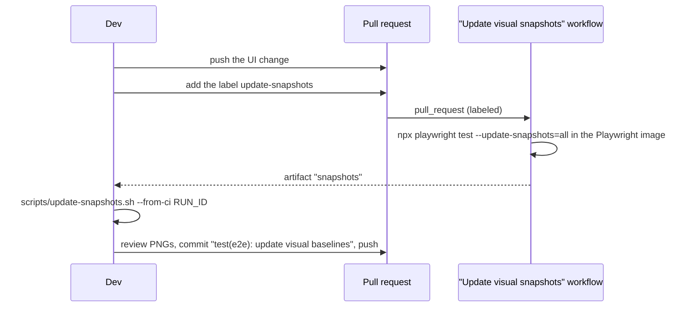

# Testing

| Layer | Where | Runs on | Needs |
|---|---|---|---|
| Lint | `scripts/lint.sh` | `php -l` on every PHP file, `node --check` on the JS in `public/` and `src/`, relative Markdown links (`scripts/check-links.mjs`: README, CONTRIBUTING, `AGENTS.md`, and every Markdown file under `docs/`), `shellcheck`, `actionlint` on `.github/workflows` | PHP, Node, shellcheck, actionlint (installed in CI) |
| HTTP integration suite | `tests/integration.php` (+ `tests/lib.php`) | `php -S` on throwaway data dirs, SQLite or PostgreSQL | PHP only |
| PHPUnit | `tests/Unit/`, `tests/Integration/HttpSuiteTest.php` | SQLite or PostgreSQL | `composer install` |
| Headless mobile checks | `tests/e2e/mobile.mjs` | Chrome via puppeteer-core at 375×667 and 390×844 | Node, Chrome |
| End-to-end + visual | `tests/visual/*.spec.ts` | Playwright: WebKit, Chromium, light and dark, SQLite and PostgreSQL | Node, PHP, Playwright browsers |

## `tests/run.sh`

```bash
tests/run.sh                      # lint + integration suite on SQLite; no Composer, no Docker
DB_DRIVER=pgsql tests/run.sh      # the integration suite against PostgreSQL (TEST_PG_* below)
php tests/integration.php         # integration suite only
KEEP_TEST_DATA=1 php tests/integration.php   # keep the temp data dirs for inspection
```

CI runs that suite on legacy@8.3 (the upgrade/rollback reference) and on legacy@8.4, on SQLite and PostgreSQL.
The ci4 cells run PHPUnit too. `APOTHEKE_APP=ci4` selects the CI4 app. The harness starts `tests/ci4-router.php`
(the shipped dev server remains `ci4/public/router.php`), and `APOTHEKE_TEST_DB` tells
`tests/lib.php` which database to pass to those servers. The catalog HTTP suite is
skipped there until those routes exist. Lint, the headless mobile checks and Playwright also
run on both PHP 8.3 and PHP 8.4; Docker build + smoke runs on the shipped PHP 8.4 image. deptrac and the DI rule check Core and DevServer. See [CI](ci.md#php-84-legs). The
legacy comparison is [php84-legacy-diff.md](plans/feature12-ci4/php84-legacy-diff.md).

The integration suite starts PHP's built-in server on temporary data directories and exercises the app over HTTP with
a small client (`tests/lib.php`: cookies, CSRF, multipart uploads, JSON). It covers uploads (images generated with
GD), search and filters, quantities, edit/delete, locations and categories, low-stock alerts, bulk actions, lending,
duplicating, nested locations, QR labels, CSV, backup/restore, migrations from legacy schemas, CSRF
and upload rejection, password mode (including gated CSV/backup downloads and login CSRF), statistics,
HEAD-on-read-routes (the router treats `HEAD` like `GET`), singular stats/`item_noun` copy, list pagination
(`PAGE_SIZE`), and the HTTP photo limit. It prints one line per assertion and exits non-zero on failure.

## Parity recorder

`tests/parity/` compares two fresh legacy installs on the PHP that is running the job. The first steps are a fresh
install (home page, migration list, settings rows, file modes), `/healthz` and `/health`, and saving General settings.
On PHP 8.4 it also compares a legacy server with the CI4 server for those health bytes, the three `/originals` URLs
and the originals directory modes. The database dump is not part of that comparison.
CSRF tokens, the `Host` header, `Date`, `Set-Cookie` and `Content-Length` are not part of the comparison. A difference
fails the test. On the legacy@8.4 CI cell this is legacy@8.4 versus legacy@8.4.

[`tests/parity/allowlist.yml`](../tests/parity/allowlist.yml) lists the four quirks that must stay identical to legacy
(N-2, QA L-2, N-4, I-3). An entry does not excuse a diff.

```bash
vendor/bin/phpunit --filter ParityRecorderTest
```

### Parity gate (PLAN step 16)

[`tests/parity/gate.php`](../tests/parity/gate.php) walks every ported area (all but backup and restore) on a legacy
and a CI4 server, both on the running PHP (8.4) and database (`APOTHEKE_TEST_DB`), with the same seeded catalog and a
frozen clock: health and static files, layout, sign-in and account, users and roles, locations and categories, the
list and search, items, photos (PNG, HEIC, broken files, cover, order, rotate), autofill against the stub (each
failure mode, the token), quantity, duplicate, attachments, merge, bulk actions and undo, labels, barcodes, lending,
stocktake, CSV export and import, and the settings CLI. About 196 steps. After every step it compares the answer
(status, type, Location, body or JSON; Cache-Control, Pragma and Expires; every Set-Cookie in full, with Path,
Domain, SameSite, Secure, HttpOnly and Max-Age; X-Frame-Options, X-Content-Type-Options, Referrer-Policy,
Content-Security-Policy, Permissions-Policy, Strict-Transport-Security and the Cross-Origin policies, absent or not),
the stub's last upload, and after every write every table and the data directory (path, mode, sha256). The users the
app created then sign in with the passwords it stored, and each stored hash is shown with the scenario password it
verifies. Normalised alike on both sides: CSRF tokens, asset cache busters, random hex names (numbered in order of
appearance), the salt and hash of a password hash (algorithm and cost are compared), session epochs, the session ID
by length and alphabet, cookie expiry as a bucket relative to the answer's Date, and wall-clock times. Cache-Control
is compared exactly except for one documented pair: on a non-JSON answer other than 200, legacy's `no-store,
no-cache, must-revalidate` (PHP's session cache limiter) equals CI4's `no-store, max-age=0, no-cache` (CodeIgniter's
`noCache()`); both forbid storing. The autofill cache is compared under legacy's names (`autofill-info.json`,
`tmp/`), because CI4 keeps it behind `Storage` as `autofill/info.json` and `autofill/tmp/` by design (#69). Any
difference fails. Steps marked `pending` list the parts of an answer that come from a page CI4 has not ported (the
Control Panel), apart from the differences; the rest of the step must match.

It also times each area's read pages, alternating legacy and CI4, and prints the p95 per area with CI4's lead in ms
at p95 and at the median. `PARITY_P95_MAX_PCT=20` fails the run when a CI4 p95 is more than 20 % above legacy's (the
PLAN bar for step 16, not met yet); `PARITY_P95_MAX_ABS_MS=N` fails it when one is more than N ms above. CI sets the
temporary absolute budget, 8 ms on SQLite and 20 ms on PostgreSQL, on the median gap; it is tightened when the
boot-cost step lands, and then CI enforces 20 %. `PARITY_BUDGET_STAT=median` makes the absolute budget compare the
medians instead of the p95 (the PM's fallback once runner noise failed the p95 gap; CI uses it, and the +N % bound
always compares p95). An empty variable checks nothing (the statistic defaults to p95); any other value that is not a
number >= 0, or not `p95` or `median`, exits 2.

```bash
php scripts/parity-gate.php                     # SQLite: differences per area, then the p95 table
APOTHEKE_TEST_DB=pgsql DB_DRIVER=pgsql TEST_PG_PASSWORD=secret php scripts/parity-gate.php --markdown
php scripts/parity-gate.php --rounds=0          # differences only, no timing
PARITY_GATE=1 vendor/bin/phpunit --filter ParityGateTest
PARITY_DEBUG='autofill: suggest' php scripts/parity-gate.php --rounds=0   # raw headers of one step
```

Turn pcov off for timing (`php -d pcov.enabled=0 …`); the gate's own servers already run with it off and opcache on.

## PHPUnit

```bash
composer install
vendor/bin/phpunit                                            # SQLite
DB_DRIVER=pgsql TEST_PG_PASSWORD=secret vendor/bin/phpunit    # PostgreSQL
vendor/bin/phpunit --filter LendingTest                       # one class
vendor/bin/phpunit --coverage-html coverage/html              # needs pcov or xdebug
vendor/bin/phpunit -c ci4/phpunit.xml.dist                    # CI4 module tests only (needs ci4/vendor, PHP 8.4)
```

* `tests/Unit/` holds the unit tests. Database tests extend `DatabaseTestCase`, which gives every test a fresh SQLite
  file or, on PostgreSQL, its own throwaway schema (`migrateFresh()` runs all migrations).
* `tests/Integration/HttpSuiteTest.php` runs `tests/integration.php` inside PHPUnit, so the HTTP suite is part of the
  PHPUnit run on both databases.

PostgreSQL settings (`TEST_PG_HOST`, `TEST_PG_PORT`, `TEST_PG_DB`, `TEST_PG_USER`, `TEST_PG_PASSWORD`) default to
`127.0.0.1`, `5432`, `apotheke`, `apotheke`, `apotheke`. The credential tests (`Ci4DsnCredentialsTest`,
`PgsqlSchemaCreateTest`) create login roles, so a non-superuser test role needs `CREATEROLE`, and on PostgreSQL 16 or
later also `createrole_self_grant = 'set, inherit'` (for example `ALTER ROLE apotheke SET createrole_self_grant =
'set, inherit'`). The container below makes `apotheke` a superuser, which needs neither. A throwaway server:

```bash
docker run --rm -p 5432:5432 -e POSTGRES_USER=apotheke -e POSTGRES_PASSWORD=secret -e POSTGRES_DB=apotheke postgres:17
```

## Headless mobile checks

```bash
npm ci --prefix tests/e2e
DATA_DIR=/tmp/apotheke-e2e php -S 127.0.0.1:9091 -t public public/index.php &
php tests/e2e/seed.php http://127.0.0.1:9091
CHROME="$(command -v google-chrome)" node tests/e2e/mobile.mjs http://127.0.0.1:9091
```

## Playwright (end-to-end and visual)

```bash
npm ci
npx playwright install --with-deps chromium webkit
npm run test:e2e                                    # everything
npx playwright test tests/visual/lending.spec.ts    # one spec, all projects
npx playwright test --project=webkit-iphone-se      # one project
npx playwright test --grep-invert visual            # functional specs only (skips the screenshot specs)
TEST_PG_HOST=127.0.0.1 npm run test:e2e:smoke-pg    # @smoke subset on PostgreSQL
E2E_DOCKER_IMAGE=apotheke:latest npx playwright test --project=docker-smoke   # @smoke against the Docker image
npm run test:e2e:report                             # open the HTML report
```

### Projects

| Project | Device | Runs |
|---|---|---|
| `webkit-iphone13`, `webkit-iphone-se` | WebKit, iPhone 13 / SE | every spec, light |
| `chromium-pixel` | Chromium, Pixel 7 | every spec, light |
| `desktop-chromium` | Chromium, 1280×860 | every spec, light |
| `*-dark` (4 projects) | same devices, dark scheme | `visual*.spec.ts` and `theme.spec.ts` |
| `pgsql-smoke` | desktop Chromium on PostgreSQL | tests tagged `@smoke` |
| `docker-smoke` | desktop Chromium against `E2E_DOCKER_IMAGE` | tests tagged `@smoke` (only when the variable is set) |

### Fixtures (`tests/visual/fixtures.ts`)

* One server per worker: `php -S` on a free port (or the Docker image), with `TZ=Europe/Athens` and the clock frozen
  via `APOTHEKE_CLOCK` (`2026-06-15 09:00:00` UTC), so dates and charts are deterministic.
* Before **every** test the data is reset and re-seeded by `tests/visual/seed.php` (`demo`: 8 items with generated
  photos, or `empty`), so tests never depend on each other.
* `app.sql()` runs SQL against the test database (to assert or to prepare state), `app.go()` navigates and waits.
* Every test fails on console errors or uncaught page errors (`errors` fixture). Helpers check layout:
  `app.noOverflow()` (no horizontal scrolling) and `app.tapTargets()` (every visible control ≥ 44 px).

### Specs

| Spec | Covers |
|---|---|
| `list.spec.ts` | empty state, grid, overview tiles and charts, instant search (incl. Greek), filter sheet and chips, quantity on cards |
| `add.spec.ts`, `item.spec.ts` | add/edit forms and validation, photos (gallery, reorder, cover, delete), quantity, delete confirmation |
| `manage.spec.ts` | locations and categories, defaults, delete with move |
| `data.spec.ts` | QR labels, CSV, backup, restore dry run and confirm, rejected files |
| `history.spec.ts` | activity log |
| `auth.spec.ts`, `errors.spec.ts`, `theme.spec.ts` | sign-in, error pages, Auto/Light/Dark |
| `photos.spec.ts` | canvas crop/rotate saves a new version, no-JS exact fields, drag-to-reorder sets the cover |
| `import.spec.ts` | upload, column mapping, dry run with row errors, skip errors, import, export round trip |
| `search.spec.ts` | ranking, highlights, snippets, typo note, escaping, no-JS search, engine in System |
| `roles.spec.ts` | roles editor (custom role, permission change, delete), guest browsing, registration + approval, accounts off |
| `users.spec.ts` | first admin, adding a viewer, read-only UI and 403s, own password, role change, deleting an account |
| `stock.spec.ts` | low-stock level, live badge, tile and filter |
| `bulk.spec.ts` | selection mode, move, tags, select all, delete confirmation |
| `lending.spec.ts` | lend, overdue, filters, Lent page, return (`@smoke`) |
| `value.spec.ts` | Value card totals, sort by value, editing a price (`@smoke`) |
| `expiry.spec.ts` | expiry date, badges, Expiring soon / Expired tiles and filters (`@smoke`) |
| `barcode.spec.ts` | manual barcode lookup → prefilled new item → item, search by barcode, edit form field (`@smoke`) |
| `saved-filters.spec.ts` | save the current filters under a name, active chip, duplicate refused, apply, rename, delete (`@smoke`) |
| `duplicate.spec.ts` | duplicate with and without photos |
| `locations-nested.spec.ts` | nested locations: create inside, move, tree order, filter by parent, item trail, delete (`@smoke`) |
| `visual.spec.ts`, `visual-login.spec.ts` | `toHaveScreenshot` baselines of the key screens |

### Screenshot baselines

Baselines live in `tests/visual/__screenshots__/<project>/<spec>/<name>.png`. They are **only** rendered in the
official `mcr.microsoft.com/playwright:v<version>-noble` image (the version comes from `package.json`), the same image
the CI `e2e` job runs in, because fonts and anti-aliasing differ between machines. Locally, the screenshot assertions
will fail on any other system; that is expected. Run the functional specs instead
(`npx playwright test --grep-invert visual`).

To update the baselines after an intended UI change:



* `scripts/update-snapshots.sh --from-ci <run id>` downloads the `snapshots` artifact with `gh` and replaces
  `tests/visual/__screenshots__/` (find the id with `gh run list --workflow snapshots.yml`).
* Alternatively, with Docker locally: `npm run test:e2e:update` (= `scripts/update-snapshots.sh`), which runs the
  same image plus a throwaway PostgreSQL container.
* Remove and re-add the label to render again.

When a screenshot assertion fails in CI, the `playwright-report-shard-N` artifact contains the HTML report, traces and
`*-diff.png` images.
