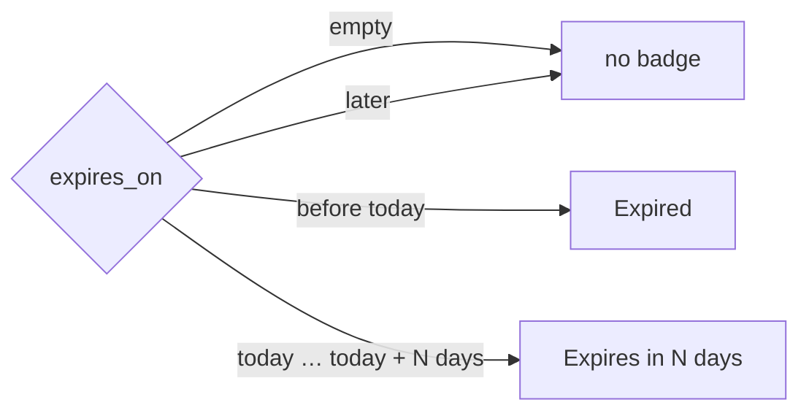
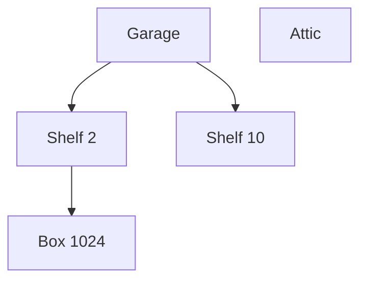

# User guide

Everything Apotheke can do, screen by screen. All of it works one-handed on a phone: tap targets are at least 44 px,
the Save / Edit bars sit at the bottom within thumb reach, and most screens also work without JavaScript.

* [The list](#the-list)
* [Search, filters and sorting](#search-filters-and-sorting)
* [Overview statistics](#overview-statistics)
* [Adding and editing items](#adding-and-editing-items)
* [Photos](#photos)
* [Quantities and low-stock alerts](#quantities-and-low-stock-alerts)
* [Tags and custom fields](#tags-and-custom-fields)
* [Locations and categories](#locations-and-categories)
* [Nested locations](#nested-locations)
* [Bulk actions](#bulk-actions)
* [Lending](#lending)
* [Duplicating an item](#duplicating-an-item)
* [QR labels](#qr-labels)
* [History](#history)
* [Backup, restore and CSV](#backup-restore-and-csv)
* [Importing a CSV file](#importing-a-csv-file)
* [Dark mode](#dark-mode)
* [Users and sign-in](#users-and-sign-in)
* [Settings (Control Panel)](#settings-control-panel)
* [Installing on the home screen](#installing-on-the-home-screen)
* [iPhone tips](#iphone-tips)

## The list

The start page (`/`) shows your items as cards: cover photo, name, location and category chips, badges
(*Running low*, *Lent* / *Overdue*) and −/+ buttons for the quantity. The header shows the item count and total
pieces; ☰ opens the menu. The camera button at the bottom right (and **+** in the header) adds an item. The list loads
`PAGE_SIZE` items at a time; *Show more* appends the next page.

Tap a location or category chip on a card to filter by it.

## Search, filters and sorting

**Search** is instant (results update while you type) and matches the name, notes, tags, serial number, barcode,
who it is lent to, the category and the whole location path ("garage" also finds the items on the garage's shelves).
It ignores case and accents, Greek included ("πριζα" finds "Πρίζα"). Every word must match somewhere; parts of words
count too ("rill" finds "drill").

* **Best match first**: without a chosen sort, results are ranked — a hit in the name beats one in the tags, which beats
  notes and the other fields; a word start beats the middle of a word. Pick a sort in the filter sheet to override.
* **Highlighted**: the matching letters are marked in the name, and when the match is elsewhere a short line shows
  where ("Notes … Fits the *screwdriver* handle").
* **Typos**: a word that finds nothing is also looked up with one letter different (two for words of 8+ letters), and
  the count says so ("showing “screwdriver” for “screwdrivr”"). Words under 4 letters must match exactly. Turn it off
  under **Settings → List → Typo tolerance in search**.

**Filter** opens a bottom sheet with:

| Filter | Options |
|---|---|
| Location | any location, or *No location* |
| Category | any category, or *No category* |
| Tag | any tag in use (with its count) |
| Stock | *All items* / *Running low* |
| Expiry / warranty | *All items* / *Expiring soon* / *Expired* |
| Lending | *All items* / *Lent out* / *Overdue* |
| Sort by | Recently added, Name, Location, Category, Quantity, Value (highest first; items without a price last) |

Active filters appear as chips under the search field; tap a chip's × to remove it, or *Clear all*. The badge on the
*Filter* button counts the active filters. Everything lives in the URL (`/?q=drill&loc=3&tag=5&stock=low&lend=out&sort=name`),
so you can bookmark a filtered view.

### Saved filters

Once a search, filter or sort is active, a **★ Save filter** button appears above the list. Give the combination a
name (for example *Garage tools* or *Medicine expiring soon*) and tap *Save*. Saved filters show as chips above the
list: tap one to apply it again; the chip of the view you are looking at is highlighted. *Edit* (or `/filters`) lists
them with a short description, where you can **rename** or **delete** them. Names are unique (ignoring case and
accents) and you can keep up to 50. A saved filter stores the search words, filters and sort, not the results, so it
always shows the current matches. Saved filters are included in backups.

## Favourites and recently viewed

Tap the ☆ on a card (or in the item page header) to make an item a **favourite**; tap again to remove it. As soon as
something is starred, a **★ Favourites** chip with the count appears above the list: it switches the list to
favourites only (`/?fav=1`) and back. The same filter is in the filter sheet (*Favourites*), combines with search and
the other filters and can be part of a saved filter. Starring doesn't change an item's place in the list.

**Recently viewed** shows the last items you opened as a row of thumbnails above the list (not while searching or
filtering). By default each device keeps its own list (an anonymous cookie); *Settings → List* can share one list for
everyone, change how many are shown (0 hides it). *Clear* empties it.

## Overview statistics

The collapsible *Overview* panel at the top of the list shows tiles (items, total quantity, locations, categories,
added this week, added this month, **Running low**, **Expiring soon**, **Expired**), a chart of items added (last 30 days by day or last 12 months by
month), and the top 5 locations and categories as bars. *By location* counts per **top-level** location, including
everything in its sub-locations, so every item is counted once (under the top of its branch). Tap a bar, or the *Running low*, *Expiring soon* or *Expired* tile, to filter the list. The
**Value** card (only once at least one item has a purchase price): the total purchase price of all priced items,
and the totals per top-level location (sub-locations rolled up, like *By location*) and per category, each with a
*No location* / *No category* bucket. The price is the price of the item entry as entered; it is **not** multiplied
by the quantity. Items without a price are left out. *Most valuable* opens the list sorted by value. The
panel remembers whether it was open (cookie) and which range you picked; while it is collapsed the statistics are not
computed or downloaded at all.

## Adding and editing items

The form has: **name** (required), **location** and **category** (pick from the list or create a new one right there
with ＋), **quantity** (stepper), **Running low at** (optional, see below), **notes**, **tags**, and under *More fields*
the value, purchase date and serial number. A new item gets the default location and category (★) preselected.

*Save & new* saves and opens an empty form that keeps the location and category you just used, which is handy when
you are emptying a box. On the item page, *Edit* opens the same form and *Delete* asks for confirmation first.

## Notes and attachments

**Notes** understand a small, safe Markdown subset: `**bold**`, `*italic*`, `~~strike~~`, `` `code` ``, `# headings`,
`- lists`, `1. numbered steps`, `> quotes`, ```` ``` ```` code blocks, `---` and links (`[text](https://…)`, plain
`https://…` addresses become links too). Everything else, including HTML, is shown as plain text; links open in a new
tab and only `http`, `https` and `mailto` are allowed.

**Attachments** keep receipts, manuals and warranty cards with the item. On the item page open *Attachments*, pick one
or more files and press *Upload*. Tap a file to download it, 🗑 removes it (after confirmation). By default PDFs and
JPEG/PNG/WebP images up to 10 MB are accepted, at most 10 per item; the types and limits are in *Settings → Photos &
uploads*. Files are checked by their content (not the name), stored under random names outside the web root and always
downloaded, never opened inside the app. They are part of the backup and are deleted together with the item.

## Photos

Up to **12 photos** per item. In the form, *Take photo* opens the camera and *Library* picks existing images. On the
item page, open *Photos* to add more, reorder them (‹ ›), choose the **cover** (★, used as the card image) or delete
one. Browse with the ‹ › arrows, the thumbnails or ← → on a keyboard; the position is in the URL (`?p=2`), so the
gallery works without JavaScript too.

**Reorder by dragging**: with two or more photos, drag a photo by its ☰ handle to a new place; the first photo becomes
the cover. The ‹ › buttons still work (and without JavaScript).

**Crop and rotate**: the ✎ button on a photo opens the editor. Rotate in 90° steps, drag on the photo to draw a crop
(drag the corners to resize, drag inside to move; arrow keys nudge, Shift + arrows resize) or pick a fixed ratio
(Free / 1:1 / 4:3). *Save* stores a **new version**: the server applies the edit with GD, regenerates the thumbnail,
bumps the photo's version and deletes the old file (unless an undo still needs it). Without JavaScript, *Exact values*
offers the same as a rotation menu and crop fields in percent. Edits are not reversible — the original is not kept.

Photos are shrunk on the device before upload (max. 1600 px, JPEG ~80 %). The server checks every upload with
`getimagesize`, re-encodes it with GD (which strips EXIF and GPS data), applies the EXIF orientation, writes a
thumbnail and stores both under random file names outside the web root.

## Quantities and low-stock alerts

The −/+ buttons on cards and on the item page change the quantity immediately; quick taps are combined into one
request. Quantity changes are logged in the history.

**Low-stock alerts:** set *Running low at* on an item (any whole number ≥ 0; leave it empty for no alert). When the
quantity is **at or below** that level:

* the card and the item page show a **Running low** badge, which appears or disappears live as you tap −/+;
* the *Running low* tile in the overview counts these items (tap it to see them);
* the filter sheet's *Stock → Running low* filter (`/?stock=low`) lists them.

The item page also shows "Alert at N or fewer". Changing or clearing the level is logged in the history, and the level
is included in the CSV export (`min_qty`) and in backups.

## Tags and custom fields

Type tags in the form and press Enter or comma to add them; existing tags are suggested. Tags are de-duplicated
ignoring case and accents, an item can have up to 20, and unused tags disappear automatically. Tag chips on the item
page link to the list filtered by that tag.

*Price, dates & serial* holds the **purchase price** (in `CURRENCY`, default EUR; `79,90` and `79.90` both work), the **purchase date** (not in the
future), the **expiry / warranty date** (see below) and the **serial number** (searchable). They show up as facts on
the item page.

### Expiry and warranty dates

*Expires / warranty until* is an optional date for anything that runs out: food, medicine, batteries, a warranty.

* **Expiring soon** means the date is today or within the next `EXPIRY_SOON_DAYS` days (default 30, see
  [Configuration](configuration.md)); the item gets an amber **Expires in N days** (or *Expires today*) badge.
* **Expired** means the date is before today (in the `TZ` time zone); the badge is red.
* The overview has *Expiring soon* and *Expired* tiles; tap one to filter. The filter sheet has
  *Expiry / warranty → Expiring soon / Expired* (`/?exp=soon`, `/?exp=expired`).
* Changing the date is recorded in the history; the date is included in the CSV export (`expires_on`), backups,
  duplicates and is kept by bulk actions.



### Barcodes

Under *Price, dates, serial & barcode* each item can have a **barcode** (the digits under an EAN/UPC barcode, or the
text of a QR code). Several items may share one, for example two packs of the same batteries.

* **Search** matches barcodes, also partly (`333931` finds `4006381333931`).
* **☰ → Find by barcode** opens `/barcode`: type the code and tap *Look up*. If one item has it, it opens; if several do,
  the list shows them; if none does, the *Add item* form opens with the barcode already filled in.
* **Scan**: where the browser supports the `BarcodeDetector` API (Chrome on Android, Chrome/Edge on macOS) a *Scan* button
  appears next to the barcode fields and uses the rear camera; the app asks for camera permission the first time. On
  browsers without it (Safari on iPhone, Firefox) the button is hidden and you type the code instead.
* Links like `https://your-host/barcode/4006381333931` can be printed or used from another scanner app.

The barcode is part of the CSV export (`barcode` column), backups and the item's history.

## Locations and categories

Locations ("box 1023", "Garage shelf") and categories ("Tools") are managed lists (☰ → *Locations* / *Categories*,
two tabs on the *Manage* page). Both work the same way, except that locations can be nested (next section):

* names are unique regardless of case or accents ("Box 5" = "box 5") and sorted naturally (box 2 before box 10);
* add, rename, delete, and mark one as the **default** (★) for new items;
* deleting one that still has items asks whether to **move** them to another entry or **leave them unassigned**;
  items are never deleted together with a location or category;
* item counts link to the filtered list.

## Nested locations

A location can sit inside another one: *Garage › Shelf 2 › Box 1024*. Categories stay flat.

* **Create inside:** on the Locations page, type the name and pick the parent under *Inside* before tapping *Add*
  (leave it on *Top level* for a top-level location). A location created from the item form (＋) is top-level.
* **Move:** *Edit* on a location → pick the new parent (or *Top level*) → *Move*. The list only offers places that
  make sense: a location cannot go inside itself or one of its own sub-locations.
* **Depth:** up to 6 levels below a top-level location. Deeper trees (or a move that would create one) are refused.
* **Lists and pickers** show the tree: children are listed under their parent, indented, and in dropdowns marked
  with "↳".
* **Counts and filters include sub-locations:** the count next to *Garage* is every item in the garage and in all
  of its shelves and boxes, and filtering the list by *Garage* (filter sheet, or tapping the count) shows all of them.
  The filter chip shows the full path.
* **Item page:** the location is shown with its path (*Garage › Shelf 2 › Box 1024*); each level links to its
  filtered list.
* **Deleting** a location only deals with the items *directly* in it (move them or leave them unassigned, as above).
  Its sub-locations, with their items, move up one level into its parent (or to the top level).
* An item belongs to exactly one location, the innermost one.
* **Search includes parent locations:** a search word matches an item when it appears in the name of the item's
  location *or of any location above it*, so searching "garage" finds the drill in *Garage › Shelf 2 › Box 1024*.
* **Overview:** the *By location* bars count per top-level location, including everything below it.



## Bulk actions

Tap **Select** next to *Filter* to switch the list into selection mode (`/?select=1`). The camera button is replaced
by a bar at the bottom:

1. Tap photos (or the round checkbox in the corner) to pick items; tapping the name works too. Picked cards get an
   outline.
2. *All on page* picks every loaded card (tap again for *None*). Your selection survives searching and filtering, so
   you can pick items from several searches.
3. *Actions* opens a sheet:
   * **Move to location** (or *No location*),
   * **Set category** (or *No category*),
   * **Add tags** (comma-separated; merged with existing tags),
   * **Remove tag** (one of the tags in use),
   * **Delete selected…**, which opens a confirmation page listing the items; nothing is deleted until you confirm.
4. You come back to the same filtered selection with a message such as "Moved 3 items". *Done* leaves selection mode.

Each action is one database transaction (all items change or none do), writes a history entry for every item, and is
CSRF-protected. At most 500 items can be changed at once. Without JavaScript, `/?select=1&all=1` pre-ticks every card
on the page.

## Lending

On the item page, open **Lend this item**, enter who has it, the date (defaults to today; not in the future) and an
optional *due back* date, then *Mark as lent*. While it is out:

* the item page shows *Lent out* (or a red *Overdue* once the due date has passed), with *Mark as returned* and
  *Change* (to correct the name or dates);
* the card shows a **Lent · name** or red **Overdue · name** badge;
* the filter sheet's *Lending* filter shows *Lent out* (`/?lend=out`) or only *Overdue* (`/?lend=overdue`);
* ☰ → **Lent out** (`/lent`) lists everything that is out: overdue items first, then by due date (no due date last),
  each with a one-tap *Returned* button.

"Overdue" means the due date is before today in the configured time zone (`TZ`), so an item due today is not yet
overdue. Lending, changes and returns ("Returned by Maria after 12 days") are logged in the history, and the three
fields (`lent_to`, `lent_at`, `lent_due`) are part of the CSV export and of backup/restore.

## Duplicating an item

*Duplicate* on the item page creates **"Name (copy)"** with the same location, category, tags, quantity, low-stock
level, notes, value, purchase date and serial number, and opens the copy's edit form so you can adjust it. Tick
**with photos** to copy the photos too: the image files are duplicated, so deleting or changing photos of one item
never affects the other. Lending status is not copied. The copy's history starts with "Created … copied from “Name”".

## Merging duplicates

Ended up with the same thing twice? Open the one you want to **get rid of** and tap **Merge…** at the bottom of the
item page. The next screen lists likely duplicates first (same name regardless of case or accents, then same barcode,
then similar names); search if the right one isn't there. Pick the item to **keep** and you see exactly what will
happen before anything changes:

* quantities are **added** (capped at 1,000,000);
* photos are appended after the kept item's photos (its cover stays), attachments and **tags** are combined;
* fields that are **empty** on the kept item (location, category, running-low level, price, purchase date,
  expiry/warranty, serial, barcode) are filled from the duplicate; fields it already has are not overwritten;
* the duplicate's notes are appended to the kept notes;
* a loan is taken over if the kept item isn't lent (if both are lent, the kept item's loan stays), the ★ is kept if
  either had one;
* the duplicate's **history moves** to the kept item, plus a "Merged “…” into this item" entry.

*Merge* then does it all in one database transaction and removes the duplicate; if anything fails, nothing changes.

## Stocktake

☰ → *Stocktake* (`/stocktake`) checks a location against the catalog. Pick the location and *Start stocktake*: every
item recorded there – including its sub-locations – is listed as *expected* (a snapshot taken at the start).

* **Tick** an item in the list when you see it (tap again to untick), or **scan** it: the field takes a barcode, the link
  in a QR label (`…/item/42`) or `#42`. *Scan* opens the camera where the browser supports `BarcodeDetector`; a USB
  barcode scanner that types and presses Enter works everywhere.
* An item that is **not** expected here (it belongs in another location, or has none) is added under *Found here,
  belongs elsewhere* – it is **misplaced**. Tap it again to remove it.
* A barcode several items share asks you to tick the right one in the list instead.

*Finish* shows the report: **missing** (expected, not ticked), **misplaced** and **found**. With *Move the misplaced
items to …* ticked (default: Control Panel → *Thresholds & limits* → *Stocktake: move misplaced items*), finishing moves
them into the checked location and records “Moved … (stocktake)” in their history. Missing items are never changed.
*Cancel* drops a stocktake without changing anything. Starting a stocktake for a location that already has an open one
continues that one. The list at `/stocktake` keeps every finished and cancelled stocktake with its counts; its report
stays readable even if items were deleted since. Stocktakes are included in backups.

## QR labels

☰ → *Print QR labels* prints one label per location; from a location you can also print one label per item in it, and
every item page has a *QR label* button. Scanning a label opens that filtered list or item. The codes are generated on
the server in pure PHP (`src/qr.php`, SVG, no network) with a print stylesheet. If the address your phone should open
differs from the one you are using, set the public URL (*Settings → General*).

**Several at once:** in selection mode (*Select*), pick items and choose **Print QR labels** in the actions sheet; you
get one label per selected item (`/labels?ids=…`, up to the bulk limit). On a location's label page,
**Location + sub-locations** prints a label for the location and every location inside it; *One label per item*
includes the items in sub-locations too.

**Label size:** *Settings → QR labels* sets the printed width and height (mm), labels per row, the gap (0 for sticker
sheets), whether to print the subtitle and link lines, and dashed cut lines. The page shows the current size above the
labels; the sizes are delivered as a generated stylesheet (`/labels.css`), so the strict CSP stays in place. Print at
100 % scale (no “fit to page”) to get exact millimetres.

## Undo

After you **save an edit**, **delete** an item or run a **bulk action** (move, set category, add/remove a tag, delete), a
bar at the bottom says what happened and offers **Undo** — for 30 seconds by default (*Settings → Thresholds & limits →
Undo window*; 0 turns it off). Undo puts things back exactly as they were:

* an edit: every field and the tags (photos you added or removed in the same edit stay as they are);
* a bulk move / category / tag change: only what the bulk action changed, so later edits to the same items survive;
* a delete: the item comes back with the **same id** (so printed QR labels keep working), its photos, attachments,
  tags, loan and ★. Deleting is a *soft delete* while undo is possible: the files stay on disk until the window is over
  and are removed afterwards.

The history keeps both entries ("Deleted…", then "Restored (deleting was undone)"; edits show "Edited (undo)"). Each
undo works once; after the window the bar disappears and the server refuses the token. Works without JavaScript too
(the bar is then simply shown until you leave the page).

## History

Every change is recorded in the same transaction as the change: created (including "copied from"), edited (old → new
values of name, category, notes, value, purchase date, serial, tags and low-stock level), moved, quantity, photos
(added, reordered, deleted, new cover), lent, returned and deleted. Bulk actions log one entry per item. The item
page shows the latest ten entries with a link to the full history; ☰ → *Recent activity* lists all items, newest first.
Entries of deleted items are kept. With sign-in on, every entry also names the account that made the change.

## Backup, restore and CSV

☰ → *Backup & restore*:

* **Download backup** creates one zip with `backup.json` (every table: items with all their fields, locations,
  categories, tags, photos, history, settings, attachments) plus all photo files, thumbnails and attached files. The format doesn't depend on the
  database, so you can move between SQLite and PostgreSQL.
* **Restore** uploads such a zip and first shows a preview (counts in the file vs. your current data). Nothing changes
  until you tick the confirmation box and press *Restore*; then all data is **replaced** in one transaction.
  Backups from older versions can be restored (columns added later are simply empty).

☰ → *Export CSV* (also in the footer) downloads the whole catalogue as UTF-8 CSV with these columns:
`id, name, location, category, quantity, notes, image, created_at, updated_at, tags, value, currency, purchase_date,
serial, min_qty, lent_to, lent_at, lent_due, expires_on, barcode`.

More about backups (CLI, cron, sizes) in [Deployment and operations](deployment-and-operations.md#backup-and-restore).

Cells that a spreadsheet would treat as a formula (starting with `=`, `+`, `-`, `@`, a tab or a carriage return) are
exported with a leading apostrophe, so Excel and LibreOffice show them as text; the import removes it again.

## Importing a CSV file

☰ → *Import CSV* (editors and admins) adds or updates many items at once:

1. **Upload** a `.csv` file (max. 5 MB, 5,000 rows). Commas, semicolons and tabs work; a UTF-8 BOM or a Windows-1252
   file (old Excel) is fine.
2. **Map the columns**: every column of the file is a card with two sample values and a choice — *Name* (required),
   *ID*, *Location*, *Category*, *Quantity*, *Notes*, *Tags*, *Value*, *Purchase date*, *Serial number*, *Barcode*,
   *Low-stock level*, *Expires on*, *Lent to*, *Due back* or *Ignore*. Headers like “Qty”, “Where”, “Price” or the
   export's own names are recognised automatically.
3. **Preview (dry run)** runs the whole import and then undoes it, so it shows exactly what would happen: how many rows
   are new, updated or unchanged, which locations/categories/tags would be created, and every problem with its row
   number ("Row 3 “Rope”: Quantity “two” is not a whole number").
4. **Import** applies it in one transaction: all rows or none. While a row has an error the button stays disabled —
   fix the file, or tick *Skip rows with errors*.

Options: *Create missing locations, categories and tags* (default from Settings → Backup & data); off means a name
that doesn't exist is an error. A location can be a path — `Garage › Shelf 2`, `Garage > Shelf 2` or
`Garage / Shelf 2` — and missing levels are created nested. Rows with an *ID* that exists update that item (columns
you didn't map keep their values); other rows are added. Importing a file from *Export CSV* therefore changes nothing,
and into an empty install it recreates the catalogue. Dates are `YYYY-MM-DD`; values like `49.90` or `49,90`. The
history records every added or changed item; *Recent imports* lists who imported what.

## Dark mode

☰ → *Auto / Light / Dark*. The choice is stored in a cookie (and `localStorage`) and rendered by the server, so pages
never flash the wrong theme. *Auto* follows the device setting.

## Users and sign-in

Out of the box nobody has to sign in (fine on a trusted home network): every visitor may do everything. To require
sign-in, open **☰ → Settings → Users & sign-in**, pick a user name (default `admin`) and a password and tap *Turn
sign-in on*: that creates the first account, an **admin**, and signs you in with it. With `APP_PASSWORD` set on the first
start the same happens automatically — the account is called `admin` and has that password. (Upgrading from a version
with one shared password? It became the account `admin`; sign in with user name `admin` and the old password.)

Then add an account for each person under **Add a user** and pick a role:

| Role | May (default permissions) |
|---|---|
| **Viewer** | view, export CSV, print labels |
| **Editor** | also add, edit, delete, move, bulk actions, lend, import, stocktake |
| **Admin** | everything, including settings, users and backup & restore — always, it cannot be changed |
| **Guest** | what visitors who are *not* signed in may do while guest browsing is on: view |

**Roles & permissions** (same page) lists every role with a checklist of its permissions: *View, Add items, Edit,
Delete, Move, Bulk actions, Lend, Import, Export, Stocktake, Labels, Settings, Users, Backup*. Change the built-in
Editor, Viewer and Guest, or add your own (e.g. “Lender”: view + lend). Deleting a custom role moves its accounts to the
role you choose. Guests can never get Settings, Users or Backup.

The permissions are checked by the server on every page and action (a refused page says which permission it needs);
the buttons a role can't use are hidden. Moving an item (changing its location in the form, a bulk move, stocktake
moves) needs *Move* on top of *Edit*; bulk actions need *Bulk actions* plus the permission of the action.

**Sign-in options** (same page):

* **Disable guest browsing** (on by default): visitors must sign in first. Off: they can look around with the Guest
  role (*Look around as a guest* on the sign-in page; *Sign in* in the menu).
* **Disable registrations** (on by default). Off: *Create an account* on the sign-in page opens `/register`; new
  accounts get the **Role for new registrations** (default Viewer; never Admin). With **Registrations need an admin’s
  approval** they show up under Users as *Waiting for approval* and can sign in once an admin taps *Approve account*.
  Sign-in is limited to 10 tries per 15 minutes and registration to 5 per hour per address.
* Turning accounts off (*Turn sign-in off*) makes everyone an anonymous guest with admin rights again.
Tap a user to change the role, rename the account, set a new password (signs that user out on every device) or delete it.
The last admin can't be demoted or deleted, and you can't delete your own account. User names ignore upper/lower case.

Everybody can change their own password under **☰ → (your name)**. The history records who made each change
("· anna"); the name stays when the account is deleted. *Turn sign-in off* keeps the accounts, so turning it on again
only needs an admin's user name and password. Sessions last 30 days by default (Control Panel → Users & sign-in → “Stay signed in for”). Locked out? On the server:
`php bin/settings.php user password admin` (or `users` to list accounts, `user role NAME admin`, `user approve NAME`,
`roles reset` to restore the built-in roles, `auth off` to turn accounts off).

## Settings (Control Panel)

**☰ → Settings** configures the app for everyone: name and tagline, accent colour (with presets and an automatic
contrast check for light and dark mode), your own logo (SVG, PNG, JPEG or WebP; PNG/JPEG/WebP also become the home-screen
icon and favicon), currency and number/date/time formats, time zone, items per page, default sort and a compact list
view, defaults for new items (quantity, low-stock threshold, tags, notes, purchase date, expiry, location, category),
the *Expiring soon* window, the default loan period, limits for saved filters and photos, photo sizes and the password.
*Backup & data* exports/imports the settings as JSON next to the backup and CSV links. Each section can be reset to its
defaults. Details: [control-panel.md](control-panel.md).

 

## Installing on the home screen

Apotheke has a web app manifest, so you can add it to the home screen: in Safari *Share → Add to Home Screen*, in
Chrome *Install app* / *Add to Home screen*. It then opens full screen like an app. It still needs the server: there
is no service worker and no offline mode.


## iPhone tips

* **Take photo** uses `<input type="file" accept="image/*" capture="environment">`, which opens the rear camera
  directly; **Library** picks an existing photo. This works over plain `http://` on your LAN, because Apotheke does not
  use the live-camera `getUserMedia` API (which would need HTTPS).
* HEIC: iOS hands Safari a JPEG for file inputs; any other format the browser can decode is converted to JPEG on the
  device before upload.
* *Add to Home Screen* gives you a full-screen app with the safe areas (notch, home indicator) respected.
* The bottom bars (Save, Edit, the bulk bar) stay above the home indicator; the filter and action sheets slide up from
  the bottom.
* Scan QR labels with the Camera app; the link opens in Safari.
