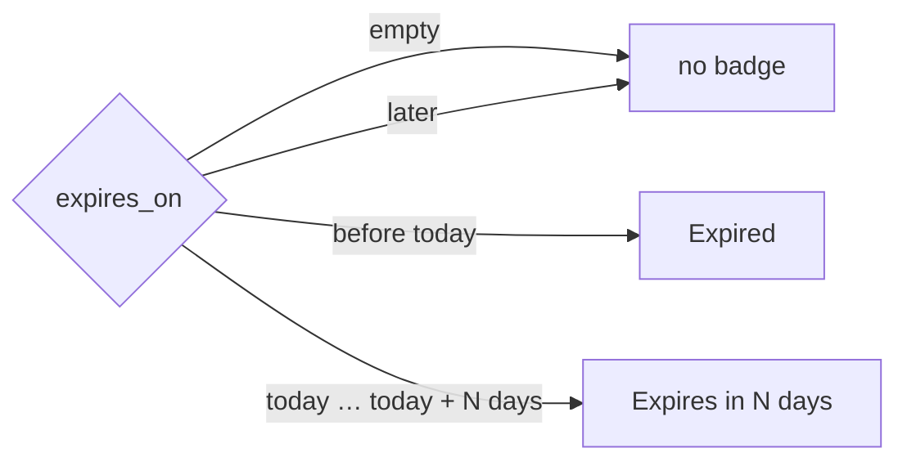
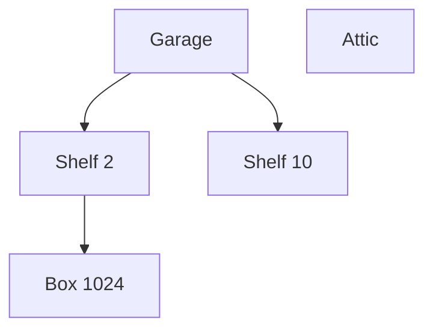

# User guide

Everything Apotheke can do, screen by screen. All of it works one-handed on a phone: tap targets are at least 44 px,
the Save / Edit bars sit at the bottom within thumb reach, and most screens also work without JavaScript.

* [The list](#the-list)
* [Search, filters and sorting](#search-filters-and-sorting)
* [Overview statistics](#overview-statistics)
* [Adding and editing items](#adding-and-editing-items)
* [Photos](#photos)
* [Quantities and low-stock alerts](#quantities-and-low-stock-alerts)
* [Tags and custom fields](#tags-and-custom-fields)
* [Locations and categories](#locations-and-categories)
* [Nested locations](#nested-locations)
* [Bulk actions](#bulk-actions)
* [Lending](#lending)
* [Duplicating an item](#duplicating-an-item)
* [QR labels](#qr-labels)
* [History](#history)
* [Backup, restore and CSV](#backup-restore-and-csv)
* [Dark mode](#dark-mode)
* [Password](#password)
* [Installing on the home screen](#installing-on-the-home-screen)
* [iPhone tips](#iphone-tips)

## The list

The start page (`/`) shows your items as cards: cover photo, name, location and category chips, badges
(*Running low*, *Lent* / *Overdue*) and −/+ buttons for the quantity. The header shows the item count and total
pieces; ☰ opens the menu. The camera button at the bottom right (and **+** in the header) adds an item. The list loads
`PAGE_SIZE` items at a time; *Show more* appends the next page.

Tap a location or category chip on a card to filter by it.

## Search, filters and sorting

**Search** is instant (results update while you type) and matches the name, notes, serial number, tags, location and
category. It ignores case and accents, Greek included ("πριζα" finds "Πρίζα").

**Filter** opens a bottom sheet with:

| Filter | Options |
|---|---|
| Location | any location, or *No location* |
| Category | any category, or *No category* |
| Tag | any tag in use (with its count) |
| Stock | *All items* / *Running low* |
| Expiry / warranty | *All items* / *Expiring soon* / *Expired* |
| Lending | *All items* / *Lent out* / *Overdue* |
| Sort by | Recently added, Name, Location, Category, Quantity, Value (highest first; items without a price last) |

Active filters appear as chips under the search field; tap a chip's × to remove it, or *Clear all*. The badge on the
*Filter* button counts the active filters. Everything lives in the URL (`/?q=drill&loc=3&tag=5&stock=low&lend=out&sort=name`),
so you can bookmark a filtered view.

## Overview statistics

The collapsible *Overview* panel at the top of the list shows tiles (items, total quantity, locations, categories,
added this week, added this month, **Running low**, **Expiring soon**, **Expired**), a chart of items added (last 30 days by day or last 12 months by
month), and the top 5 locations and categories as bars. *By location* counts per **top-level** location, including
everything in its sub-locations, so every item is counted once (under the top of its branch). Tap a bar, or the *Running low*, *Expiring soon* or *Expired* tile, to filter the list. The
**Value** card (only once at least one item has a purchase price): the total purchase price of all priced items,
and the totals per top-level location (sub-locations rolled up, like *By location*) and per category, each with a
*No location* / *No category* bucket. The price is the price of the item entry as entered; it is **not** multiplied
by the quantity. Items without a price are left out. *Most valuable* opens the list sorted by value. The
panel remembers whether it was open (cookie) and which range you picked; while it is collapsed the statistics are not
computed or downloaded at all.

## Adding and editing items

The form has: **name** (required), **location** and **category** (pick from the list or create a new one right there
with ＋), **quantity** (stepper), **Running low at** (optional, see below), **notes**, **tags**, and under *More fields*
the value, purchase date and serial number. A new item gets the default location and category (★) preselected.

*Save & new* saves and opens an empty form that keeps the location and category you just used, which is handy when
you are emptying a box. On the item page, *Edit* opens the same form and *Delete* asks for confirmation first.

## Photos

Up to **12 photos** per item. In the form, *Take photo* opens the camera and *Library* picks existing images. On the
item page, open *Photos* to add more, reorder them (‹ ›), choose the **cover** (★, used as the card image) or delete
one. Browse with the ‹ › arrows, the thumbnails or ← → on a keyboard; the position is in the URL (`?p=2`), so the
gallery works without JavaScript too.

Photos are shrunk on the device before upload (max. 1600 px, JPEG ~80 %). The server checks every upload with
`getimagesize`, re-encodes it with GD (which strips EXIF and GPS data), applies the EXIF orientation, writes a
thumbnail and stores both under random file names outside the web root.

## Quantities and low-stock alerts

The −/+ buttons on cards and on the item page change the quantity immediately; quick taps are combined into one
request. Quantity changes are logged in the history.

**Low-stock alerts:** set *Running low at* on an item (any whole number ≥ 0; leave it empty for no alert). When the
quantity is **at or below** that level:

* the card and the item page show a **Running low** badge, which appears or disappears live as you tap −/+;
* the *Running low* tile in the overview counts these items (tap it to see them);
* the filter sheet's *Stock → Running low* filter (`/?stock=low`) lists them.

The item page also shows "Alert at N or fewer". Changing or clearing the level is logged in the history, and the level
is included in the CSV export (`min_qty`) and in backups.

## Tags and custom fields

Type tags in the form and press Enter or comma to add them; existing tags are suggested. Tags are de-duplicated
ignoring case and accents, an item can have up to 20, and unused tags disappear automatically. Tag chips on the item
page link to the list filtered by that tag.

*Price, dates & serial* holds the **purchase price** (in `CURRENCY`, default EUR; `79,90` and `79.90` both work), the **purchase date** (not in the
future), the **expiry / warranty date** (see below) and the **serial number** (searchable). They show up as facts on
the item page.

### Expiry and warranty dates

*Expires / warranty until* is an optional date for anything that runs out: food, medicine, batteries, a warranty.

* **Expiring soon** means the date is today or within the next `EXPIRY_SOON_DAYS` days (default 30, see
  [Configuration](configuration.md)); the item gets an amber **Expires in N days** (or *Expires today*) badge.
* **Expired** means the date is before today (in the `TZ` time zone); the badge is red.
* The overview has *Expiring soon* and *Expired* tiles; tap one to filter. The filter sheet has
  *Expiry / warranty → Expiring soon / Expired* (`/?exp=soon`, `/?exp=expired`).
* Changing the date is recorded in the history; the date is included in the CSV export (`expires_on`), backups,
  duplicates and is kept by bulk actions.

## Locations and categories

Locations ("box 1023", "Garage shelf") and categories ("Tools") are managed lists (☰ → *Locations* / *Categories*,
two tabs on the *Manage* page). Both work the same way, except that locations can be nested (next section):

* names are unique regardless of case or accents ("Box 5" = "box 5") and sorted naturally (box 2 before box 10);
* add, rename, delete, and mark one as the **default** (★) for new items;
* deleting one that still has items asks whether to **move** them to another entry or **leave them unassigned**;
  items are never deleted together with a location or category;
* item counts link to the filtered list.

## Nested locations

A location can sit inside another one: *Garage › Shelf 2 › Box 1024*. Categories stay flat.

* **Create inside:** on the Locations page, type the name and pick the parent under *Inside* before tapping *Add*
  (leave it on *Top level* for a top-level location). A location created from the item form (＋) is top-level.
* **Move:** *Edit* on a location → pick the new parent (or *Top level*) → *Move*. The list only offers places that
  make sense: a location cannot go inside itself or one of its own sub-locations.
* **Depth:** up to 6 levels below a top-level location. Deeper trees (or a move that would create one) are refused.
* **Lists and pickers** show the tree: children are listed under their parent, indented, and in dropdowns marked
  with "↳".
* **Counts and filters include sub-locations:** the count next to *Garage* is every item in the garage and in all
  of its shelves and boxes, and filtering the list by *Garage* (filter sheet, or tapping the count) shows all of them.
  The filter chip shows the full path.
* **Item page:** the location is shown with its path (*Garage › Shelf 2 › Box 1024*); each level links to its
  filtered list.
* **Deleting** a location only deals with the items *directly* in it (move them or leave them unassigned, as above).
  Its sub-locations, with their items, move up one level into its parent (or to the top level).
* An item belongs to exactly one location, the innermost one.
* **Search includes parent locations:** a search word matches an item when it appears in the name of the item's
  location *or of any location above it*, so searching "garage" finds the drill in *Garage › Shelf 2 › Box 1024*.
* **Overview:** the *By location* bars count per top-level location, including everything below it.

## Bulk actions

Tap **Select** next to *Filter* to switch the list into selection mode (`/?select=1`). The camera button is replaced
by a bar at the bottom:

1. Tap photos (or the round checkbox in the corner) to pick items; tapping the name works too. Picked cards get an
   outline.
2. *All on page* picks every loaded card (tap again for *None*). Your selection survives searching and filtering, so
   you can pick items from several searches.
3. *Actions* opens a sheet:
   * **Move to location** (or *No location*),
   * **Set category** (or *No category*),
   * **Add tags** (comma-separated; merged with existing tags),
   * **Remove tag** (one of the tags in use),
   * **Delete selected…**, which opens a confirmation page listing the items; nothing is deleted until you confirm.
4. You come back to the same filtered selection with a message such as "Moved 3 items". *Done* leaves selection mode.

Each action is one database transaction (all items change or none do), writes a history entry for every item, and is
CSRF-protected. At most 500 items can be changed at once. Without JavaScript, `/?select=1&all=1` pre-ticks every card
on the page.

## Lending

On the item page, open **Lend this item**, enter who has it, the date (defaults to today; not in the future) and an
optional *due back* date, then *Mark as lent*. While it is out:

* the item page shows *Lent out* (or a red *Overdue* once the due date has passed), with *Mark as returned* and
  *Change* (to correct the name or dates);
* the card shows a **Lent · name** or red **Overdue · name** badge;
* the filter sheet's *Lending* filter shows *Lent out* (`/?lend=out`) or only *Overdue* (`/?lend=overdue`);
* ☰ → **Lent out** (`/lent`) lists everything that is out: overdue items first, then by due date (no due date last),
  each with a one-tap *Returned* button.

"Overdue" means the due date is before today in the configured time zone (`TZ`), so an item due today is not yet
overdue. Lending, changes and returns ("Returned by Maria after 12 days") are logged in the history, and the three
fields (`lent_to`, `lent_at`, `lent_due`) are part of the CSV export and of backup/restore.

## Duplicating an item

*Duplicate* on the item page creates **"Name (copy)"** with the same location, category, tags, quantity, low-stock
level, notes, value, purchase date and serial number, and opens the copy's edit form so you can adjust it. Tick
**with photos** to copy the photos too: the image files are duplicated, so deleting or changing photos of one item
never affects the other. Lending status is not copied. The copy's history starts with "Created … copied from “Name”".

## QR labels

☰ → *Print QR labels* prints one label per location; from a location you can also print one label per item in it, and
every item page has a *QR label* button. Scanning a label opens that filtered list or item. The codes are generated on
the server in pure PHP (`src/qr.php`, SVG, no network) with a print stylesheet (3 labels per row on A4/Letter). If the
address your phone should open differs from the one you are using, set `PUBLIC_URL`.

## History

Every change is recorded in the same transaction as the change: created (including "copied from"), edited (old → new
values of name, category, notes, value, purchase date, serial, tags and low-stock level), moved, quantity, photos
(added, reordered, deleted, new cover), lent, returned and deleted. Bulk actions log one entry per item. The item
page shows the latest ten entries with a link to the full history; ☰ → *Recent activity* lists all items, newest first.
Entries of deleted items are kept.

## Backup, restore and CSV

☰ → *Backup & restore*:

* **Download backup** creates one zip with `backup.json` (every table: items with all their fields, locations,
  categories, tags, photos, history, settings) plus all photo files and thumbnails. The format doesn't depend on the
  database, so you can move between SQLite and PostgreSQL.
* **Restore** uploads such a zip and first shows a preview (counts in the file vs. your current data). Nothing changes
  until you tick the confirmation box and press *Restore*; then all data is **replaced** in one transaction.
  Backups from older versions can be restored (columns added later are simply empty).

☰ → *Export CSV* (also in the footer) downloads the whole catalogue as UTF-8 CSV with these columns:
`id, name, location, category, quantity, notes, image, created_at, updated_at, tags, value, currency, purchase_date,
serial, min_qty, lent_to, lent_at, lent_due, expires_on`.

More about backups (CLI, cron, sizes) in [Deployment and operations](deployment-and-operations.md#backup-and-restore).

## Dark mode

☰ → *Auto / Light / Dark*. The choice is stored in a cookie (and `localStorage`) and rendered by the server, so pages
never flash the wrong theme. *Auto* follows the device setting.

## Password

If `APP_PASSWORD` is set, Apotheke shows a sign-in page and *Sign out* appears in the menu and footer. There is one
shared password, no user accounts. Sessions last up to 180 days.

## Installing on the home screen

Apotheke has a web app manifest, so you can add it to the home screen: in Safari *Share → Add to Home Screen*, in
Chrome *Install app* / *Add to Home screen*. It then opens full screen like an app. It still needs the server: there
is no service worker and no offline mode.

## iPhone tips

* **Take photo** uses `<input type="file" accept="image/*" capture="environment">`, which opens the rear camera
  directly; **Library** picks an existing photo. This works over plain `http://` on your LAN, because Apotheke does not
  use the live-camera `getUserMedia` API (which would need HTTPS).
* HEIC: iOS hands Safari a JPEG for file inputs; any other format the browser can decode is converted to JPEG on the
  device before upload.
* *Add to Home Screen* gives you a full-screen app with the safe areas (notch, home indicator) respected.
* The bottom bars (Save, Edit, the bulk bar) stay above the home indicator; the filter and action sheets slide up from
  the bottom.
* Scan QR labels with the Camera app; the link opens in Safari.
